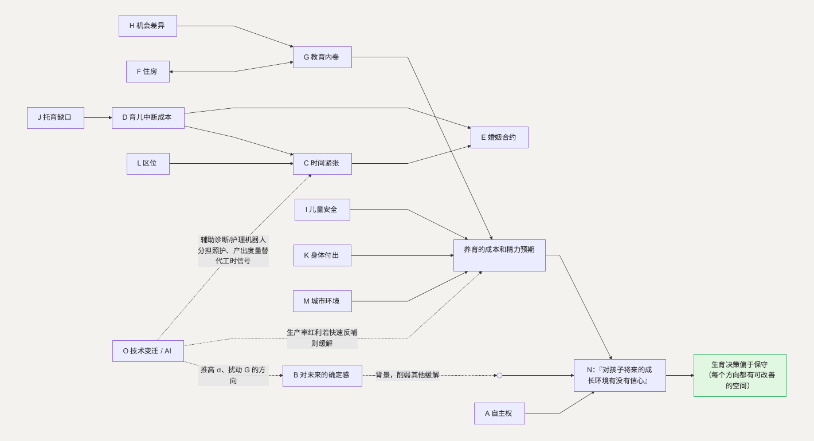

# 把这些方向连起来看

上面每一个都不是孤立的，它们互相影响：

- 教育内卷（[G](G-education.md)）抬高养育成本 → 家庭看到这个成本 → 生育决策更谨慎。
- 育儿中断的成本（[D](D-interruption.md)）落到家庭一方 → 加重时间紧张（[C](C-time.md)）→ 又让婚姻里的分工更失衡（[E](E-marriage.md)）。
- 机会差异（[H](H-inequality.md)）让教育竞赛（G）变成一台放大器。
- 住房（[F](F-housing.md)）和教育（G）互相把对方推高（学区房）。
- 对未来的确定感不足（[B](B-certainty.md)）像一层背景，削弱其他每一个方向本来可能有的缓解。
- 技术变迁（[O](O-technology.md)）从外部同时推 B 的不确定性、G 的竞赛方向、[A](A-autonomy.md) 的养老指望——它是一个放大器，也可能是一个缓解器，取决于生产率红利反哺得多快。
- 技术变迁（O）除了从外部推高 $\sigma$，也从供给侧帮 B：AI 辅助诊断分诊、康复与护理机器人、居家养老和儿童健康管理工具，分担了大病冲击里的照护中断（B.3）和双向照护里的 $c_{elder}$（B.4）——让这两项负担不必全压在某一个家人身上。同理，协作与产出度量工具让“在岗时长”不再是必需的信号，帮 C 的工时竞赛降温。
- 所有这些，最后都汇入 [N](N-overall.md)：一个人对“愿不愿意生”的总体判断。

---

# 结尾

回到引言的“两本账”。理解生育选择的一把钥匙是：成本偏前、偏集中在个体，收益偏后、偏分散到社会。前面 15 节做的，是把这个结构在每个具体领域拆开——找出让“弊”变小、让“利”（尤其社会对个体的反哺）变快变大的着力点。这些着力点大多是**建设性、增量式、可以从现有政策方向自然延伸**的。

把这些问题压到最后，大家想要的其实很朴素：一份可预期的生活，一套相对公平的规则，一点属于自己的时间，一个不用谁独自牺牲的分工，一份“这是我的选择”的自主，以及一种“未来值得期待”的感觉。

比“让生孩子看起来便宜一点”更接近核心的，可能是最根本的那一个问题：

> **我对孩子将来的成长环境，有没有信心？**

没有哪一条政策能直接回答它。但如果前面这些方向真的在一点点改善，越来越多的人在认真想过之后会更愿意说“有信心”、也更愿意说“愿意”，生育这件事，也就慢慢顺了。
