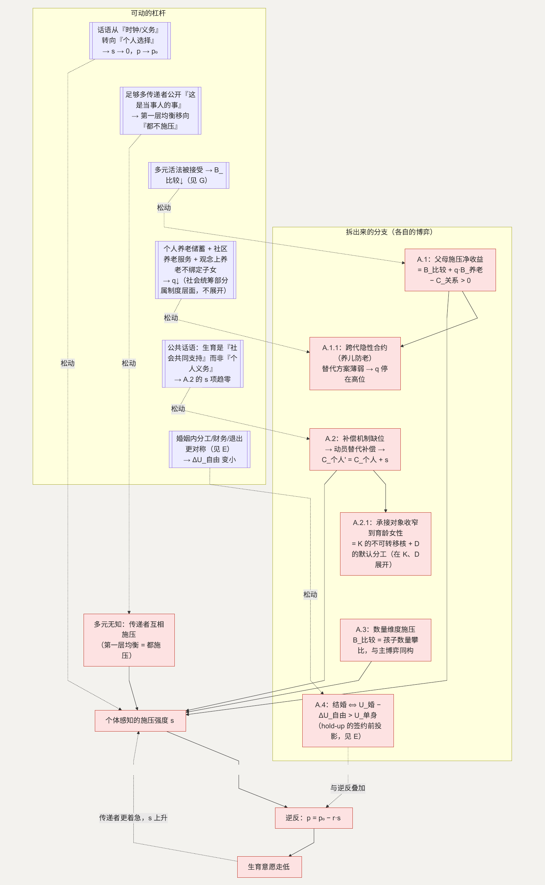

# A. 自主权：被催促会把决策推向反方向

**简单说：催得越紧，越容易适得其反——把“要不要生、生几个”还给本人决定，压力反而会小。**

第一类问题（条目 1–12）几乎不涉及金钱：不想因年龄到了被要求结婚、不希望婚育被定义为义务、希望不婚 / 丁克 / 只生一个都被正常接受、希望生不生和生几个由自己决定。这一层的诉求可以概括为：**生育是一个选择，不是一项待完成的任务。** 青年调查中“婚育自主性增强”的趋势与此一致。([CyOL News](https://news.cyol.com/gb/articles/2026-05/11/content_BbVbgotldw.html))

**这一节用到的记号**（主问题和各子问题共用，先集中说明；后面出现时不再重复解释）：

| 记号 | 含义 | 为什么这样定义 |
| --- | --- | --- |
| $p$ | 个体当前的生育倾向（数值越高＝越想生、越不往后拖） | 本节要解释的因变量 |
| $p_0$ | 个体的“真实意愿”：完全没有外部施压时会有的生育倾向 | 拿它和 $p$ 相比，差额就是施压造成的偏移 |
| $s$ | 个体**感知到**的施压强度（催的话、眼神、反复提起） | 用感知量而非客观量——同一句话，不同人感到的 $s$ 不同，真正起作用的是感受 |
| $r$ | 逆反系数：$s$ 每上升一分，$p$ 下降多少 | 反映“被要求做某事会激起抵触”的强度，因人、因关系而异 |
| $q$ | 个体主观认为“多生确实能让自己老年更有保障”的概率 | 养老回报不确定，要按这个概率折算才进入账 |
| $B_{\text{比较}}$ | 熟人网络里“孩子结婚了 / 生了 / 生几个”带来的**相对**地位收益 | 定义成相对量：它靠和邻里亲戚比出来，不是绝对好处 |
| $B_{\text{养老}}$ | 多一个孩子在年老时可能提供的照护和经济支持 | 与 $q$ 相乘后才计入，因为能否兑现不确定 |
| $C_{\text{关系}}$ | 因催促产生的亲子关系摩擦（长期、累积） | 施压的代价 |
| $C_{\text{个人}}$ | 个体权衡的生育净成本（钱、时间、职业、身体、不确定性之和） | 后面 B–N 各节逐项拆的就是它 |
| $E_{social}$ | 社会从一个孩子长大后获得的净收益 | 见引言“社会这本账” |

## 主博弈：规范强制 + 逆反

这里有两层结构叠在一起。

**第一层，规范传递者之间的从众。** “到年龄就该结婚生子”是一个自我强制的社会规范。传递者（父母、亲戚、熟人网络）是否施压，取决于其他传递者是否施压：

| | 其他传递者施压 | 其他传递者不施压 |
| --- | --- | --- |
| **我施压** | 符合角色期待 (0) | 显得越界、多管闲事 (−) |
| **我不施压** | 显得“不上心” (−m) | 无成本 (0) |

即使多数传递者私下并不坚信“人人都该早生多生”，只要预期别人会施压，（施压, 施压）就是均衡——这是**多元无知**：每个人都在执行一个自己未必认同的规范。

**第二层，个体对施压的反应。** 把生育框定为“你应该、必须、到点就得办”，会把它标记为**外部强加**，触发逆反（reactance）——个体通过推迟或拒绝来重建自主感。

用一个简化式表示个体的生育倾向（记号见上表）：

$$p = p_0 - r \cdot s$$

这里 $s$ 取“感知到的施压强度”而不是客观次数，是因为逆反反应针对的是“我被要求了”这种感受，而不是对方说了几句；$r$ 因人而异——越是把自主看得重、和施压者关系越紧张，$r$ 越大。$s$ 上升，$p$ 下降；而 $p$ 走低又会让传递者更着急、$s$ 进一步上升。这是一个自我强化的循环：**施压越强 → 决策越往反方向走 → 施压更强。** 好消息是，这个循环的入口（$s$）是几乎没有成本就能松动的。

### 怎么移动均衡

- **降低 $s$：** 公共话语和人际话语从“时钟 / 义务”框架转向“个人选择”框架。当 $s \to 0$，$p \to p_0$——因逆反而迟延的那部分人回到真实意愿，其中一部分本就想生。
- **打破第一层的多元无知：** 当足够多传递者公开表达“这是当事人自己的事”，（不施压, 不施压）成为可达均衡。不婚、丁克、独生被视为正常选项，等于把这个均衡的吸引域扩大。

## A.1 传递者为什么还在沿用“多子”脚本

**这个子问题为什么存在。** 在农业社会且无社会化养老的条件下，子女数量约等于老年保障加劳动力，“多生”是家庭层面的理性投资。父母催子女多生，是这套投资逻辑的延续。如今养老部分社会化、养育回报期变长且不确定（见引言“两本账”），“多子防老”的期望收益已大幅下降——但**规范的更新滞后于收益结构的变化**，传递者仍在执行一个收益基础已经缩水的脚本。

**它自己的博弈。** 父母与子女的重复博弈，父母施压的净收益可写成：

$$\text{施压净收益} = B_{\text{比较}} + q \cdot B_{\text{养老}} - C_{\text{关系}}$$

三项的含义：$B_{\text{比较}}$ 是熟人网络里的面子收益——它是相对的，别人家孩子都结婚生子而自家没有，落差本身就是成本；$q \cdot B_{\text{养老}}$ 是养老指望，$B_{\text{养老}}$ 是子女年老时能给的照护和经济支持，$q$ 是“这份指望真能兑现”的主观概率，两者相乘才是期望收益；$C_{\text{关系}}$ 是催出来的亲子摩擦。当前 $q$ 和 $B_{\text{比较}}$ 都还不低，所以施压仍是父母的占优选择。

**怎么优化这个子博弈。** $B_{\text{比较}}$ 随“多元活法被接受”而下降（这一维和 [G](G-education.md) 的“只设一个奖池”同源，见 G）；$q \cdot B_{\text{养老}}$ 随“老年保障不再主要依赖子女”而下降。后一条本身又是一个子问题，往下拆一层。

### A.1.1 “养儿防老”的预期为什么还在起作用

**为什么存在。** $q$ 之所以还不低，是因为“年老后的照护和经济支持由谁承担”在很多人的预期里仍然默认指向子女。这个预期来自一份跨代的隐性合约：父母养育子女，子女年老时反哺——一份没写下来、靠规范和情感维系的合约。

**它自己的博弈。** 这是一个连锁世代之间的重复博弈。每一代在“要不要反哺上一代”上的选择，取决于它对“下一代会不会同样反哺自己”的预期。合约靠两样东西维持：规范（不养老人会被指责）和缺少替代方案（除了子女没有别的老年依靠）。只要替代方案薄弱，$q$ 就停在高位，“多生一个 = 多一份养老保险”的算法就成立。

**怎么优化这个子博弈。** 让老年生活有子女之外、可依赖的支撑。这里只谈个人、市场、观念层面能着力的部分：个人的长期储蓄和商业养老安排、社区层面的养老服务供给、以及观念上“养老不必然等于和子女绑定”。替代方案越实、越可信，$q$ 越低。

> **在基本保障之外，“补充性养老服务”是一块需求在增长、供给还不足的领域。** 一个侧面观察：需求明确且存在缺口的地方，通常会有多种服务提供方进入、彼此竞争、逐步迭代，覆盖面和质量会在这个过程里慢慢改善。（老年保障里还有社会统筹的部分，属于制度层面的互动参数。）

**如何传导回大问题。** $q$ 下降 → A.1 的 $q \cdot B_{\text{养老}}$ 缩小 → 施压净收益转负 → 父母施压动机减弱 → $s$ 下降 → $p$ 回升。这条链路对“生几个”格外关键——养老动机主要推的是“多生”，而不是“生不生”。

**如何传导回大问题（A.1 整体）。** $B_{\text{比较}}$ 和 $q \cdot B_{\text{养老}}$ 两项都降后，施压净收益转负，父母施压动机自然减弱——不需要要求父母改变观念，是收益结构变了。父母端 $s$ 下降 → 个体端 $p$ 回升。

## A.2 生育的社会意义，为什么会收窄成对一部分人的要求（条目 11）

**这个子问题为什么存在。** 生育对社会是净收益（见引言“两本账”），这层“社会意义”在表达时需要一个承接的对象。社会并没有一个市场把这份收益直接支付给承担成本的人，于是“社会需要更多孩子”这个宏观命题，在传导中容易被翻译成对具体某群人的要求——由于身体成本不可转移（见 [K](K-body.md)）和照护的默认分工（见 [D](D-interruption.md)），这个对象往往收窄到育龄女性身上。

**它自己的博弈。** 这是一个外部性没有被定价的问题。社会从每个孩子身上获得收益 $E_{social}$，却缺少把这份收益回馈给承担成本者的补偿渠道。当补偿机制缺位，“规范动员”就被当成替代手段——用压力 $s$ 代替补偿。被要求的一方会把这层压力直接计入生育的个人成本：

$$C'_{\text{个人}} = C_{\text{个人}} + s$$

压力上去了，补偿没上去，个人成本反而更高。作为“支付替代品”，动员的效率是负的：它不缩小两本账之间的缺口，只是把缺口的另一头压到个体身上。而个体的反应和主博弈一致——被标记为外部强加、触发逆反，$p$ 进一步下行。

**优化的可行性与方向。** 落点在观念和公共话语层面，可操作：把“社会意义”的表达方式，从“个人应尽的义务”改回“值得社会共同支持的事”。前者施加 $s$，后者指向降低 $C_{\text{个人}}$（公共服务、成本分担）。区别不在措辞，在于责任主体——是要求个体多承担，还是社会多分担。

**如何优化 → 新均衡。** 当公共话语稳定地把生育描述为“社会共同支持”而非“个人义务”，被要求群体计入的 $s$ 项趋近于零，$C'_{\text{个人}}$ 回落到 $C_{\text{个人}}$。

**如何传导回大问题。** $s$ 下降 → 主博弈的 $p = p_0 - r \cdot s$ 回升；同时被点名群体不再把这层压力计入成本，其生育意愿单独回升一块。

### A.2.1 这层要求为什么偏偏落到育龄女性身上

**为什么。** 承接对象的收窄，是两个更底层机制的合成结果：身体成本的不可转移核（[K](K-body.md)）把一部分成本天然固定在女性身上；照护的默认分工（[D](D-interruption.md)）把可转移的那部分也推给女性。两者叠加，“谁来多生”在传导时就有了一个默认答案。

**博弈性质。** 这不是 A 内部一个独立的博弈，而是 K 和 D 两个博弈的下游投影——A 这一层能做的，只是不再用话语去追加 $s$；真正让这个默认答案松动，要靠 K 的 $\alpha_w \to 0.5$ 和 D 的分工再平衡。**机制在 K 和 D 展开，此处不重复。**

## A.3 “至少生两个”的数量预期（条目 5–8）

**这个子问题为什么存在。** “多子”规范不仅规定“该生”，还规定“该生够数”。历史上是“多子多福”，如今常表现为“一个太少、至少两个”。它和 A.1 同源，只是作用在数量维度而非“生不生”维度。

**它自己的博弈。** 传递者在数量维度上的施压，收益结构和主博弈第一层同构：

$$\text{施压净收益} = B_{\text{比较}}\text{（孩子数量的攀比）} + q \cdot B_{\text{养老}} - C_{\text{关系}}$$

被施压方的反应也同构：数量要求被标记为外部强加 → 逆反 → 对“是否生第二个”更抵触。这里有一个溢出效应：当“生一个”被预设为“只是还没生够”，一部分人会把整件事都往后推——数量压力污染了“是否生第一个”的决策。

**优化的可行性与方向。** 这个子博弈几乎不需要单独的杠杆，它和主博弈完全共享参数：$q$ 随养老保障社会化而下降，$B_{\text{比较}}$ 随“生一个也是完整选择”被接受而下降（这一点在 K 的子问题里展开）。方向是把公共讨论和支持的重心，从“让生一个的人生两个”移到“让想生一个的人顺利生一个”。

**如何优化 → 新均衡。** 两项参数下降后，数量维度的施压净收益转负，“至少两个”的预期弱化，（不施压, 不施压）在数量维度上也成为可达均衡。

**如何传导回大问题。** 数量维度的 $s$ 下降 → 想生一个的人不被“至少两个”的隐含预期劝退，$p$ 在 $n = 1$ 处更容易过线。

## A.4 结婚会不会让我失去自主（条目 83）

**这个子问题为什么存在。** 这一条挂在 A 的自主权主题下，但它的机制属于婚姻：婚姻把个体在一系列决策上的单方行动权（时间安排、消费、居住、职业流动）改成了需要协商的事项。个体在“要不要进入婚姻”时，会预先把这项自主权的让渡计入。

**它自己的博弈。** 这是 [E](E-marriage.md) 的套牢（hold-up）结构的一个签约前投影：

> 结婚 $\Leftrightarrow U_{\text{婚}} - \Delta U_{\text{自由}} > U_{\text{单身}}$

$\Delta U_{\text{自由}}$ 越大——尤其当个体预期婚后自己会成为被单方面支配的一方——门槛越高，决定越往后推。它和主博弈的逆反叠加：越是感到“结婚是必须完成的事”，越会放大对 $\Delta U_{\text{自由}}$ 的估计。

**优化的可行性与方向。** 降低 $\Delta U_{\text{自由}}$ 里“被支配”的部分，靠的是让婚姻内部的分工、财务、退出规则更对称、更可预期——这正是 E 的主博弈在做的事。A 这一层能做的，是不把结婚框定为“到点必须办”，从而不额外抬高个体对 $\Delta U_{\text{自由}}$ 的预估。

**如何传导回大问题。** 这是 A（自主）与 E（合约）的接口：自主权顾虑里“怕结婚失去自己”这一块，一部分靠 A 降 $s$，另一部分要靠 E 让 $\Delta U_{\text{自由}}$ 真正变小。**完整机制见 E。**

---

## 拆出来的分支（图）

