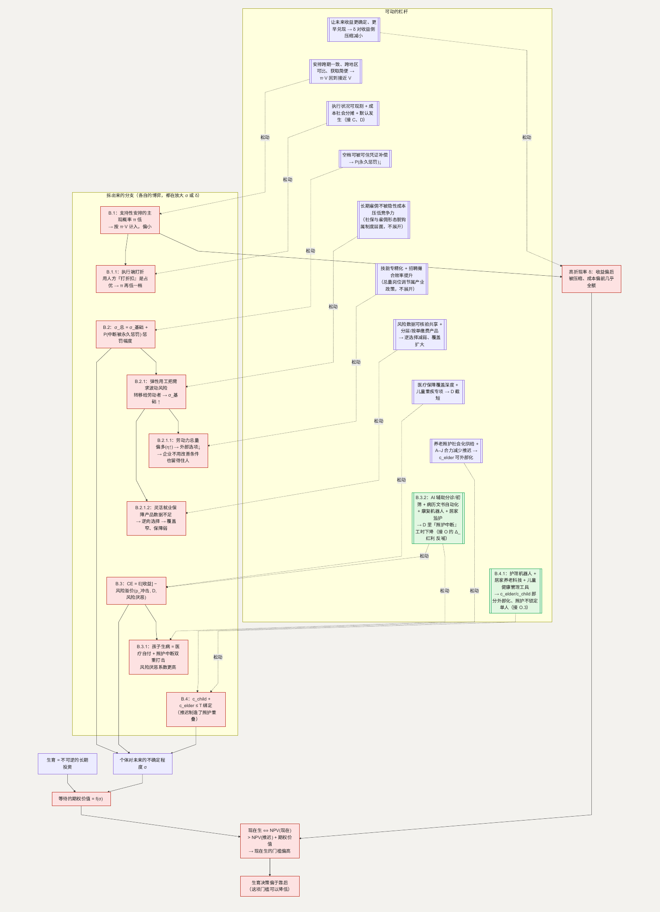

# B. 对未来的确定感：不可逆决定遇上高不确定性

**简单说：生孩子是一次没法回头的决定，可现在的工作、收入、行业前景都太不确定——谁都不敢先押上去。**

第二类问题（条目 13–24）都指向同一件事：对未来一段时间的收入和生活，能不能有一个大致稳定的预期。人民大学一项针对已婚未育人群的研究发现，“工作”“经济”“照料”是推迟生育的重要原因，对已过理想生育年龄的人，“工作压力大”尤其突出。([RKYJ](https://rkyj.ruc.edu.cn/CN/Y2025/V49/I4/20))

**这一节用到的记号：**

| 记号 | 含义 | 为什么这样定义 |
| --- | --- | --- |
| $\sigma$ | 个体对自身未来（收入、就业、健康）的不确定程度 | 本节核心自变量——它单独就能改变生育时点 |
| 期权价值($\sigma$) | “再等等看”这个选择本身的价值，随 $\sigma$ 上升 | 不可逆决定下，等待能换来更多信息，所以推迟有价值 |
| $\delta$ | 折现率：给“二十年后”相对“现在”打多少折 | 对未来越没把握，$\delta$ 越大，远期收益被压得越狠 |
| NPV(现在生/推迟生) | 该时点下未来所有收益减成本、折算到当下的净值 | 用来做“现在 vs 推迟”的比较 |
| $\pi$ | 个体相信“某项支持性安排会长期延续”的主观概率 | 名义价值 $V$ 的安排，只按 $\pi \cdot V$ 计入决策 |
| $V$ | 一项支持性安排（补贴、假期、服务）的名义价值 | 与 $\pi$ 相乘才是它在个体账本上的实际分量 |
| $\Delta\sigma_{\text{中断}}$ | 一段育儿中断给 $\sigma$ 额外增加的量 | $= P(\text{中断被永久惩罚}) \times \text{惩罚幅度}$，把“中断风险”单拎出来 |
| $\eta$ | 劳动力市场的供需比：求职人数 / 岗位空缺数 | 衡量“总量上是人多还是岗位多”；$\eta$ 越高，劳动者的外部选项越弱，见 B.2.1.1 |
| $D$ | 一次重大冲击（大病等）落到家庭头上的损失规模 | 尾部风险的“深度”；医疗保障覆盖深度就是在截短它 |
| $p_{\text{冲击}}$ | 这段时期内家庭遭遇一次重大冲击的概率 | “这件坏事有多可能发生”——风险溢价的第一个输入 |
| 风险厌恶系数 | 个体“不确定的损失”比对“同等大小的确定损失”更害怕的程度 | 因人而异，但同一个方向：系数越大，同样一份不确定性压得越狠 |
| 风险溢价 | 为了不去承受这份不确定性，个体愿意从期望收益里预先扣掉的那一块 | $= f(p_{\text{冲击}}, D, \text{风险厌恶系数})$，三者共同决定扣多少 |
| CE | 确定性等价：风险厌恶者据以决策的、扣掉风险溢价后的收益 | 小概率大后果的事件，按 CE 算比按期望值算低得多 |
| $c_{child} / c_{elder} / T$ | 育儿、养老各自需要的照护时间；家庭时间总量 | 两项需求同时到达时受同一个 $T$ 约束 |

## 主博弈：不可逆投资的期权价值

生育是一项**不可逆的长期投资**。在不确定性下，不可逆投资带有一个“等待的期权价值”——推迟决定本身有价值，因为等待能获得更多信息。

> 个体现在生育 $\Leftrightarrow$ NPV(现在生) $>$ NPV(推迟生) $+$ 期权价值($\sigma$)

其中 $\sigma$ 是个体对自身未来（收入、就业、健康）的不确定程度。$\sigma$ 上升 → 期权价值上升 → “现在生”这一侧要跨过的门槛更高。**所以“确定感”本身就是一个独立的杠杆——即使收益和成本都不变，确定感提高，也会让“现在生”更容易被选择。**

再叠加一层折现。生育是二十年的承诺，个体对二十年后的状态用一个较高的折现率 $\delta$：

> 净值 $= \sum \text{收益}_t \cdot \delta^t - \sum \text{成本}_t \cdot \delta^t$

这里 $t$ 是从现在起数的第几年（$t = 0, 1, 2, \dots$，一路数到孩子成年前后），$\delta^t$ 就是把“每往后一年打的那一份折扣”逐年复利式地叠乘起来：$t$ 越大——也就是某笔收益或成本发生的时间点离现在越远——它被压缩得就越狠。收益偏后（子女的回报、以及任何“未来才兑现”的支持），$t$ 大、被 $\delta^t$ 压得厉害；成本偏前，$t$ 小，几乎不打折。$\delta$ 越大（对未来越没把握），这种逐年叠加的压缩就越猛，这笔账的净值越不利。这与引言里“两本账”的时间错配是同一件事，从个体决策的角度重写了一遍。

### 怎么移动均衡

- **降低 $\sigma$：** 就业稳定性、收入可预期性、失业和大病有兜底感——这些让期权价值下降，“现在生”相对“推迟”的门槛回落。这里每一项都不是一句话能带过的：就业稳定性、以及“不稳定用工为什么在扩张”（劳务派遣、外包、短期合同、平台零工），是各自独立的博弈，见 B.2、B.2.1；大病的家庭财务冲击见 B.3；“失业兜底”里属社会保障的部分是制度层面的可动参数，能在市场层面着力的部分——面向收入波动人群的收入平滑类工具——并入 B.2.1 一起看。“收入可预期性”是前两者的合成，不单列。落点在社会保障的覆盖深度、劳动力市场，以及相关的市场供给。
- **降低 $\delta$ 对收益侧的压缩：** 让“未来的收益”更确定、更早兑现。这正对应引言里“社会反哺个体如何更快”那条——反哺越快、越确定，$\delta$ 对它的折损越小。

## B.1 “这个安排明年还在吗”

**这个子问题为什么存在**（条目 261–270）。生育是二十年的决定，而个体能观察到的各类支持性安排——补贴、假期、服务——时间跨度通常远短于二十年，且各地不一。个体在决策时，对“这些安排能持续多久”只能做保守估计。

**它自己的模型。** 这是一个**信念形成问题**。设个体对“安排会长期延续”的主观概率为 $\pi$，个体把一项名义价值为 $V$ 的安排，按 $\pi \cdot V$ 计入决策。$\pi$ 由个体观察到的信息决定：安排是否跨期一致、跨地区一致、获取是否简便。若观察到频繁调整、地区差异大、申请繁琐，$\pi$ 下降，$\pi \cdot V$ 趋近一个很小的数——安排在名义上存在，在个体的账本上几乎不计分。

**怎么优化。** 提高 $\pi$ 的途径是让安排本身表现出一致性：跨期稳定、跨地区可比、获取简便。个体观察到的稳定性上升 → $\pi$ 上升 → $\pi \cdot V$ 回升到接近 $V$。（这里只描述 $\pi$ 由什么决定，不展开“应当如何固定安排”。）

**如何传导回大问题。** $\pi$ 上升 → 个体对“未来收益侧”的确定性上升 → 折现压缩减小、期权价值下降 → “现在生”的门槛回落。

### B.1.1 为什么“写在制度里的安排”到执行端会打折（条目 266）

**为什么存在。** 个体观察到的 $\pi$ 不只看安排本身，还看它落不落得了地。育儿假是典型——写在规定里，但在一部分单位执行不到位。执行端的折损会直接拉低 $\pi$。

**它自己的博弈。** 用人方在“照执行”和“打折扣”之间选择：照执行有即时成本（岗位空缺、排班），不执行的风险是被追究——而单个员工的追究成本高（怕影响关系和前途），多数人不追究，于是“打折扣”往往是用人方的占优选择。这和 [C](C-time.md) 的育儿假协调博弈是同一结构在执行层的投影。

**怎么优化这个子博弈。** 让执行状况变得可观测（行业内彼此看得见谁在执行）、让休假成本不由单个雇主独担（社会分摊，接 [D](D-interruption.md)）、把育儿假做成“默认发生”而非“申请才有”（接 C 的协调装置）。用人方“打折扣”的收益随之下降。

**如何传导回大问题。** 执行端折损变小 → 个体观察到“说了的确实做到” → $\pi$ 上升。

## B.2 职业中期的就业稳定性（条目 16）

**这个子问题为什么存在。** 技能会随时间折旧，用人方对中年求职者要重新评估、成本高；一段育儿中断叠加在这层结构之上，在履历上形成一个“空档”。个体在生育决策时，担心的不只是眼前的产假，而是“这段中断会不会永久拉低我在中年时的就业选择”。

**它自己的博弈。** 这是劳动力市场的信号问题。中年求职者的真实生产率 $\theta$ 不可观测，用人方用“年龄 + 职业连续性”作代理。履历上的空档被读作 $\theta$ 下降的信号，形成再就业折价。个体预期到这一点，提前把它计入不确定性：

> $\sigma_{\text{总}} = \sigma_{\text{基础}} + \Delta\sigma_{\text{中断}}$，其中 $\Delta\sigma_{\text{中断}} = P(\text{中断被永久惩罚}) \cdot \text{惩罚幅度}$

**优化的可行性与方向。** 落点在企业用工文化和技能再培训的供给（社会 / 市场），在允许范围内。关键是让“空档”可以被一个可信的凭证补偿——可查的技能认证、项目经历、再培训记录——使中断不再等于一段无法解释的信号缺失。

> **面向成年人的技能再培训和职业认证，本身是一块供给还比较薄的市场。** 侧面看：当“技能会加速折旧”成为普遍预期，对“随时能重新学一门、并拿到被认可的凭证”的需求会持续存在，多方参与（培训机构、行业组织、用人方自建）在竞争中把成本压低、把凭证做得更可信，是这个方向可能的演化路径。

**如何优化 → 新均衡。** 当中断可被补偿，$P$(中断被永久惩罚) 下降 → $\Delta\sigma_{\text{中断}}$ 收缩 → 中断从“不可逆的信号损失”变成“可修复的间断”。

**如何传导回大问题。** $\sigma_{\text{总}}$ 回落 → 期权价值下降 → “现在生”的门槛回落。（与 C、D 相关。）

### B.2.1 为什么不稳定用工在扩张（条目 27–30）

**为什么存在。** $\sigma_{\text{基础}}$（这份工作能干多久的不确定性）为什么会升高？劳务派遣、外包、短期合同、平台零工，说到底是同一件事的不同程度：企业要应对业务量的起伏，又不想自己扛这份不确定，就把它转嫁给劳动者。程度从轻到重排一下——劳务派遣好歹还有个名义上的雇主，定期合同到期就散，平台零工按单结算、几乎不构成传统意义上的雇佣关系。越往后一档，企业转出去的风险越多，劳动者感受到的 $\sigma_{\text{基础}}$ 也跟着抬高一档——这是同一根链条上的几个点，所以放在同一个子博弈里看。

**它自己的博弈。** 企业面对业务量波动，有两种选择：一是“长期雇佣”，淡季自己扛成本；二是“弹性用工”，把淡季的成本转给劳动者（旺季多用、淡季少用甚至不用）。只要弹性用工比长期雇佣划算，企业就会倾向选它。风险并没有凭空消失，只是从企业的账本，搬进了每个劳动者对自己未来的预期里，让“这份工作能干多久”这本账，每个人心里都多了一份不踏实。这里比的到目前为止只是企业自己的成本；如果把劳动力总量也算进来，这本账还会被压得更往企业一侧倾斜，见 B.2.1.1。

**怎么优化这个子博弈。** 这里只谈市场和用工文化能着力的部分：别让“长期雇佣”背上不必要的额外负担（比如某些和雇佣形态绑得太死的隐性成本），别让它在成本上被弹性用工用开太多。面向收入不稳定人群的保障产品也是能着力的一块，但它自己现状如何、卡在哪，值得单独展开，见 B.2.1.2。

**如何传导回大问题。** 长期雇佣不再明显吃亏 → 稳定岗位占比回升 → $\sigma_{\text{基础}}$ 下降 → 主博弈里“再等等看”的期权价值也跟着下降。

#### B.2.1.1 劳动力总量偏多时，这场博弈会更压向企业一侧

**为什么存在。** B.2.1 那道“长期雇佣 vs 弹性用工”的账，算的是企业自己的成本比较。但企业选弹性用工要不要担心留不住人，还要看另一件事：一份工作不满意时，劳动者能有多容易换到别的。如果把视野放大到全国范围，一个比较常见的观察是：找工作的人往往比当下能提供的岗位多。设 $\eta$ 为这个比例（求职人数 / 岗位空缺数），$\eta$ 越高，排队等着接手这份工作的人越多，单个劳动者“这份不行我就换一份”的底气就越弱。

**它自己的博弈。** 这让 B.2.1 的选择不再只是企业内部的成本核算，而是企业和劳动者之间的一场隐性议价：劳动者愿不愿意接受条件较差的弹性用工合同，取决于他手里的“外部选项”值不值钱；$\eta$ 越高，这个外部选项越不值钱，愿意接受的条件下限也跟着往下探。企业不需要主动压低待遇，只要总量上人比岗位多，同样的合同条款照样能招到人、留得住人——“弹性用工是占优选择”这个结论，因此被总量上的供需比又锁紧了一道，单个企业想主动改善用工条件，也未必能改变自己在同行里的相对成本位置。这和引言里“个体理性、集体次优”是同一个结构在总量层面的重演：单个劳动者把自己变得更有竞争力没有错，但只要排队的人数不变，改变的是谁排在队伍前面，队伍本身不会变短。

**怎么优化这个子博弈。** 这里能着力的，不是“总量上到底该有多少岗位”——那属于宏观经济和产业结构层面的安排。个人、企业和市场供给能做的，是让个体不必和“总量池”里所有人竞争同一批岗位：往细分技能、可信凭证上专精化（接 B.2 已经谈过的再培训和认证），相当于把自己搬进一个供需比更低的子市场；招聘信息要透明、跨地区跨行业的岗位撮合更高效，在总量比例不变的情况下，缩短个体实际花在“找下一份”上的时间，让外部选项没有账面上那么弱。新的行业和岗位类型（比如平台经济、新兴服务业）由市场自发生长出来，也会在总量之外开出新的子市场，这是可能的演化方向。

**如何传导回大问题。** 个体挪进供需比更低的子市场、招聘匹配效率提升 → 个体实际面对的外部选项回升 → B.2.1 里“弹性用工不用改善条件也能招到人”这个优势收窄 → $\sigma_{\text{基础}}$ 的下降不再只靠企业自愿松动，也多了一条来自劳动者一侧的推力。

#### B.2.1.2 面向灵活就业人群的保障产品，为什么现状还不够

**为什么存在。** 这类保障目前大致分两层。一层是制度内的选项——灵活就业人员可以自愿参加职工基本养老、医疗保险，但通常要自己承担原本由单位分摊的那部分费用；部分行业也有职业伤害类保障在试点。这一层的缴费和补贴怎么设计，属于社保筹资的制度安排，是一个可以调整的变量。另一层是市场自己长出来的部分——保险公司、平台自建的意外险、健康险，以及少量收入平滑类产品，这是本节能展开讨论的部分：目前普遍还停留在“出了意外赔一笔”，很少真正覆盖“这个月没接到单、收入断了”这类风险，覆盖面也偏窄。

**它自己的博弈。** 这本质是一个新风险类别的定价难题，和 [J](J-childcare.md) 模块的柠檬市场同构，但卡点不一样：J 卡在“质量看不见”，这里卡在“数据不够”。保险公司给一类新风险定价，需要足够大、足够同质的风险池和历史数据支持精算；灵活就业人群本身却很不同质（配送、网约车、自由职业、内容创作……风险特征差别很大），相关数据又分散在各平台手里，保险公司很难拿到统一、可信的信息。信息不够时，价格只能定得保守偏高——这时候愿意掏这笔钱的，往往是自认为近期出险概率较高、最需要保障的人，也就是通常说的“逆向选择”：投保人群的风险比总体平均更差，实际赔付率进一步走高，保险公司只能提价或收窄保障范围来自保。均衡就卡在“覆盖窄、保障弱”这一点，没能滑到“覆盖广、保障足”的另一个可能均衡上。

**怎么优化这个子博弈。** 落点在保险产品设计和数据基础设施，在允许范围内。如果平台愿意把脱敏的从业时长、出勤规律、既往出险记录这类信息，提供给保险公司或行业性的风险数据库，用真实数据替代保守估计，价格能定得更准也更低，本身风险不高的人也更愿意加入，逆向选择的自我强化就会松动；把产品从“一次性、固定费率”改成“按单 / 按天缴费、保额可选分层”，也能降低参保门槛、扩大基数——基数越大，大数定律越稳，价格就有下调空间。**面向灵活就业人群的保障产品，仍是一块需求在扩大、供给还不够的市场**，随着这块从业人群规模持续扩大，会有更多保险公司、平台和行业组织进入，在数据积累和产品设计上竞争。

**如何传导回大问题。** 风险数据从“分散、不可信”变成“可核验、可共享” → 逆向选择的自我强化减弱 → 参保基数扩大、价格下降 → 收入中断这块风险被更好地覆盖 → 回到 B.2.1，$\sigma_{\text{基础}}$ 里由收入不稳定带来的那部分进一步下降。

## B.3 重大疾病的家庭财务冲击（条目 22–23）

**这个子问题为什么存在。** 医疗支出的分布是长尾的：多数年份很低，小概率年份可能极高。自付的那一段，对一个普通家庭可能是灾难性的。生育让家庭规模变大，这条尾巴覆盖的人更多。

**它自己的博弈。** 这不是多人博弈，是一个体在不确定下的决策——风险厌恶的个体按“确定性等价”而非期望值来决策。一件发生概率为 $p_{\text{冲击}}$、后果为 $-D$ 的事，把生育的确定性等价收益压低的幅度，远超 $p_{\text{冲击}} \cdot D$（因为损失 $D$ 越大，同样的期望值带来的效用损失越重）：

> CE $= E[\text{收益}] - \text{风险溢价}(p_{\text{冲击}}, D, \text{风险厌恶系数})$，$D$ 越大，风险溢价越大，CE 越低

拆开看这个公式在说什么。$E[\text{收益}]$ 是按概率算出来的平均结果——不管怕不怕，这个数字客观摆在那里。但人不是按平均结果做决定的，尤其是面对“一旦发生就很惨”的事：多数人宁愿放弃一个期望为正的赌注，也不愿意去赌一把可能输光的结果。这种“比期望值更保守”的心理调整，就是**风险溢价**——决策时从期望收益里预先扣掉的一块，扣多少由三样东西共同决定：$p_{\text{冲击}}$（这件坏事有多大概率发生）、$D$（一旦发生，亏得有多惨）、风险厌恶系数（同样一份不确定性，这个人有多怕）。这三个都往上走，风险溢价就跟着往上走。**确定性等价**（CE）就是扣完之后剩下的数字——它是一笔“确定拿到手”的钱，个体主观上觉得它和“那件带风险的事”一样值。放到生育决策里：孩子的养育成本大体是能预见的，但“家里万一遭遇一场大病”这种小概率、大后果的可能性，会被这套风险厌恶的逻辑打了折之后计入账本，比单纯“概率乘以损失”算出来的期望值要沉重得多——这就是为什么这类尾部风险值得单独拎出来看，而不是并进日常开支里一起算。

**优化的可行性与方向。** 医疗保障的覆盖深度，落点在公共服务，在允许范围内（只谈“覆盖深度”方向，不涉及筹资细节）。覆盖深度上升 → 自付段 $D$ 被截短 → 风险溢价下降。

**如何优化 → 新均衡。** $D$ 下降 → 风险溢价下降 → CE 回升 → $\sigma$ 里的尾部那一块缩小。

### B.3.1 为什么“孩子生病”这条尾巴权重特别高

**为什么。** 它是双重打击：儿科大病的自付支出 + 照护必须有人中断工作，两项同时到达。而且父母对孩子健康的损失厌恶系数，通常高于对自己的。

**它的博弈。** 仍是确定性等价决策，但孩子这条尾巴的风险厌恶系数更高，$D$ 里还多一块“照护中断”的收入损失。**优化：** 儿童重疾的专项保障 + 病儿照护的带薪假（接 [C](C-time.md)）——把 $D$ 的两块（医疗自付、照护中断）分别截短。

**传导回大问题。** 这条权重最高的尾巴变短 → $\sigma$ 尾部显著收缩。

### B.3.2 AI 辅助分诊、康复与监护如何截短 $D$ 里“照护中断”那一段

**为什么单独看这一块。** B.3 里 $D$ 由两块组成：医疗自付支出，和“照护必须有人中断工作”的收入损失。自付段靠保障的覆盖深度，属制度层面。另一块的规模，取决于照护有多依赖家人亲自到场、到场多久。

**它自己的博弈。** 大病发生后，陪诊、陪护、康复期看护当前几乎只能由家人承担 → 至少一人阶段性离岗 → 这块损失 ≈ 离岗时长 × 收入。外部照护不可得时，被压缩的总是照护者自己的工作。

**AI 和机器人怎么帮上忙**（成熟度不一：有的已经过了早期验证、进入更大范围的实际使用，有的还在起步）。AI 辅助分诊和影像、病历初筛，让“去哪看、要不要转诊”更快有答案，减少反复奔波与陪同的次数，这一类目前推进得相对较快；病历记录和整理的自动化（语音转录、结构化归档），把医生本来要花在文书上的时间还回去，接诊和检查结果流转的速度跟着加快，患者和家属排队、陪同等待的总时长也随之缩短——这条同样落在“减少必须亲自在场的工时”这条主线上，只是省下来的时间先落在医护一侧，再传导到患者和家属一侧；康复机器人和居家康复指导工具，把一部分本需康复师或家人全程陪同的训练，变成在家自主完成、远程复核；跌倒预警、用药提醒、体征远程查看等监护设备，让“必须有人守着”变成“可远程盯着”。更早期一些的方向是基于基因测序的个性化治疗（比如按肿瘤个体特征定制的新型疗法）——这类技术目前成本仍然很高、能覆盖的病种和人群还很窄，短期内还进不了大多数家庭的账本，但代表了“大病能不能被治得更快、更好”这条更长的曲线，值得留意，不必急着计入眼下的账。这些方向的共同点是：都不替代诊疗判断和照护本身，只是把其中“信息处理”和“重复劳动”的部分交给机器，把医护和家人的时间还给真正需要人来判断、来陪伴的环节。这条链路接 [O](O-technology.md) 的 $\Delta_{\text{红利}}$——让既有的医疗和照护人力覆盖更多家庭，是红利反哺的一种直接形态；也与 [O.3](O-technology.md) 一致：是给照护类劳动加杠杆，不是取代它。

> **AI 辅助诊断与分诊、病历与文书自动化工具、康复机器人、居家监护与陪护设备，是一块需求在扩大、供给还不足的领域。** 侧面看，人口结构决定了大病与康复照护的需求会持续上行，器械厂商、医疗机构、居家养老服务方从不同方向进入，竞争会逐步把覆盖面做宽、把成本压到普通家庭可及。

**如何传导回大问题。** $D$ 里“照护中断”这块收缩 → 风险溢价下降 → CE 回升 → $\sigma$ 尾部那一块进一步缩小 → 期权价值下降 → “现在生”的门槛回落。

## B.4 同时照顾孩子和老人（条目 21）

**这个子问题为什么存在。** 生育推迟（本节主博弈、[K](K-body.md)）让生育年龄和父母进入需照护年龄的时间窗重叠起来，形成“上有老、下有小”的三明治结构。**推迟本身制造了这个重叠**——每一代往后推，都把“照护重叠”往下一代传。

**它自己的博弈。** 这是家庭内时间预算约束下的双向照护分配。时间总量 $T$ 固定，育儿需求 $c_{child}$ 和养老需求 $c_{elder}$ 同时到达，约束 $c_{child} + c_{elder} \le T$ 绑定 → 只能压缩其中一项，或购买外部照护。当外部照护不可得，被压缩的通常是照护者自己的工作与休息。

**优化的可行性与方向。** 两条：一是让人不必推到那么晚生（A–J 的合力，缩小时间窗重叠的概率）；二是养老照护的社会化供给（与 J 同类，落在公共服务 / 市场）。

**如何优化 → 新均衡。** $c_{elder}$ 可部分外部化 → 约束 $c_{child} + c_{elder} \le T$ 松动 → 生育的时间成本预期下降。

**如何传导回大问题。** 个体提前计入的“双向照护”负担变轻 → $\sigma$ 下降 → “现在生”门槛回落。（与 J、K 相关。）

### B.4.1 护理机器人与居家养老科技如何把 $c_{elder}$ 部分外部化、让照护不锁定在一个人身上

**为什么单独看这一块。** B.4 的约束是 $c_{child} + c_{elder} \le T$。松动它有两条路：减少需求量，或把需求外部化。养老照护的社会化供给（与 J 同类）是后者，其中一部分正在被技术改变形态。

**它自己的博弈。** 三明治家庭里，$c_{elder}$ 往往压在某一个共同居住或地理最近的子女身上——协调博弈里“谁离得近谁扛”。这个人既要看护老人又要带孩子，$T$ 约束绑定 → 被压缩的是自己的工作与休息。照护越依赖“必须本人在场”，越没法在兄弟姐妹或外部服务之间分担。

**AI 和机器人怎么帮上忙**（现有水平仍有限）：移位、如厕、喂食等辅助器械，分担照护里体力最重、最需两人协作的环节；远程监护、智能药盒、异常预警，把“必须有人守在家里”变成多名家庭成员或一个服务方可以轮流远程照看——照护从“锁定一个人”变成“可分工”；语音交互与陪伴设备，填补老人白天独处的时段；儿童侧的健康管理与用药提醒工具，同理削掉一部分 $c_{child}$ 的日常监护负荷。这补的是 [O.3](O-technology.md) 那条“照护类岗位供给会更稳”——工具让每个照护者能覆盖更多老人，等于给那条供给再加一层；若这类设备经由公共养老服务落地，也是 O 的 $\Delta_{\text{红利}}$ 反哺家庭的一种形态。

> **护理机器人、居家养老科技、儿童健康管理工具，是一块需求在扩大、供给还不足的领域。** 侧面看，老龄化与生育推迟叠加，双向照护的需求只会上行，养老机构、家电与器械厂商、社区服务方从不同方向进入，竞争会逐步改善这类产品的可及性与成本。

**如何传导回大问题。** $c_{elder}$（及部分 $c_{child}$）可外部化、可在多人间分担 → 约束 $c_{child} + c_{elder} \le T$ 松动 → 个体提前计入的“双向照护”负担变轻 → $\sigma$ 下降 → “现在生”的门槛回落。

---

## 拆出来的分支（图）

左下为 B 各子问题的分支博弈，右上为“可动的杠杆”，最终汇入“个体对未来的不确定程度 $\sigma$”与“现在生 vs 推迟生”的决策。

