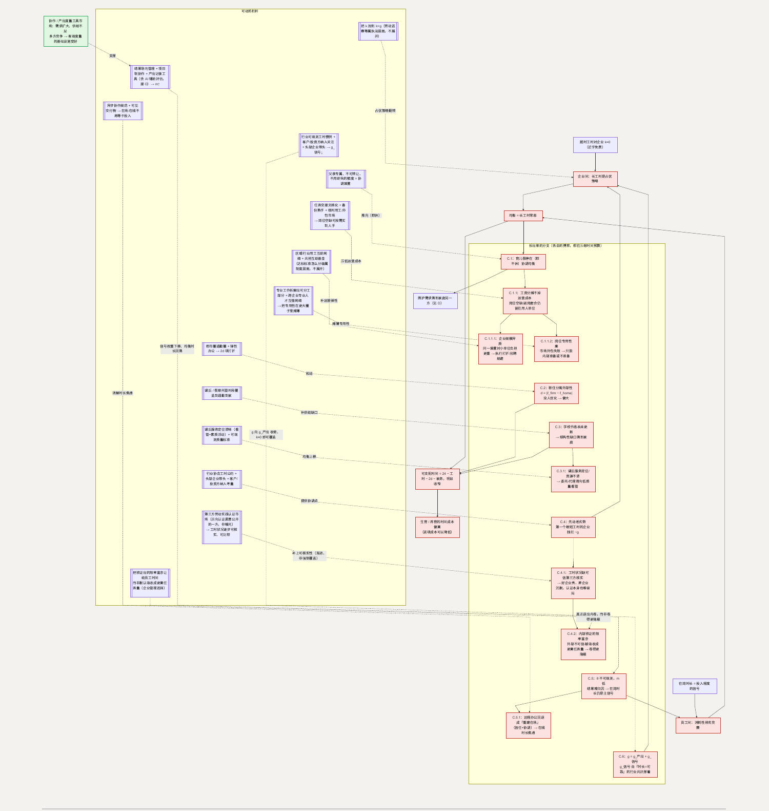

# C. 时间：一场谁也不敢先退的军备竞赛

**简单说：延长产假解决不了“时间不够”，工时才是关键——只要没人敢先下班，时间就永远紧张。**

生育和养育需要**可支配时间**这项投入。一天工作八九小时、通勤两三小时、回家还有家务，剩下的时间量决定了一个家庭能不能再容纳“陪孩子、辅导、带去看病、参加学校活动”这些新增负担。延长产假不改变时间总量，因此对这项约束作用有限。工时才是时间总量的主要变量。

**这一节用到的记号：**

| 记号 | 含义 | 为什么这样定义 |
| --- | --- | --- |
| 长工时 / 标准工时 | 企业可选的两种用工强度 | 主博弈一的策略 |
| $g$ | 一家企业单方面延长工时能取得的**相对**产出优势 | 竞争看的是相对位置，所以收益是相对量 |
| $c$ | 长工时给员工福利造成的损失（时间、健康、家庭） | 这项代价被外部化到员工一侧，不进企业的账 |
| $k$ | 超出法定时长的工时给企业带来的边际成本 | 当前 $k \approx 0$——抬到 $k > g$ 是移动均衡的关键 |
| $\theta$ | 员工真实的投入程度（不可观测） | 因为看不见，“在岗时长”被当成它的信号 |
| $m$ | 产出 / 结果的可度量性与可归因性（$m \in [0,1]$） | $\theta$ 不可观测才让在岗时长成为信号；$m$ 是“绕过这个不可观测性”的程度，是 C.5 唯一的核心可动参数 |
| $g_{\text{产出}} / g_{\text{信号}}$ | $g = g_{\text{产出}} + g_{\text{信号}}$：多干时间真实多出的产出 / 因被读作“更拼”而获得的相对评价收益 | 拆开才能看清 $g$ 里哪一块能在市场和行业层面压小（C.6） |
| $d / 2d$ | 职住单程通勤时间 / 每天往返通勤时间 | 直接从可支配时间里扣掉 |
| 可支配时间 | $= 24 - \text{工时} - 2d - \text{家务}$ | 生育、养育要占用的就是这个余额 |

## 主博弈一：企业之间的工时竞赛

**玩家**：同一市场里的企业。**策略**：长工时 / 标准工时。在月薪制下，边际工时对企业几乎不额外付费，而产出大致随工时增加；企业的竞争位置取决于**相对**产出。

| | B：长工时 | B：标准工时 |
| --- | --- | --- |
| **A：长工时** | (0, 0)：相对位置不变，双方员工福利各 −c | (+g, −g)：A 取得相对优势 |
| **A：标准工时** | (−g, +g)：B 取得相对优势 | (0, 0)：相对位置不变，员工福利各 +c |

长工时是占优策略（无论对方怎么选，它都不劣），纳什均衡是 (长工时, 长工时)。但 (标准工时, 标准工时) 帕累托占优——相对位置同样不变，员工福利却高 $c$。这是标准的囚徒困境：偏离带来的收益 $g$ 即时且确定，代价 $c$ 落在员工一侧、被外部化。

**判据**：企业选长工时 $\Leftrightarrow g$（相对产出收益）$> k$（超时的边际成本）。当前 $k \approx 0$。把 $k$ 抬到 $k > g$——让超出法定时长的工时对企业带来实际成本——占优策略即翻转，(标准工时, 标准工时) 成为可达均衡。行业层面若形成工时惯例，单个企业偏离会被同行和客户看见，相当于给这个合作均衡加了一个外部观测点。

$g$ 这个偏离收益由什么构成、能不能在行业和市场层面被压小，见 C.6——它和 C.4 是两个问题：C.4 问为什么到不了更优均衡，C.6 问 $g$ 本身能不能变小（$g$ 越小，协调装置即便不完美也更容易维持合作均衡）。

## 主博弈二：员工之间的排名竞赛

晋升名额和岗位稳定是**相对排名**的竞争。真实投入程度 $\theta$ 不可观测，在岗时长成为 $\theta$ 的信号。这是一个消耗性竞赛（rent-seeking contest）：个人的最优在岗时长随他人时长上升，对称均衡停在 边际信号收益 = 边际负效用 处，而这个点高于社会最优——因为信号收益是纯位置性的（零和），多出来的时长是全体净损失。

**移动方向**：降低“时长”作为信号的权重。当产出和结果本身可衡量、可归因时，时长不再是主要信号，竞赛的均衡时长下移。这个“可衡量、可归因”本身是一个卡住的博弈，也是市场和 AI 有明确着力点的地方，展开见 C.5、C.5.1。

## C.1 育儿假为什么“写在制度里却不敢休”

**这个子问题为什么存在。** 生育对社会是净收益、成本却由生育者承担（见引言“两本账”），其中一部分成本是“生育后必须离岗照护一段时间”。育儿假是一项制度设计，把“离岗照护”从“个人违约、可能被淘汰”改写成“受保护的权利”，目的是让承担了社会外部性的个体不至于因此在劳动力市场额外受罚。

**它自己的博弈。** 在上面的排名竞赛结构里，员工 i 是否休假，取决于其他人是否普遍休：

| | 其他人普遍不休 | 其他人普遍休 |
| --- | --- | --- |
| **i 休** | i 相对排名 −g，且被读作“低承诺” | 无相对损失（基准一起移动），照护得到保障 |
| **i 不休** | 无相对损失，照护需求落到家庭另一方（多由母亲承担，见 [D](D-interruption.md)） | i 相对排名 +g |

这是一个有**多重均衡**的协调博弈：(大家都不休) 和 (大家都休) 都是均衡。当前停在 (都不休)——第一个休的人承担 −g，没人愿意先动。

**怎么优化这个子博弈。** 需要一个协调装置，让参与者同时切换到 (都休)。父亲专属、不可转让、“不用即失”的育儿假额度就是这样一个装置：它把休假从“个体可选、因此是信号”变成“默认动作、不休反而是浪费”，从而把均衡推向 (都休)——此时休假不再传递“低承诺”。另一个参数：育儿假期间的成本若由社会分摊而非由单个雇主承担，雇主施加在 −g 里的那部分随之下降——但这里说的“成本”其实是 D 定义的 $L$（假期工资 + 岗位空缺 + 返岗磨合）：能被分摊掉的只是假期工资这一块（D 里 $L \to L'$ 那一步），岗位空缺和返岗磨合不会因为工资由社会统筹就自动消失，这部分怎么办，见 C.1.1。

**如何传导回大问题。** 子博弈从 (都不休) 移到 (都休)：育儿假可用 → 生育后的照护更容易由双方共担 → 时间紧张中“生育相关”的那一块被缓解，同时让 D 的分工更均衡。

### C.1.1 工资分摊不掉的那一半：谁接手这段时间的工作

**为什么存在。** 工资由社会统筹解决的是“钱从哪个口袋出”，解决不了“这段时间谁干活”——岗位空缺期间找人顶上、回来后重新对齐进度，是组织和知识层面的摩擦，不会因为钱的问题解决就跟着消失。这件事在不同企业、不同岗位身上难度差得很远，至少能拆成两条独立的线：

| | 岗位可替代度高 | 岗位可替代度低 |
| --- | --- | --- |
| **大中型企业** | 内部调配、临时外包都好用，冲击最小 | 靠得住的是自己的知识管理和内部备份，有资源做到 |
| **小微企业** | 相对最容易——本身通用性岗位多，临时用工市场也够用 | 最难的一格：既没规模养内部备份，也没议价力借到临时顶替 |

一条是**企业规模不同带来的“能不能达成共识”问题**（C.1.1.1），一条是**岗位能不能被别人顶替带来的“能不能靠外部市场解决”问题**（C.1.1.2），分开看。

**它自己的博弈。** 这不是对抗性博弈，更像是一个“要不要提前投入”的短视问题：把关键任务文档化、培养出至少一个“备份”熟手，都要在没人休假的时候先花成本，收益却只在真的有人休假时才兑现——贴现之下，多数用人单位选择不提前做。但“值不值得投、投不投得进去”，在下面两条线里答案很不一样。

**怎么优化这个子博弈。** 分开看，见 C.1.1.1（企业规模不同时，怎么找到大多数人都接受的安排）和 C.1.1.2（岗位不可替代时怎么办）。

**如何传导回大问题。** 两条线各自压低运营成本 → 用人方对“是否支持员工休满育儿假”的抵触进一步下降 → C.1 的 (都休) 均衡更容易维持，社会分摊掉的那部分工资，也不会被“找不到人接手”这类隐性成本重新抵消。

#### C.1.1.1 企业规模不同，同一套安排很难让大部分企业都真心接受

**为什么存在。** 同样一天育儿假带来的运营冲击，在不同规模的企业眼里完全不是一回事：大机构里，一个岗位空缺很容易被其他人临时分摊，几乎感觉不到；三五个人的团队，一人休假往往就是全队重新排班、甚至有些工作暂时没人做。这不是钱的问题——哪怕工资全额由社会分摊，同一套安排对小单位仍然是重得多的负担，差距在运营弹性本身，不在成本由谁出。

**它自己的博弈。** 这是一个**异质参与者的协调博弈**：C.1 的主博弈假设“大家一起休”这个均衡对所有参与者一样划算，但当参与者规模差异很大，同一个协调点对小单位的实际成本远高于大单位。结果是部分小单位即便名义上接受了这套安排，也会像 B.1.1 描述的那样在执行端打折——排班上想办法让员工“尽量少休”；或者干脆在招聘阶段更谨慎地避开看起来快要休假的人（回到 D 的 $\phi \cdot L$ 逃避逻辑）。单一装置想让所有规模的企业都真心配合，本身就有结构性的困难。

**怎么优化这个子博弈。** 具体的达标标准要不要按规模分级，属制度设计层面。企业和市场层面能做的，是给小单位一条不用靠自己扛的路：区域或行业性的用工互助——几家小单位共享一个临时人力池、共同分摊一小笔互助基金，效果上类似小单位“抱团”把自己的运营弹性做到接近大机构的水平，而不需要单独一家去扛。这类互助形式不同行业已有先例（用工紧张时互相借调员工），是一个可以自然长出来的市场，不要求每家企业单独解决。

**如何传导回大问题。** 小单位的运营弹性被互助机制补上 → 打折执行和招聘规避的动机都下降 → C.1 的 (都休) 均衡覆盖到更多规模的企业，不再只是大机构才落实得了。

#### C.1.1.2 有些岗位换不了人：专用性越高，市场解法越不管用

**为什么存在。** C.1.1 提到的“临时用工/外包市场”能不能顶用，取决于这个岗位有多依赖某个具体的人——客户关系、内部信任积累、专业资质、商业机密，这些都不是找个临时人手就能顶替的。可以把岗位按“换个人做，影响多大”分成两类：可替代度高的岗位（流程化、标准化、交接成本低），换人影响小；可替代度低的岗位（关系绑定深、机密程度高、资质门槛高），换人几乎不可行。育儿假的运营成本落在后一类岗位上时，市场化外包解决不了，只能靠企业自己提前准备。

**它自己的博弈。** 这本质上是“**靠市场解决，还是靠内部准备**”的选择（make-or-buy）：可替代度低的时候，市场这条路基本走不通，企业只剩两个选项——要么提前投入内部冗余（多培养一个人熟悉这块业务，这里几乎是唯一选项，不是可选项），要么完全不作准备、赌这段时间不出事。后者更省钱，是很多企业的现实选择，一旦真的发生育儿假，业务就会出现真空。

**怎么优化这个子博弈。** 这里能着力的，是让“提前投入”本身变得更划算，而不是让市场外包变得可行（对这类岗位它本来就不可行）：把不可分割的专业工作尽量拆解出可以分工的部分（哪怕核心决策必须一个人做，辅助性的部分也能有人先分担），降低整体的不可替代程度；跨企业的专业人才互借网络——几家非直接竞争的企业之间，在关键岗位空缺时互相借调对口的资深人手，是介于“完全外包”和“完全自己扛”之间的一条中间路径，本质上是把“专用性”在更大的圈子里摊薄，而不是消灭它。

**如何传导回大问题。** 专用性岗位的运营真空被部分填补 → 这类岗位的员工请育儿假不再等于业务暂停 → 高专业度、高机密密度岗位（往往也是收入较高、议价力较强的岗位）不再是“最不敢休”的那一批，C.1 的 (都休) 均衡覆盖到关键岗位而不只是可替代岗位。

## C.2 通勤时间——职住分离的外部性

**这个子问题为什么存在。** 企业选址的目标（商业集聚、人才池、地租）和家庭选址的目标（房价、学区）不一致。通勤时长是这两个独立优化之间的余数，没有任何一方在优化它。

**它自己的博弈。** 这是双边选址的协调失败。企业选 $\ell_{firm}$ 最大化 集聚收益 − 地租；家庭选 $\ell_{home}$ 最大化 住房效用 − 房价。两个独立优化的交叉决定通勤距离 $d = |\ell_{firm} - \ell_{home}|$。$d$ 产生的时间和精力成本由通勤者承担，不进入企业或房东的目标函数——是一项没人承担的外部性，因此 $d$ 系统性偏大。它直接吃掉时间预算：

> 家庭可支配时间 $= 24 -$ 工时 $- 2d -$ 家务

**优化的可行性与方向。** 落点在都市圈通勤圈的基础设施，以及企业对远程 / 弹性办公的接受度（用工文化），都在允许范围内。前者让同样的空间距离对应更短的时间；后者直接削减通勤频次。

**如何优化 → 新均衡。** 通勤圈把“住得远”的时间惩罚降低 → $d$ 的有效成本下降；弹性办公让 $2d$ 项按在家办公的天数打折。

**如何传导回大问题。** $2d$ 缩小 → 可支配时间回升 → 生育 / 养育的时间约束松动。（与 [F](F-housing.md) 相关。）

## C.3 工时与学校时间错配

**这个子问题为什么存在。** 学校的作息表——放学早、寒暑假长、临时停课——历史上是围绕“家庭有一位全职照护者”设计的，在双职工普遍化之后没有同步更新。放学到下班之间的两三个小时、假期的整段时间，成了一个结构性缺口，默认由家长自行填补。

**它自己的博弈。** 谁来填补这个缺口，是家庭内的协调博弈（谁请假、谁接送），而且它叠加在 C 的主博弈之上：由于工时竞赛，双方都难抽身，缺口最终落到弹性最低的一方、祖辈，或校外机构。这是制度惯性（作息表不更新）与供给缺口（没有正式的课后承接）的合成。

**优化的可行性与方向。** 课后服务和假期托管的时段覆盖，落点在公共服务供给，在允许范围内。方向是让正式的承接时段一直覆盖到“家长通勤到家”。

**如何优化 → 新均衡。** 缺口被外部供给接住 → 家庭内“谁填缺口”的协调博弈压力下降。

### C.3.1 为什么“课后服务”常常又变成变相补课或低质量看管

**为什么。** 当课后服务缺乏明确定位和相应资源，供给方（学校或第三方）会把这段时间填充成最省事的形式：上自习、写作业，或直接外包成学科辅导。

**它的博弈。** 这是一个委托—代理 + 质量不可观测的结构：家长要的是“有质量的看管加素质活动”，供给方在约束下倾向“低成本合规”，而课后时段的质量家长当场看不到（接 [J](J-childcare.md) 的柠檬结构）。目标不一致 + 质量不可观测 → 均衡滑向低质量看管。

**怎么优化。** 把课后服务的定位写清楚（看管 + 素质活动，不是学科延伸）+ 给一组可观测的质量标准（师生比、活动内容、场地）+ 配上对应资源。定位和标准明确后，供给方的“省事解”不再合规，均衡上移。

**传导回大问题。** 课后时段真正能承接 → 家长不必用请假或校外补习来填 → C 主博弈的时间压力和 [G](G-education.md) 的竞赛压力同时缓解一点。

## C.4 行业为什么难自发形成“不加班”的惯例（条目 31–34）

**这个子问题为什么存在。** 主博弈一说清了 (长工时, 长工时) 是均衡；这个子问题问的是：为什么行业内部形不成一个“大家都按标准工时来”的自律惯例。

**它自己的博弈。** 这是 N 人协调博弈里的“先动者劣势”。若所有企业同时切到标准工时，相对位置不变、员工福利都涨（帕累托改进）。但第一个单方面缩短工时的企业，在惯例形成之前要独自承受 $-g$ 的相对劣势。没有一个协调点，谁都不肯先动。

**怎么优化这个子博弈。** 需要一个让企业“同时切换”的协调装置，且落在市场和行业层面：行业协会牵头的工时公约、头部企业带头（它们抗 $-g$ 的能力强、示范效应大）、客户和投资方把“工时状况”纳入合作与估值考量（让长工时不再是纯优势）。这些都相当于给合作均衡加一个可观测的锚点。（用行政力量抬高 $k$（劳动监察等）属于执法层面。）

**如何传导回大问题。** 行业惯例一旦形成，(标准工时, 标准工时) 从“更优但不可达”变成“可达均衡” → 可支配时间总量回升。

### C.4.1 工时状况怎么变得可核实——第三方认证/评级是否会成为一个行业

**为什么存在。** 上面这三条杠杆——行业公约、头部企业带头、客户/投资方纳入考量——都要求一件事先成立：一家企业真实的工时状况，得是外部可核实、可比较的。但目前基本靠企业自己披露或零星的员工爆料，没有一个各方都认的核实标准；连“谁做到了、谁没做到”都说不清楚，公约和头部企业带头就很难真正约束到所有人。

**它自己的博弈。** 这是信息基础设施缺位问题，和 C.5 的“结果可衡量性”同构，但多一层复杂：认证要真正起作用，覆盖面得足够大、足够可信；而工时状况最差、最需要被“看见”的那批企业，恰恰是最没有动机参与、甚至可能抵制这类认证做大的一方——它们现在的竞争优势（C.6 里 $g_{\text{信号}}$——“更拼”那部分）本身部分建立在信息不透明上，认证体系越成熟，这部分优势被拆穿得越干净。这和 C.4 主博弈“先动者劣势”是同一种阻力，只是从“单个企业要不要先缩短工时”，挪到了“认证体系要不要真的做起来、做大”这一层——这个“解法”本身又是一个协调博弈，不会天然长成。

**怎么优化这个子博弈。** 正因为“让所有企业都参与”这条路走不通，能走通的路径是只做**正向认证，不做曝光**——不追求覆盖所有企业，只服务“本身工时就不差、愿意主动证明这一点”的那一批。**第三方劳动实践认证/评级，是一块需求在扩大、供给还不足的领域**：面向出口制造业供应链的劳动条件审计已经运作多年，面向白领雇主品牌的“最佳雇主”类认证也已经存在，共同点是奖励愿意公开的一方，而不是揭发不愿意公开的一方。参与规模积累到一定程度后，客户和投资方的偏好本身会形成压力——不参与认证渐渐等于给自己贴上一个说不清楚的标签，这个过程比强制覆盖慢，但不需要正面打破既得利益方的抵制。国内这类认证还早期，能走多远取决于愿意率先参与的企业基数能不能先积累起来。

**如何传导回大问题。** 认证体系覆盖面扩大 → C.4 里“客户/投资方纳入考量”这条杠杆逐渐有了抓手，头部企业带头的示范效应也能被验证和跟随 → 协调点从“隐性、靠信任”变成“显性、有数据支撑”；但这条路径天然渐进、从愿意配合的企业开始，对已经靠信息不透明获得优势、缺乏动机改变的那部分企业作用有限——这仍然只是把问题缩小，不是让它消失。这同一套基础设施，也是 C.6 里“行业可观测工时惯例”能落地的前提，两处杠杆其实共用一件事。

### C.4.2 一家企业自己验证“不加班也能按时完成”，够不够让它退出内卷

**为什么存在。** C.5 解决的是企业内部的信号问题——管理者不用再靠在岗时长去猜员工的真实投入。但这不等于解决了这家企业在行业里要不要卷——这是两层不同的博弈，前者的答案不能直接套到后者。

**它自己的博弈。** 企业在 C.4 主博弈里的相对位置，是被客户、投资方、人才市场“怎么看”它决定的，不是被它自己的内部账本决定的。只要外部观众仍把工时长短读作投入度的代理（$g_{\text{信号}}$ 还在起作用），这家企业单方面把工时降下来，账面产出没变，但外部感知的投入下降了——它依然要承担“先动者独扛 $-g$”的代价，除非内部验证的效率能变成外部也认可的信号（接 C.4.1）。这家企业能不能真的退出内卷，取决于内部验证结果能不能“出圈”，光自己知道没用。

还有一层容易被忽略：验证出“不加班也能完成”，说明企业发现了一块真实的产出富余——这是真的 $g_{\text{产出}}$，不是信号。这块富余怎么处置是管理层的选择，不是测量结果自动决定的：一种选择是把它兑现成员工的时间（工时降、产出不变，这才是真退出内卷）；另一种选择是把它吸收成更高的任务量（工时不变、产出提高）——后一种没有退出内卷，只是把这块真实的效率优势变成了下一轮竞赛的弹药，逼对手要么也提效率，要么被迫也加时间才能追上。同一个测量结果，通向两个完全不同的方向，选哪个是企业自己的取舍，不是技术自动解决的。

**怎么优化这个子博弈。** 要让验证过的效率真正兑现成“退出内卷”而不是“卷得更隐蔽”，需要两条同时成立：一是 C.4.1 那种把内部验证转成外部可信信号的认证/评级基础设施；二是企业主动把测量出来的产出富余分给员工的时间，而不是默认吸收成更高的任务量——这属于企业管理方式和用工文化层面的选择，是一个真实存在的岔路口。

**如何传导回大问题。** 单个企业的内部效率验证，只有在“外部可信”和“企业主动把富余让给员工时间”两个条件都成立时，才会真正压低这家企业的均衡工时，并通过 C.4.1 的认证机制逐步影响其他企业——否则它只是在同一个均衡里换了一种更高效的加班方式。

## C.5 绩效度量的客观化——“结果”为什么还没能替代“在岗时长”

**这个子问题为什么存在。** 主博弈二里在岗时长成为 $\theta$ 的信号，前提是 $\theta$ 看不见、产出也难以直接归因到人。这个“难归因”不是自然事实，而是一个长期没补上的缺口：多数协作型工作既没有清晰的任务边界，也没有把过程沉淀成可回溯记录的习惯，评价只能退回最容易观察的代理量——谁在座位上、待多久。

**它自己的博弈。** 记 $m \in [0,1]$ 为产出 / 结果的可度量性与可归因性。管理者可以投入成本拆解任务、定义交付物、建立产出记录（$m \uparrow$），也可以沿用“看在场”这个零成本代理；员工可以推动明确的目标与验收口径，也可以接受模糊评价、用在场表忠诚。$m$ 低时，“看时长”是双方的占优应对：管理者省事，员工也知道多待是最稳的自保。于是低 $m$ 自我锁定——没人单独有动力去建那套度量基础设施。

**优化的可行性与方向。** 落点在企业的管理方式和用工文化，以及协作 / 项目管理工具的市场供给，都在允许范围内。方向是把评价锚点从“投入时间”移到“约定结果是否达成”：结果导向的目标管理、项目制的任务拆分与验收、把工作过程留痕成可评估的产出。

> **把工作产出变得可记录、可衡量、可归因，是一块需求在扩大、供给还不足的领域。** 侧面看：远程与跨地点协作越普遍，“靠在场判断投入”越不可行，对协作平台、项目管理、产出度量、以及 AI 辅助的工作记录与评估的需求越持续；多方参与（工具厂商、企业自建、行业模板）在竞争中会把这类度量做得更轻、更准、更难被“表演”。AI 对 $m$ 的抬升可视为 [O](O-technology.md) 的 $\Delta_{\text{红利}}$ 在管理场景的一种具体形式，机制接 O，不在此重复。

**如何优化 → 新均衡。** $m$ 上升 → $\theta$ 可由产出直接估计 → 在岗时长作为信号的权重下降 → 主博弈二里“边际信号收益”曲线下移，对称均衡的在岗时长回落。

**如何传导回大问题。** 均衡在岗时长下降 → 工时项减小 → 可支配时间 $= 24 - \text{工时} - 2d - \text{家务}$ 回升。

### C.5.1 远程 / 分布式办公下，成果管理为什么没成为默认

**为什么存在。** 远程和跨地点协作把“看在场”这个代理量物理上取消了，理论上会逼出成果管理。但多数团队的回退方式不是转向结果，而是重建在场感——上线打卡、消息秒回、频繁视频。$m$ 没提高，信号只是换了载体。

**它自己的博弈。** 这是一个信任加协调博弈。管理者不确定看不见的人是否在投入（$\theta$ 仍不可观测），默认怀疑的成本低于逐个建立产出评估的成本；员工知道自己被默认怀疑，于是用“随时在线”这个新的在场信号自保。双方都选“高频在线”，均衡是“分布式办公 + 时长焦虑”的组合——比坐班更耗散，因为在线时段可以无限延展。

**优化的可行性与方向。** 落点在团队协作规范和工具选择，属用工文化与市场供给。方向是把评价锚点钉在“异步可见的交付物”上：明确的任务看板、书面化的进展、以结果验收替代过程监视。

**如何优化 → 新均衡。** 异步协作规范加可见交付物 → “在线时长”不再是投入的证明 → 员工不必用秒回和挂机自保 → 时长焦虑那部分消解。

**如何传导回大问题。** 远程办公同时压缩 $2d$（接 C.2）和无效在场时长 → 可支配时间回升，这块回升对有幼儿的家庭尤其直接。

## C.6 $g$ 从哪里来——单方面延长工时的相对优势能不能在行业层面被压小

**这个子问题为什么存在。** 判据 $g > k$ 一直把 $g$ 当成一个整体常数，却没问 $g$ 由什么构成。把它拆开：$g = g_{\text{产出}} + g_{\text{信号}}$。$g_{\text{产出}}$ 是多干的时间真实多产出的部分——在体力岗位大致成立，在知识型工作里随疲劳递减、越过某点会因出错和返工转负。$g_{\text{信号}}$ 是延长工时因被读作“更拼”而在客户、上级、投资方眼里获得的相对评价收益，和主博弈二的 $\theta$ 信号同源。观测到的 $g$ 里，$g_{\text{信号}}$ 往往是更大且更顽固的一块。

**它自己的博弈。** $g_{\text{信号}}$ 由一组外部观察者的预期支撑：只要“工时长 = 更可靠”是行业共识，单个企业压缩工时就会在争取订单和融资时吃亏（承担 $-g_{\text{信号}}$）。这是一个预期自我实现的协调博弈——共识不变，个体不敢先动；没有可观测的共同参照，共识也不会自己变。

**优化的可行性与方向。** 落点在行业和市场层面：行业内形成可观测、可比的工时惯例，让“按标准工时交付”成为正常水平而非异常信号；客户与投资方把工时状况纳入合作与尽调的关注项，使隐性超长工时不再自动折算成“更靠谱”；抗 $-g_{\text{信号}}$ 能力强的头部企业带头，提供示范锚点。这些都不改 $k$——用行政力量抬高 $k$ 属执法层面。

**如何优化 → 新均衡。** 外部观察者的预期从“时长 = 可靠”松动 → $g_{\text{信号}}$ 收缩 → $g$ 向 $g_{\text{产出}}$ 收敛 → 知识型工作里 $g_{\text{产出}}$ 本就不大，现有的、甚至接近零的 $k$ 就足以覆盖 → 判据 $g > k$ 反向，(标准工时, 标准工时) 成为可达均衡。

**如何传导回大问题。** 企业间工时竞赛降温 → 工时项回落 → 可支配时间 $= 24 - \text{工时} - 2d - \text{家务}$ 回升。

---

## 拆出来的分支（图）

