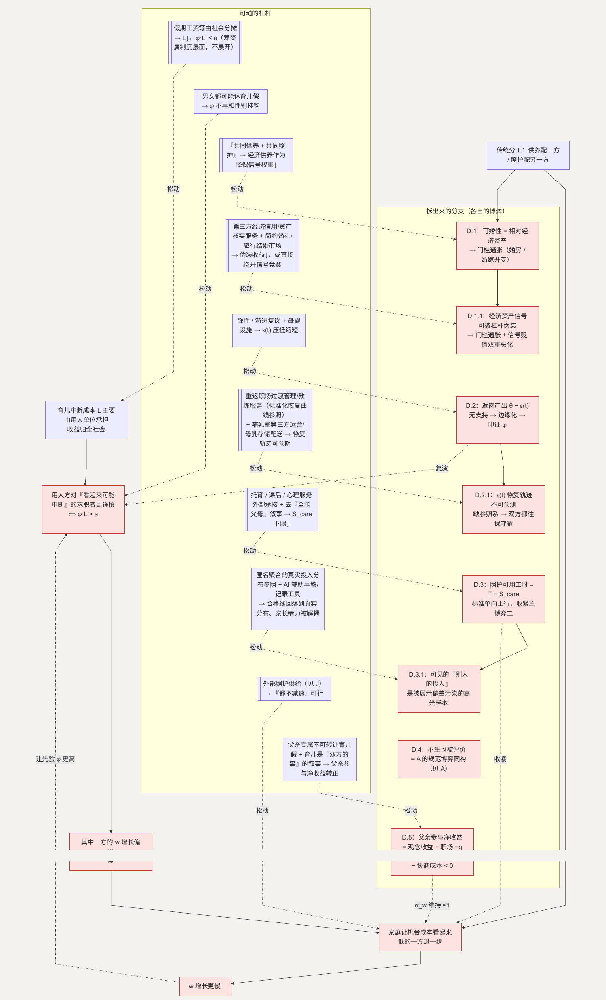

# D. 育儿中断的成本，目前集中在少数人身上

**简单说：生娃前后那笔“中断成本”，现在几乎全压在一个人身上——不是谁更该扛，是没人替另一半分。**

第四类（条目 43–59）和第五类（条目 60–68）其实是同一件事的两面：生育前后，一个家庭要吸收一笔“育儿中断成本”——照护时间、家务、职业上的暂时放缓、身体的付出。现在这笔成本的分担很不均匀：在家庭内主要落在一方（多为母亲），在市场上主要落在她所在的用人单位；而另一方（多为父亲）承担的是“必须多挣钱”的那一侧。两侧都是负担，只是形式不同。

2025 年一项大规模招聘实验发现，用人方在初筛阶段会对求职者“可能因育儿而中断”的信号做出反应。([ScienceDirect](https://www.sciencedirect.com/science/article/pii/S0927537124001647)) 另一项 2025 年的中国研究发现，成为父母后，育儿和家务时间的增加在夫妻之间分布很不均，主要落在一方。([ScienceDirect](https://www.sciencedirect.com/science/article/pii/S0167268125003609))

**这一节用到的记号：**

| 记号 | 含义 | 为什么这样定义 |
| --- | --- | --- |
| $\phi$ | 某类求职者中“会因育儿中断”的比例（用人方的先验估计） | 用人方看不见个体，只能按群体比例判断 |
| $L$ | 一次育儿中断给用人单位的成本（假期工资＋岗位空缺＋返岗磨合） | $L$ 由谁承担，决定它会不会被前移到招聘环节 |
| $L'$ | 假期工资等由社会分摊后，用人方仍承担的那部分 | 移动均衡就是把 $L$ 压到 $L'$ |
| $a$ | 这类求职者相对其他人的平均生产率优势 | 和 $\phi \cdot L$ 比较——$\phi \cdot L > a$ 时用人方转向谨慎 |
| $w_1(t)/w_2(t)$ | 夫妻两人的工资增长路径 | 谁的 $w$ 增长慢，谁在家庭里“机会成本看起来低” |
| $\alpha_w$ | 可转移的育儿成本里落在她头上的份额（$\alpha_w + \alpha_h = 1$） | 现状 $\alpha_w \approx 1$；详见 [K](K-body.md) |
| $\epsilon(t)$ | 产后返岗初期的过渡损耗，随支持措施下降 | 返岗产出 $= \theta - \epsilon(t)$ |
| $S_{care}$ | 社会对“好家长”照护投入的达标标准 | 它单向上行，挤占照护方的可用时间 |
| 相对经济资产 | 房、车、收入、稳定职业等可观测的经济信号 | 婚姻匹配里被当成“可婚性”的代理，且是相对量 |

## 主博弈一：用人方 × 求职者 —— 按群体平均值判断

用人方无法观测某个求职者个体的育儿中断概率，只能按群体平均值估计。设某类求职者中“会中断”的比例为 $\phi$，一次中断给用人方带来成本 $L$（假期工资 + 岗位空缺 + 返岗磨合）。用人方对这类求职者的预期额外成本约为 $\phi \cdot L$。

> 用人方对这类求职者更谨慎 $\Leftrightarrow \phi \cdot L > a$（$a$ = 这类求职者相对其他人的平均生产率优势）

于是**没有中断打算的个体，也无法把自己和“会中断”分开**，被平均值拖累。这个负担落得最重的，是“看起来最可能马上中断”的那一小群人——这正是实验数据的形状。

关键在于 $L$ 的归属：当育儿中断成本主要由用人单位承担、而生育收益归全社会，$L$ 对用人方是净成本，会被前移到招聘环节。这也解释了为什么单纯延长假期、成本仍由用人单位承担，反而会加重招聘顾虑。([ScienceDirect](https://www.sciencedirect.com/science/article/pii/S2666933125000486))

**怎么移动均衡：**

- 把 $L$ 里的假期工资等部分由社会（生育保险）分摊，用人方一侧的 $L$ 降到 $L'$，$\phi \cdot L'$ 可能落到 $a$ 之下，平均折价收窄。
- 让 $\phi$ 不再和性别挂钩：当男女都可能休育儿假、都可能有一段中断，$E[\text{中断成本} \mid \text{男}] \approx E[\text{中断成本} \mid \text{女}]$，“性别”和“婚育状态”就失去了作为判断依据的价值。

## 主博弈二：夫妻 × 照护分工 —— 一个相互强化的循环

设夫妻两人的工资增长路径为 $w_1(t)$、$w_2(t)$。因为主博弈一，其中一方（多为女性）的 $w$ 增长已经偏慢。家庭“理性”地让机会成本看起来更低的一方退一步——由于她的 $w$ 已经偏慢，往往就是她。

| | 另一方主责照护 | 另一方不减速 |
| --- | --- | --- |
| **她主责照护** | 双方都减速，家庭收入损失最大 | 她承担 → **当前均衡**（她的 $w$ 已偏慢，机会成本“看起来”小） |
| **她不减速** | 另一方承担（较少见） | 都不减速 → 需要外部照护（见 [J](J-childcare.md)） |

她退一步 → $w$ 增长更慢 → 反过来让主博弈一里“这类人会中断”的先验 $\phi$ 更高 → 循环。**预测 → 定价 → 兑现 → 印证预测。** 好在这个循环有多个可以插入的杠杆。

## D.1 另一侧的“必须养家”

**这个子问题为什么存在。** 传统分工把“经济供养”配给一方、把“照护”配给另一方。一方的“养家压力”（婚房、部分地区的婚嫁开支、对稳定职业的要求）和另一方的“照护默认”，是同一条规范的两面。

**它自己的博弈。** 在婚姻匹配里，一方的“可婚性”常被等同于经济供养能力（房、车、收入、稳定职业），而且这个信号是**相对**的：

> 个体 $i$ 的匹配概率 $= f(i \text{ 的相对经济资产})$

大家同时投资于可观测的经济资产来发信号 → 门槛一起通胀（军备竞赛结构）→ 婚房和婚嫁开支的标准被顶高，而相对匹配格局不变。

**怎么优化这个子博弈。** 降低“经济供养能力”作为主要择偶信号的权重。当两个人都工作、都参与供养，“一方必须独自供养”这个信号的价值下降，婚姻的经济门槛回落。这和照护那一侧是同一个杠杆的两面：从“一方主外、一方主内”转向“共同供养、共同照护”，两边同时松开。

**如何传导回大问题。** 经济门槛回落 → 结婚更容易（接 [E](E-marriage.md) 的前置门）；育儿参与的观念和制度空间打开 → 主博弈二的分工更均衡 → $w$ 不再被单向拖慢 → 主博弈一的 $\phi$ 回落。

### D.1.1 “经济资产”这个信号本身也能被伪装，谁来验真

**为什么存在。** D.1 主博弈默认“相对经济资产”是外部可观测的信号，但可观测不等于可信——房、车、收入这些外观，可以靠信用杠杆、短期借贷在不具备对应长期经济基础的情况下撑出来。当伪装的成本低于伪装带来的匹配收益，理性个体会选择伪装：这是 D.1 军备竞赛结构上再叠加的一层——不仅门槛在通胀，门槛本身还在贬值，因为看得见的不一定是真的。

**它自己的博弈。** 这是一个信号可信度问题：真实经济基础扎实的一方，和靠杠杆撑出同等外观的一方，从对方能观察到的信息看几乎无法区分。当伪装普遍化，观察者对“看得见的资产”这个信号的信任度整体下降，理性的反应是进一步抬高门槛，或转向更难在短期内伪装的信号（比如更长的收入流水、更稳定的职业记录）——但这些同样有一定的包装空间，也需要更高的核实成本，均衡并没有变得更健康，只是伪装和甄别各自升了一级，和 [J](J-childcare.md) 模块托育质量“看不清、只能靠代理指标”是同一种结构。

**怎么优化这个子博弈。** 这里指向两类市场供给方向。一类是面向婚恋匹配的第三方经济信用/资产核实服务，把“这项资产或收入是否真实、是否可持续”变成一项双方都能核验的信息，压低伪装的相对收益——这和 [C.4.1](C-time.md) 里“给工时状况找第三方可信来源”是同一种基础设施的另一种应用，只是换了个市场。另一类是帮助年轻人直接绕开这场信号竞赛的服务：这几年出现的简约婚礼、旅行结婚这类新兴婚庆细分市场，本质是提供一条不靠“资产门面”也能被认可的路径，是一块需求可能扩大的领域。（具体信息怎么交换、核实到什么程度，涉及个人隐私边界，本文只到“它影响信号可信度”为止，不展开。）

**如何传导回大问题。** 伪装空间被压缩、或者有人直接绕开这套信号竞赛 → “相对经济资产”对匹配概率的边际影响下降 → D.1 主博弈里军备竞赛的门槛通胀速度放缓，选择不参与这场竞赛的个体也不再被系统性地惩罚。

## D.2 哺乳期支持与产后返岗（条目 50–51）

**这个子问题为什么存在。** 产后返岗是从“中断”到“复位”的过渡期。这段时间里，返岗一方的产出暂时低于常态（哺乳需求、睡眠不足、重新适应），而岗位可能已被调整。这个过渡期的成本，落在返岗一方和她的用人单位。

**它自己的博弈。** 这是用人方与返岗员工的一次小型重复博弈，也是主博弈一在个人职业生涯内的复演。返岗初期的产出可写成 $\theta - \epsilon(t)$，$\epsilon(t)$ 是过渡损耗，随支持措施（哺乳时间、临时弹性、渐进复岗）下降。若没有支持，用人方看到的是“低于预期的产出”，可能进一步边缘化这个岗位 → 员工感知到信号恶化 → 索性延长中断或退出 → 反过来印证主博弈一的先验 $\phi$。

**优化的可行性与方向。** 落点在用工安排（弹性、渐进复岗）、母婴设施（接 [M](M-city.md)），以及哺乳期成本的社会分摊，都在企业用工文化和公共服务的范围内。

**如何优化 → 新均衡。** 支持措施把 $\epsilon(t)$ 压低并缩短 → 用人方观察到的产出快速回到 $\theta$ → 不触发边缘化，员工也不需要延长中断。

**如何传导回大问题。** 返岗顺利 → 主博弈一里 $L$ 的“返岗磨合”那一块下降 → $\phi \cdot L$ 收窄。

### D.2.1 用人方看不清“这段产出下滑什么时候会恢复”

**为什么存在。** D.2 主博弈里，用人方看到的是 $\theta - \epsilon(t)$ 这个当下的数字，但决定要不要边缘化这个岗位的关键信息，其实是 $\epsilon(t)$ 的恢复轨迹——这段过渡期还要多久、恢复到什么程度，而不是某一个时间点的产出快照。多数用人方没有一个可参照的基准去判断“这是正常的、会自行消退的过渡期”还是“预示着长期低于预期”，信息不足时，保守的反应是提前边缘化，而不是等它自然恢复。

**它自己的博弈。** 这不是单纯的类型不可观测，是**恢复轨迹不可预测**——即使用人方愿意给时间，如果没有一个可信的参照（这段过渡期“正常”应该多长、进展到哪一步算符合预期），双方都缺一个校准点：员工不知道自己“应该”多快恢复到能安心，用人方也不知道该等多久才算合理，缺乏参照系时，双方都倾向于往保守的方向猜。

**怎么优化这个子博弈。** 这里指向的市场方向，是把“渐进复岗”从一句原则性的描述，变成一套有节点、可追踪的具体方案——面向重返职场过渡期的管理/教练类服务，给出一条标准化的恢复曲线参照（哪个阶段大致恢复到什么产出水平），员工和用人方对着同一个参照系走，用人方的不确定性下降，员工也不必自证“我很快就没事了”；这类服务在海外已经是人力资源领域一个专门的细分市场，国内目前还处于早期。另一块更具体的方向落在哺乳期的实际操作层面：职场哺乳室的第三方专业运营、母乳存储与配送这类服务，把原本只能“企业自建、员工自己扛”的部分变成可以外部采购的服务，直接压低 $\epsilon(t)$ 本身，而不只是压低对它的不确定性。

**如何传导回大问题。** $\epsilon(t)$ 的恢复轨迹变得可预期、可参照 → 用人方不再需要靠保守猜测来对冲不确定性 → 边缘化的触发点后移甚至消失 → 主博弈一里 $L$ 的“返岗磨合”部分进一步收窄。

## D.3 对“好家长”的要求过高（条目 58）

**这个子问题为什么存在。** 照护一侧的“达标投入”标准 $S_{care}$ 随社会预期上升——陪伴质量、早教、精细喂养、情绪关注……它和 [G](G-education.md) 的责任标准同源，只是作用在照护维度而非教育投入维度。

**它自己的博弈。** 这是家长之间的标准攀比（多元无知 + 军备竞赛）：每个家长按“别人做到的”来定义“合格”，标准单向上行。承担照护的一方（主博弈二里退一步的那方）首当其冲：

> 照护方的有效可用工时 $= T - S_{care}$ 相关投入

$S_{care}$ 越高，可用工时越少，$w$ 越难恢复，主博弈二的循环收得越紧。

**优化的可行性与方向。** 把一部分“好家长”投入外部化（托育、课后、儿童心理服务，接 G、[I](I-child-safety.md)、J）；

- 社会叙事去“全能父母”化。落在观念和公共服务，在允许范围内。

**如何优化 → 新均衡。** $S_{care}$ 里可被外部承接的部分被接走 → 家长的达标投入下限下降 → 照护方的可用工时回升。

**如何传导回大问题。** 照护负担的绝对量下降 → 主博弈二里“退一步”的代价变小 → 分工更容易向 0.5 移动 → $w$ 不再被单向拖慢。

### D.3.1 家长看到的“别人的投入”，本来就不是一个真实样本

**为什么存在。** D.3 的多元无知机制要成立，需要一个前提——家长对“别人做到了什么”的估计本身是有偏的。这个偏差不是随机的，是系统性偏高：愿意被展示、被谈论的，天然是那些做得“出色”的瞬间和成果（精致的辅食、早教成果、丰富的活动安排），普通、平淡甚至有点狼狈的大多数时刻很少被拿出来讲。家长参照的“别人家”，从一开始就不是随机抽样，而是一个持续向上偏移的高光集合。

**它自己的博弈。** 这是一个感知层面的放大器：即使真实的育儿投入分布没有变化，只要“可见”的那部分持续偏向高投入端，每个家长照着这个被污染的样本调整自己的“合格线”，标准就会持续被推高——不需要任何人真的在互相较劲，每个人都只是想“达到看起来的平均水平”。这和 [A](A-autonomy.md) 模块“多元无知”的机制同构，只是这里的扭曲来源更具体：是内容展示本身的选择性（谁愿意分享、什么内容更容易被看到），而不是单纯的互相猜测。

**怎么优化这个子博弈。** 这里指向两类市场方向。一类是提供更接近真实分布的参照——不以“晒”为核心机制、以匿名聚合方式呈现“大多数家庭实际投入水平”的育儿社群或工具，给家长一个不被高光样本污染的锚点，这和 D.2.1、C.4.1 给模糊的比较对象找一个可信参照系是同一个手法。另一类是直接压低达标投入本身需要的家长精力——AI 辅助的早教内容生成、发展记录工具，把“看起来投入很大”和家长实际耗费的时间精力部分解耦，这和 [B](B-certainty.md) 模块里 AI 给照护类劳动“加杠杆”是同一个机制，只是用在了早期育儿场景。

**如何传导回大问题。** 家长对“合格线”的估计从被污染的高光样本回落到接近真实分布 → $S_{care}$ 的攀比性上涨速度放缓 → 照护方的可用工时下限回升更快。

## D.4 不生育也会受到评价（条目 59）

**这个子问题为什么存在。** 这是规范博弈的另一面：同一套“到年龄就该生”的规范（见 A），对选择不生的人施加评价性压力。它在 D 出现，是因为这层评价常和育儿分工、职业选择绑在一起（“不生是不是因为太看重事业”）。

**它自己的博弈。** 与 A 的主博弈同构——多元无知的规范传递 + 被评价方的逆反。**机制已在 A 完整展开，此处不重复。**

**如何传导回大问题。** A 的施压强度 $s$ 下降 → 这条评价压力一并减弱。

## D.5 父亲的育儿参与为什么在观念和职场上都受阻（条目 66–68）

**这个子问题为什么存在。** 传统分工把照护配给一方，它的反面是另一方的育儿参与在观念和职场上都缺少空间：“会带孩子的男人”没有正面的社会脚本，“请长育儿假的男性”在职场被读作低承诺（和 [C.1](C-time.md) 同构，只是性别方向相反）。

**它自己的博弈。** 父亲是否深度参与照护，取决于 观念收益（被认可为好父亲）$-$ 职场信号成本（$-g$）$-$ 家庭内协商成本。当正面脚本缺失、职场惩罚存在，“不深度参与”是占优 → 照护继续单侧堆积 → 主博弈二的 $\alpha_w$ 维持在 $\approx 1$。

**怎么优化这个子博弈。** 父亲专属、不可转让、“不用即失”的育儿假（和 C 的协调装置是同一个）把“父亲休假”从信号变成默认动作；公共叙事和企业文化把育儿呈现为“双方共同的事”。两者一起把 $-g$ 和“没有脚本”这两项成本压下去。

**如何传导回大问题。** 父亲参与的净收益转正 → 主博弈二里“另一方主责照护”这一格变得可选 → $\alpha_w$ 向 0.5 移动 → $w$ 不再被单向拖慢 → 主博弈一的 $\phi$ 回落。

---

## 拆出来的分支（图）

