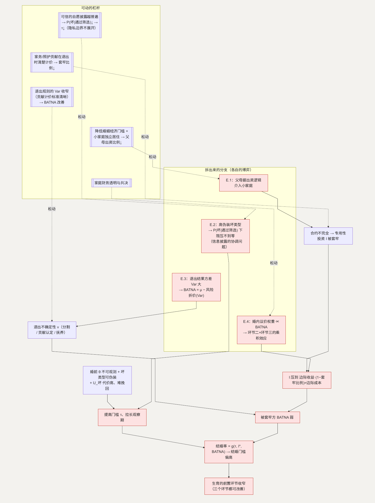

# E. 婚姻：一份难以反悔的不完全合约

**简单说：婚姻像一份没法反悔的长期合约，越想清楚风险，就越容易往后拖。**

在中国的语境里，不结婚，大部分生育不会发生——婚姻是生育的前置环节。第六类问题（条目 69–84）把婚姻当成一份**跨期、难以反悔的合约**在评估：三观是否合、家务怎么分、双方父母介入多深、遇到严重不合适的伴侣的风险、离婚成本、财产分割和抚养权的不确定。2026 年全国青年调查中，00 后择偶最看重道德品质、三观和性格。([zqb.cyol.com](https://zqb.cyol.com/pc/content/202604/27/content_425160.html)) 这份合约的三个环节，环环都在推高结婚的门槛、把决定往后推。

**这一节用到的记号：**

| 记号 | 含义 | 为什么这样定义 |
| --- | --- | --- |
| $\theta \in \{\text{好}, \text{坏}\}$ | 对方作为长期伴侣的真实类型 | 婚前不可观测，是逆向选择的根源 |
| $P(\text{好/坏} \mid \text{通过筛选})$ | 通过了自己筛选的对象里，真是好 / 坏类型的概率 | 决策依据是“筛选之后”的条件概率，不是先验 |
| $U_{\text{好}} / U_{\text{坏}} / U_{\text{单身}}$ | 婚配到好类型、坏类型，以及维持单身的效用 | $U_{\text{坏}}$ 代价高且难挽回，这一点主导筛选强度 |
| $\tau$ | 个体设定的筛选门槛（观察期长度、条件严格度） | $U_{\text{坏}}$ 越可怕，$\tau$ 越高，好类型也被误筛、时点推后 |
| $I / I^*$ | 一方为关系做的专用性投资（放慢职业、投入家庭）/ 其均衡水平 | 投资后议价地位下降，会被“套牢” |
| 套牢比例 | 投资后 $I$ 的收益被对方事后重新谈判拿走的比例 | 比例越高，$I^*$ 越低，甚至不进入合约 |
| $\upsilon$ | 离婚结果的不确定性 | 注意是结果的**方差**、不是均值——见 E.3 |
| BATNA | 被套牢一方“谈不拢就退出”的外部选项价值 | $= E[\text{离婚结果}] - \upsilon$ 的折价；它决定婚内议价地位 |
| 结婚率 | $= g(\tau, I^*, \text{BATNA})$ | 三个环节的合成输出 |

## 主博弈：合约的三个环节

**环节一，签约前 —— 逆向选择。** 对方真实类型 $\theta \in \{\text{好}, \text{坏}\}$ 不可观测，婚前信号部分可伪装，坏类型有动机模仿好类型。个体的决策：

> 结婚 $\Leftrightarrow P(\text{好} \mid \text{通过筛选}) \cdot U_{\text{好}} + P(\text{坏} \mid \text{通过筛选}) \cdot U_{\text{坏}} > U_{\text{单身}}$

其中 $U_{\text{坏}}$（遇到严重不合适的伴侣）代价高、且难以挽回。理性反应是提高筛选门槛 $\tau$、拉长观察期——这提升了 $P(\text{好} \mid \text{通过筛选})$，但也筛掉一些好类型、并把时点推后。结婚决定更谨慎、更靠后。

**环节二，签约后 —— 专用性投资被套牢（hold-up）。** 合约写不全所有未来状态。一方做关系专用性投资 $I$（放慢职业、投入家庭），投资后议价地位下降，对方可以事后重新谈判、攫取 $I$ 收益的一部分。预期到这一点，投资方把 $I$ 压到：

> 边际收益 $\cdot (1 - \text{套牢比例}) =$ 边际成本

套牢比例越高，$I$ 越低，甚至干脆不进入合约。

**环节三，退出 —— BATNA 弱。** 离婚结果的不确定性 $\upsilon$（财产分割、家务贡献认定、抚养权）决定被套牢一方的外部选项价值：BATNA $= E[\text{离婚结果}] - \upsilon$ 的折价。$\upsilon$ 高 → BATNA 弱 → 婚内议价地位进一步恶化 → 婚姻预期价值下降。

三个环节合起来：结婚率 $= g(\tau, I^*, \text{BATNA})$，都在推高结婚门槛。生育的前置环节随之收窄——而这三个环节都有可改善的空间。

### 怎么移动均衡

- 婚前关键信息可查 → $P(\text{坏} \mid \text{通过筛选})$ 下降 → $\tau$ 可以降回来，观察期缩短。
- 无偿家务和照护这类专用性投资的贡献，在退出时被清楚计价 → 套牢比例下降 → $I^*$ 回到接近社会最优。
- 退出规则明确、可预期、相对公平 → $\upsilon$ 下降 → BATNA 改善 → 婚内地位改善 → 婚姻预期价值上升。

**当“进去”和“出来”都可预期，人才敢进去。**

## E.1 双方父母为什么会过度介入

**这个子问题为什么存在**（条目 73–75）。中国的婚姻常常是两个家庭的结合，而不只是两个人的结合，一个结构性原因是：婚姻的启动成本（婚房、部分地区的婚嫁开支）往往由父母出资，出资方据此获得对小家庭事务的发言权。这是一个“谁出资、谁有发言权”的逻辑。

**它自己的博弈。** 小家庭的决策从 2 人博弈变成 4–6 人博弈。介入方（父母）的收益 = 影响小家庭决策的效用 + “出资的回报”预期（赡养、隔代亲近）；小夫妻的收益 = 决策自主 − 关系摩擦。当启动资金主要来自父母，父母的发言权有产权依据，介入是均衡。

**怎么优化这个子博弈。** 降低父母对婚姻启动的出资比例——也就是降低婚姻的经济门槛（接 [D](D-interruption.md) 的男性侧子博弈、[F](F-housing.md) 的住房）——父母的“产权发言权”依据减弱，介入的均衡强度下降。小家庭能独立居住（住房可及性）则切断日常介入的物理条件。

**如何传导回大问题。** 介入减少 → 婚内冲突维度减少 → 环节二的摩擦下降 → 婚姻预期价值上升。

## E.2 遇到严重不合适的伴侣的风险（条目 76–77）

**这个子问题为什么存在。** 这是环节一里 $U_{\text{坏}}$ 的主要来源。某些关键属性——严重的行为倾向、隐瞒的债务或健康问题、性格上的重大缺陷——在婚前的观察窗内不容易暴露，而婚后代价高、退出难。

**它自己的博弈。** 在信号博弈里，坏类型中有一个“高伪装能力”的子类型，他们的婚前信号和好类型几乎不可分。于是：

> $P(\text{坏} \mid \text{通过筛选})$ 的下限，由“高伪装坏类型的占比”决定，再拉长观察期也压不到零

理性个体的反应，要么把筛选门槛 $\tau$ 抬到很高（连带筛掉大量好类型），要么给 $U_{\text{坏}}$ 乘一个很大的损失厌恶系数——两条都让结婚决定更靠后。

**优化的可行性与方向。** 降低这个下限，靠的是让好类型有办法把自己和“会伪装”的区分开——也就是让一部分关键信息可以由双方自愿、可信地交换。这本质上是一个信息披露的协调问题：主动坦诚的人本该得利，但如果没有一种双方都认可的可信方式，好类型也难以把“我愿意坦诚”变成一个难以模仿的信号，只能靠更长的观察期来替代。

**如何传导回大问题。** 可信的自愿披露越普遍，$P(\text{坏} \mid \text{通过筛选})$ 的下限越低 → $\tau$ 可回落、观察期缩短 → 结婚门槛下降。这类信息如何交换涉及个人隐私的边界，本文只到“它影响筛选成本”为止。

## E.3 离婚成本与财产分割的不确定（条目 79–80）

**这个子问题为什么存在。** 这是环节三的 $\upsilon$。退出结果取决于对无偿贡献的认定、财产的追溯、抚养权的判定，这些在个案之间方差很大。

**它自己的博弈。** 这是一个“退出规则可预期性”问题。设退出结果 $R$ 服从均值 $\mu$、方差 Var 的分布。做了专用性投资 $I$ 的一方，其 BATNA $= \mu -$ 风险折价(Var)。**关键是 Var 而不是 $\mu$**——同样的均值，方差越小，被套牢方的 BATNA 越好。（谈 $\mu$ 的高低是分配之争，这里不涉及；谈 Var 的收窄是规则清晰度问题。）

**优化的可行性与方向。** 让退出规则里“无偿家务和照护贡献如何计价”有更清晰、更可预期的标准 → Var 下降。落在规则的可预期性，不主张具体的分配比例，在允许范围内。

**如何优化 → 新均衡。** Var 下降 → 风险折价下降 → BATNA 改善 → 环节二的 hold-up 减轻 → $I^*$ 回升。

**如何传导回大问题。** $I^*$ 回升 + BATNA 改善 → 结婚率 $= g(\tau, I^*, \text{BATNA})$ 上升。

## E.4 婚后经济上的话语权不对等（条目 71）

**这个子问题为什么存在。** 这是 hold-up 的一个具体形式：收入低、或中断了职业的一方，在消费、居住、生育节奏等决策上话语权偏低。

**它自己的博弈。** 婚内决策近似一个纳什议价，议价权重正比于各自的 BATNA。做了专用性投资的一方，BATNA 已被环节三的 Var 拉低 → 话语权系统性偏向未投资方 → 投资方预期到这点 → 环节二进一步少投资。这是环节二和环节三的乘积效应。（名义上的共同财产不改变这一点——支配权跟着收入流和退出选项走。）

**优化的可行性与方向。** 主要靠 E.3 的 Var 下降，加上观念层面的家庭财务透明与共决。

**如何优化 → 新均衡。** 投资方 BATNA 改善 → 议价权重趋于对称 → $I^*$ 回升。

**如何传导回大问题。** 同 E.3：$I^*$ 和 BATNA 一起改善，婚姻预期价值上升。

---

## 拆出来的分支（图）

