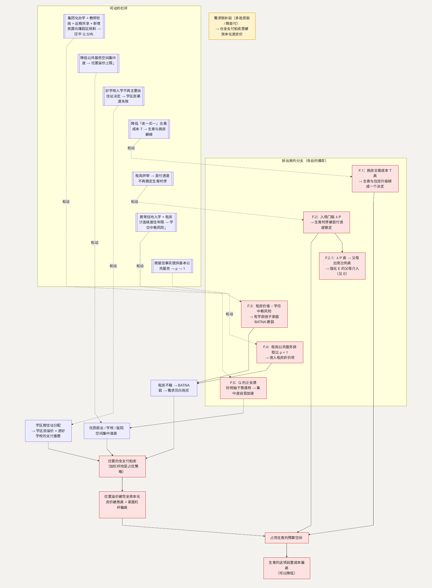

# F. 住房：一场位置的全支付拍卖

**简单说：房价贵只是表面——真正卡住人的是“学区、通勤、稳定感”这几件事绑在了同一套房子上。**

第七类问题（条目 85–95）里，“房价贵”只是表层。住房是几个机制叠在一起：位置争夺、学区绑定、租房不稳、长贷撞上不确定的未来。

**这一节用到的记号：**

| 记号 | 含义 | 为什么这样定义 |
| --- | --- | --- |
| $S / N$ | 靠近优质公共服务的住房套数 / 竞争的家庭数 | $S$ 大致固定、$N > S$，是“拍卖”的前提 |
| $b$ | 一个家庭的出价能力（首付＋可用杠杆） | 位置按 $b$ 排序分配，加杠杆抢是占优 |
| 位置溢价 | 家庭为“接近优质公共服务”愿意多付的最大额 | 均衡下它被完全计入房价 |
| $\lambda / P$ | 首付比例 / 房价 | 入场门槛是 $\lambda \cdot P$，它锁定生育时序（F.2） |
| $T$ | 刚性自住需求换房的交易摩擦（税费、认定、时间差） | $T$ 高 → 生育和住房升级被绑成一个决定 |
| $\rho \in [0,1]$ | 租房相对买房能获得的公共服务比例 | $\rho < 1$ 直接进入“租房不稳定性折价”（F.4） |
| 学位中断风险 | 租房家庭因搬家导致孩子转学的风险 | 让有学龄孩子的家庭租房 BATNA 更弱（F.3） |

## 主博弈：位置的全支付拍卖

靠近优质就业、学校、医院的住房，供给是刚性的（大致固定 $S$ 套）。$N$ 个家庭竞标，出价 $b$（首付加杠杆能力），位置按出价排序分配给前 $S$ 名。

这个博弈有两个关键特征。一是**全支付**：即使没拍到，付出的储蓄、机会成本、心理消耗也不退回。二是**加杠杆抢是占优策略**：无论别人怎么出，你多出一点就多一分拿到的概率。均衡里，家庭出价被推高到接近其支付能力上限，位置溢价被完全资本化进房价：

> 位置溢价 = 家庭为“接近优质公共服务”愿意支付的最大额

公共服务的空间集中度越高，这个最大额越高，房价和家庭杠杆也越高。

这个结构还解释了一件事：**需求侧补贴（多批贷款、降首付）容易被资本化。** 补贴提高家庭出价能力 $b$ → 在全支付拍卖里均衡出价随之上移 → 补贴进入位置溢价，价格上移、家庭杠杆更高。这不是对某项做法的评价，是供给刚性市场里需求侧补贴的一般结果——也说明这个方向的着力点更应放在供给和“位置稀缺性”本身。

### 三个耦合的机制

- **学区把 [G](G-education.md) 的军备竞赛资本化进房价。** 好学校入学按住址分配时，“买学区房”成为教育投入的一个渠道，学区房溢价 = 家庭对“孩子进好学校”的支付意愿。G 的竞赛越激烈，学区房溢价越高，位置溢价越高——两个博弈互相推高。
- **租房不是可信替代**（与 [E](E-marriage.md) 的 BATNA 同构）。租房价值 = 居住效用 − 不稳定性折价（续租不确定、房东收回、租购公共服务差别）。折价高 → 租房 BATNA 弱 → “买还是租”被推向买 → 需求全压向购买端 → 位置溢价更高。
- **杠杆 × 不确定性**（接 [B](B-certainty.md)）。30 年贷款遇上“不知道五年后还在不在这个城市”，买房成了一个高杠杆、不可逆、押注未来的决定，$\sigma$ 高时要么推迟、要么买后焦虑。

### 怎么移动均衡

- 削弱公共服务的空间集中度（好学校、好医院不那么扎堆）→ 家庭愿付的位置溢价上限下降 → 房价回落。
- 好学校入学如果不再主要由住址决定，“买学区房”作为教育投入渠道就失效 → G 与 F 的耦合断开。
- 提高租房 BATNA：稳定租期、租金可预期、租购公共服务差别缩小 → 家庭有“不买也能稳定养育”的可行解。
- 降低 $\sigma$（接 B）→ 买房的期权价值下降。

## F.1 生育与“住房升级”为什么被绑成一个决定

**这个子问题为什么存在**（条目 87–88）。家庭的住房需求随孩子出生跳变（面积、可能还有学区），而换房有很高的交易摩擦 $T$（税费、二套认定、卖旧买新的时间差和资金链）。

**它自己的模型。**

> 家庭换房 $\Leftrightarrow$ 新增居住效用 $>$ 交易成本 $T +$ 杠杆增量的负效用

$T$ 越高，家庭越倾向两种做法：一是**提前透支**——在生育前就买大房，加重杠杆，抬高生育的前置成本；二是**推迟生育**，直到能一次性负担换房。两种做法都把生育和住房升级绑成了同一个决定。

**怎么优化这个子博弈。** 降低刚性自住需求的换房交易摩擦（“卖一买一”的税费和认定），$T$ 下降 → 生育和住房升级解绑 → 家庭可以“先生、后换”，生育的前置资本门槛下降。

**如何传导回大问题。** 生育不再要求“先备好一套够大的房”，前置门槛下降。

## F.2 首付高、房贷期限长（条目 85–86）

**这个子问题为什么存在。** 首付是位置溢价的一次性折现，月供是它的分期。它们是主博弈的下游会计恒等式，但首付本身还有一个机制：它是进入拍卖的“入场资格”。

**它自己的博弈。** 当首付比例固定为 $\lambda$，家庭必须先积累 $\lambda \cdot P$ 才能出价。于是家庭会把生育时点排在“凑齐首付”之后——**生育的时序被首付进度锁定。** $P$ 越高，$\lambda \cdot P$ 这道门槛越晚跨过，生育越往后推。

**优化的可行性与方向。** 靠主博弈的位置溢价回落（$P$ 下降则 $\lambda \cdot P$ 下降），加上租购并举提供一条“不买也能稳定养育”的替代路径。落在供给和公共服务，在允许范围内。

**如何优化 → 新均衡。** 入场门槛 $\lambda \cdot P$ 下降，或存在可信的租赁替代 → 生育时序不再被首付进度锁死。

**如何传导回大问题。** 前置资本门槛下降 + 时序解锁 → 生育决策提前、更从容。

### F.2.1 为什么“凑首付”会反过来强化父母介入

**为什么。** 首付常由双方父母共同出资，出资即产权发言权（接 [E.1](E-marriage.md)）。首付门槛越高，父母出资比例越大，介入的依据越强。**这是 F 与 E 的耦合，机制在 E 展开**——这里只标出这条链路：$\lambda \cdot P$ 高 → 父母出资比例高 → E 环节二的婚内摩擦上升。

## F.3 频繁搬家对孩子上学不友好（条目 91–92）

**这个子问题为什么存在。** 租房家庭的学位连续性没有保障，一次搬家可能意味着一次转学。

**它自己的博弈。** 有学龄孩子的家庭，居住决策里多了一个“学位连续性”约束：

> 租房价值 = 居住效用 − 不稳定性折价 − 学位中断风险

第三项让**有学龄孩子的家庭的租房 BATNA，比没孩子的家庭更弱** → 更被迫买房 → 恰恰是最需要预算空间的家庭被推向最高的杠杆。

**优化的可行性与方向。** 租房家庭的学位稳定性——按常住地入学、租房也计入连续居住年限。落在公共服务，在允许范围内。

**如何优化 → 新均衡。** 学位中断风险项下降 → 有孩子家庭的租房 BATNA 改善 → 不再被强制推向购买端。

**如何传导回大问题。** 这部分需求从购买端分流 → 主博弈的位置溢价上限下降。

## F.4 租购在公共服务上的差异（条目 93）

**这个子问题为什么存在。** 一部分公共服务（入学、某些补贴、落户）与产权而非居住事实挂钩，这是租房不稳定性折价的制度来源。

**它自己的博弈。** 设租房相对买房的公共服务获取比例为 $\rho \in [0,1]$。$\rho < 1$ 直接进入租房 BATNA 的折价项：$\rho$ 越低，租房越不是可信替代，需求越压向购买端，主博弈的位置溢价越高。它和 F.3 是同一个折价项的两个来源。

**优化的可行性与方向。** 把 $\rho$ 推向接近 1——按常住地、按居住事实提供基本公共服务。落在公共服务，在允许范围内（不展开户籍制度本身）。

**如何优化 → 新均衡。** $\rho \to 1$ → 租房 BATNA 改善 → 购买端需求分流。

**如何传导回大问题。** 与 F.3 合流：租房成为可信替代 → 位置溢价上限下降 → 生育的预算空间回升。

## F.5 优质公共服务为什么在空间上越聚越密（条目 89、112–113）

**这个子问题为什么存在。** 主博弈的驱动是“公共服务的空间集中度”。这个集中度不是天生的，是一个自我强化过程的结果：好学校吸引好师资和好生源 → 办得更好 → 拿到更多资源和关注 → 更好。医院同理。集聚一旦启动就自己加速。

**它自己的博弈。** 这是一个正反馈的区位博弈。设一所学校的相对质量 $Q$，它的师资流入和生源流入都随 $Q$ 上升，而 $Q$ 又随这两个流入上升——$Q$ 高的越来越高，$Q$ 低的被抽干。均衡是少数节点极强、大量普通校偏弱，对应到住房市场就是极高的位置溢价。

**优化的可行性与方向。** 这里只谈供给侧和组织方式能着力的部分：集团化办学（把强校的管理和师资摊到弱校）、教师区域内轮岗、优质课程的远程共享、新增资源明确向薄弱区域倾斜。这些相当于在正反馈里加一个负反馈项，压平 $Q$ 的分布。（按行政层级配置公共资源的部分，属于制度层面的可动参数。）

**如何优化 → 新均衡。** $Q$ 的分布被压平 → “非得挤进那几个点”的必要性下降 → 家庭愿付的位置溢价上限下降。

**如何传导回大问题。** 主博弈的 CONC（集中度）这个源头变量本身松动 → 位置溢价、房价、家庭杠杆一起回落。

---

## 拆出来的分支（图）

