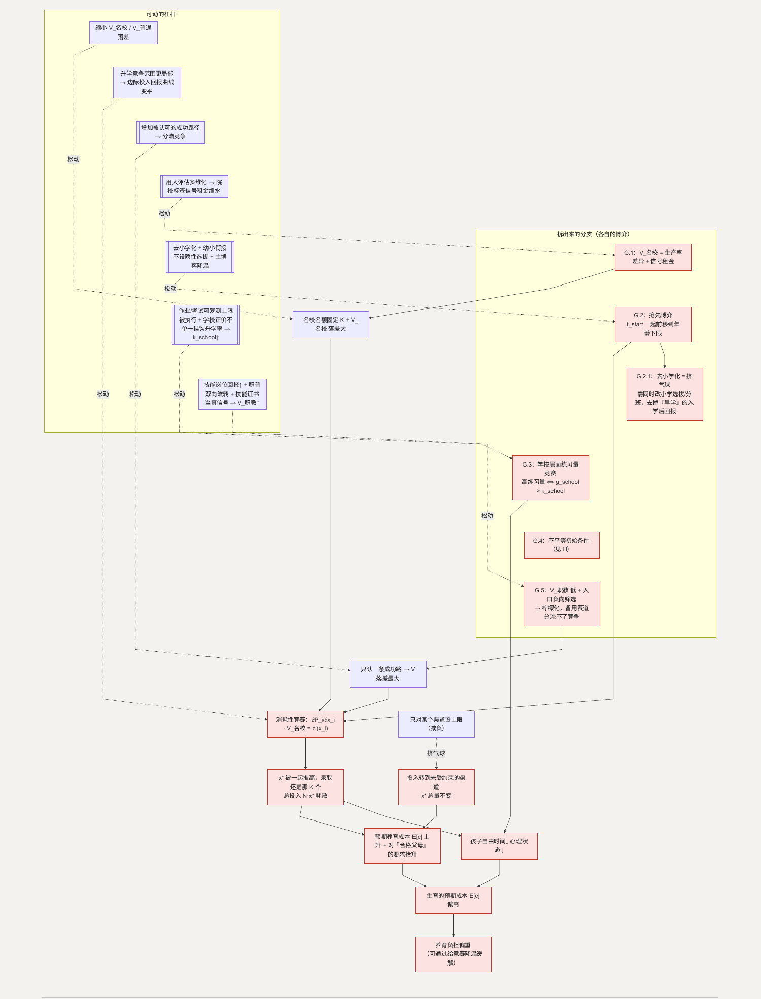

# G. 教育内卷：一场名额固定的军备竞赛

**简单说：让人犹豫的不是学费，是内卷本身——名额就那么多，谁都不敢先退出这场竞赛。**

第八、九、十七、十九类（条目 96–120、209–241）合起来是全文最清晰的一个囚徒困境。全国青年调查里，养育压力排前三的是教育支出 77.6%、日常支出 62.6%、时间精力不足 59.1%。([Nopss](https://www.nopss.gov.cn/n1/2024/1227/c219544-40390722.html)) 比“学费”更让人犹豫的，是内卷本身——好在这类困境正是可以通过调整规则来缓解的。

**这一节用到的记号：**

| 记号 | 含义 | 为什么这样定义 |
| --- | --- | --- |
| $K$ | 优质高中和大学的名额数（大致固定） | 名额固定＋按相对排名，是“军备竞赛”的根源 |
| $x_i$ | 家庭 $i$ 的教育总投入 $= x_{\text{校内}} + x_{\text{校外}} + x_{\text{家庭}}$ | 录取看的是相对投入份额 |
| $P_i$ | 孩子的录取概率 $\approx x_i / \sum x_j$ | 纯相对——别人加码，你的 $P_i$ 就掉 |
| $V_{\text{名校}}$ | 上名校相对不上名校的收益差 $=$ 生产率差异 $+$ 信号租金 | 竞赛的“赌注”，缩小它 $x^*$ 才降 |
| $c(x_i)$ | 投入 $x_i$ 的代价（钱＋孩子的自由时间和心理损失） | 孩子是这项代价的主要承担者 |
| $x^*$ | 对称均衡下每个家庭的投入 | $\partial P_i / \partial x_i \cdot V_{\text{名校}} = c'(x_i)$，随他人投入上升 |
| $S$ | 社会对“合格父母”的达标标准 | 与竞赛互为因果，一起把 $E[c]$ 抬高 |
| $E[c]$ | 年轻人预期的养育总成本 | 它偏高，是生育决策转保守的直接原因 |
| $g_{school} / k_{school}$ | 学校加练习量的相对收益 / 声誉合规成本 | G.3：$g_{school} > k_{school}$ 时学校也在卷 |

## 主博弈：教育投入的消耗性竞赛

优质高中和大学名额大致固定为 $K$ 个，升学按相对排名。家庭 $i$ 选择教育投入 $x_i$（金钱 + 时间），孩子的录取概率近似为相对份额：

> $P_i = x_i / \sum x_j$，家庭效用 $U_i = P_i \cdot V_{\text{名校}} - c(x_i)$

$c(x_i)$ 里既有金钱，也有孩子的自由时间和心理损失。对称纳什均衡里，每个家庭的最优投入满足 $\partial P_i / \partial x_i \cdot V_{\text{名校}} = c'(x_i)$，且 $x^*$ 随其他家庭的投入上升而上升（战略互补）。

社会最优其实是“大家都不额外投入”——因为录取格局完全由相对值决定，绝对投入是纯浪费。但均衡是 $x^*$ 被一起推到很高：**总投入 $N \cdot x^*$ 几乎全部耗散，录取的还是原来 $K$ 个。** 这一代孩子已经在承受代价：2025 年一项覆盖 31 省、5503 名家长和 5822 名孩子的调查里，36.4% 的孩子说考试太多，35.1% 说作业经常做到很晚很累（[zqb.cyol.com](https://zqb.cyol.com/pc/content/202511/27/content_419223.html)）；另一项研究里初中阶段家长的教育焦虑比例达 64%。([CSSN](https://www.cssn.cn/skgz/bwyc/202512/t20251211_5955015.shtml))

### 为什么“减负”常常落空 —— 挤气球

减负是对某个投入渠道设上限，比如 $x_{\text{校内}} \le \bar{x}$。但 $P_i$ 依赖的是总投入 $x_i = x_{\text{校内}} + x_{\text{校外}} + x_{\text{家庭}}$。约束一个渠道，家庭把投入转移到未受约束的渠道，$x^*$ 总量不变，甚至因为转到效率更低、更不透明的渠道而福利更差。这就是“挤气球”。$x^*$ 要真正下降，只能改 $V_{\text{名校}}$ 或改 $P_i$ 的机制。

### 两个放大器

- **责任标准抬升**（条目 209–221）。“合格父母”的标准 $S$ 上升，单个孩子的“达标投入”下限随之上升。它与竞赛互为因果：竞赛抬高“不掉队”所需投入 → 被理解为“责任” → $S$ 上升 → 预期养育成本 $E[c]$ 上升。**生育意愿降低，很多时候不是因为年轻人不负责任，而是因为把当父母算得太认真。**
- **只设一个奖池**（条目 231–241）。若社会只认一条成功路径，$V_{\text{名校}}$ 相对其他路径的落差最大，竞赛烈度也最大。“普通生活等于失败”“读职校低人一等”都是这个结构的表现。

### 怎么移动均衡

- 缩小 $V_{\text{名校}} / V_{\text{普通}}$ 的落差 → $x^*$ 下降。
- 让 $P_i$ 不再是纯粹的全局相对排名。当升学竞争的范围更小、更局部（竞争对手是一个更小的群体），边际投入的相对回报曲线变平，$x^*$ 下降。
- 增加被社会认可的成功路径数量 → 竞争被分流 → 每条赛道的 $V$ 落差缩小。
- 把一部分“父母责任”外部化（心理服务、课后托管、校园安全，接 [I](I-child-safety.md)、[J](J-childcare.md)）→ $S$ 的达标投入下限下降。

## G.1 为什么“上不上名校”的差距这么大

**这个子问题为什么存在。** 用人方招聘时无法低成本观测求职者的真实能力 $\theta$，于是用“毕业院校”作为 $\theta$ 的信号（名校 = 通过过一次高强度筛选）。这让

> $V_{\text{名校}}$ = 真实生产率差异 + 信号租金

其中“信号租金”是仅仅因为“名校”这个标签本身带来的溢价。换句话说：名校学历值钱，一部分是真本事，另一部分只是“贴了这张标签”本身的溢价。

**它自己的博弈。** 这是一个信号博弈（Spence 模型）：学生投资于“进名校”来发能力信号，雇主按信号定价，均衡停在“高能力者愿付、低能力者不愿付”的分离点。问题是这笔信号投资（备考、刷题、竞赛）大部分是**无生产性的**——它证明能力，但不创造能力。

**怎么优化这个子博弈。** 降低“院校标签”在用人筛选中的权重。当用人方用更多维度评估能力（实习表现、项目、技能认证），院校标签的信号租金部分缩水 → $V_{\text{名校}}$ 里可通过“教育投入”套利的空间变小 → 主博弈的 $x^*$ 下降。

**如何传导回大问题。** $V_{\text{名校}}$ 落差缩小 → 军备竞赛的赌注变小 → $x^*$ 下降 → 孩子的时间和心理损失减小 → 预期养育成本下降。

## G.2 学前段抢跑（条目 106、115）

**这个子问题为什么存在。** 竞赛在时间维度上前移。当 $P_i$ 依赖总投入且战略互补，任何一个家庭提前投入都能获得暂时的相对领先，于是“起跑线”不断前移——从小学提前到幼儿园、再到早教。

**它自己的博弈。** 这是主博弈的一个“抢先”变体。设投入的起始时点 $t_{start}$，家庭效用里有一项 $f(\text{他人平均} t_{start} - \text{自己} t_{start})$，越早越占优 → 均衡 $t_{start}$ 一起前移，直到触及孩子发展的年龄下限（“再早也学不进去”）。净结果：竞争窗口被拉长，总投入增加，相对格局不变。

**优化的可行性与方向。** 学前“去小学化” + 幼小衔接不设隐性选拔 + 主博弈降温（$V_{\text{名校}}$ 落差缩小，前移的收益也随之缩小）。落在教育供给，在允许范围内。

**如何优化 → 新均衡。** $t_{start}$ 前移的收益下降 → 竞争窗口收缩 → 学龄前孩子的时间、家庭这一段的投入都减少。

**如何传导回大问题。** 养育成本 $E[c]$ 里“学龄前”那一段下降。

### G.2.1 为什么“去小学化”也常常落空

**为什么。** 和减负同构——这是“挤气球”的又一例。约束幼儿园的学科化教学，家庭把学科抢跑转移到校外机构和家庭内。

**它的博弈。** 约束一个渠道，总投入 $x^*$ 不变。要真正生效，得同时降低 $t_{start}$ 前移的收益，也就是改小学阶段的选拔和分班机制，让“早学”在入学后不形成持续优势。当“早学”的入学后回报趋近于零，家庭提前投入的动机才真正消失。

**传导回大问题。** 抢跑的收益结构被改写 → G.2 的均衡 $t_{start}$ 才真正后移。

## G.3 考试太多、作业太长、没有自由时间（条目 116–118）

**这个子问题为什么存在。** 这是军备竞赛的直接产物。$c(x_i)$ 里“孩子的时间和心理”这一块，是竞赛投入的主要承担者。

**它自己的博弈。** 这里有一个学校层面的次级博弈。学校之间也在按升学率排名竞争 → 加练习量、加考试频次是学校的占优策略（和 [C](C-time.md) 的企业工时竞赛同构）：

> 学校选高练习量 $\Leftrightarrow g_{school}$（升学率相对收益）$> k_{school}$（声誉/合规成本），当前 $k_{school}$ 偏低

作业和考试量一起被推高，学校的相对升学位次不变，孩子的时间被净消耗。

**优化的可行性与方向。** 把 $k_{school}$ 抬起来——作业总量、考试频次有可观测的上限且被真正执行，加上学校评价不单一挂钩升学率。落在教育供给和评价方式，在允许范围内。

**如何优化 → 新均衡。** $k_{school} > g_{school}$ → 学校层面的练习量竞赛降温 → $c(x_i)$ 里孩子时间损失那一块下降。

**如何传导回大问题。** 竞赛的主要承担者（孩子的时间和心理）负荷减轻 → “孩子的童年会不会太紧张”这项顾虑变轻。

## G.4 家庭背景影响教育机会（条目 114）

**这个子问题为什么存在。** 这是把 G 的竞赛放在不平等的初始条件下的结果。

**它自己的博弈。** 机制在 [H](H-inequality.md) 的主博弈完整展开——竞赛把整体投入推高，低资源家庭“打满”和高资源家庭“打满”的绝对差距被放大。**此处不重复，见 H。**

## G.5 职业教育的社会认可为什么上不去（条目 239–241）

**这个子问题为什么存在。** 主博弈的一个杠杆是“增加被认可的成功路径”。职业教育本应是其中一条，但它的社会认可长期偏低——这条备用赛道没有真正分流竞争。

**它自己的博弈。** 两个机制叠加。用人市场端：技能岗位的相对回报（收入、稳定性、上升空间）偏低 → 家庭对职教路径的估值 $V_{\text{职教}}$ 低。筛选端：职教被当作“考不上普高之后的去处”，入口就是负向筛选 → 生源和资源双弱 → 办学质量难提升 → 印证“职教不行”（柠檬化，和 J 同构）。

**怎么优化这个子博弈。** 提高技能岗位的实际回报（市场，把 $V_{\text{职教}}$ 的分子做大）；打通职教和普教之间的双向流转，让职教不是死胡同、入口不再等于失败；企业招聘和社会评价把技能证书当真信号。三条一起缩小 $V_{\text{职教}} / V_{\text{名校}}$ 的落差。

**如何传导回大问题。** $V$ 落差缩小 → 主博弈的赌注变小 → $x^*$ 下降；同时“只设一个奖池”被拆成多个，竞争分流。

---

## 拆出来的分支（图）

