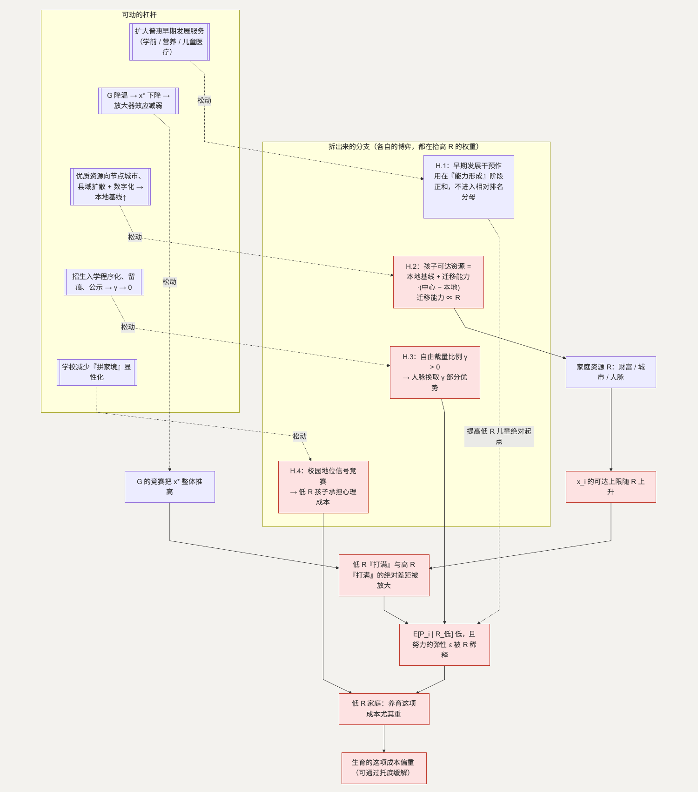

# H. 机会不平等：军备竞赛是一台放大器

**简单说：教育这场竞赛不是所有人站在同一条起跑线上，家境差距会被这场竞赛进一步放大。**

第十类问题（条目 121–132）问的是：普通家庭和富裕家庭的资源差距、城乡差距、父母人脉的影响、“努力”还换不换得来相称的回报。核心是一句话：**孩子能不能在相对公平的规则下长大。**

**这一节用到的记号**（沿用 [G](G-education.md) 的 $x_i / P_i / x^*$）：

| 记号 | 含义 | 为什么这样定义 |
| --- | --- | --- |
| $R_i$ | 家庭 $i$ 的资源禀赋（财富、所在城市、人脉） | 它决定 $x_i$ 能打到多高——放大器放大的就是它 |
| $E[P_i \mid R_i]$ | 给定家庭资源下，孩子录取概率的期望 | 它随 $R_i$ 上升，反映的是投入能力、不是孩子能力 |
| $E[\text{孩子前景} \mid R_{\text{低}}]$ | 低资源家庭孩子的预期发展前景 | 竞赛把它压低，是低 $R$ 家庭生育成本重的直接来源 |
| $\epsilon$ | 个体感知的“努力 → 回报”弹性 | $\epsilon$ 高才愿做大的长期投入；养孩子是最大的一次 |
| 本地基线/迁移能力 | 常住地的资源水平 / 家庭为孩子迁往中心城市的能力 | 迁移能力 $\propto R$，“人跟资源走”再放大 $R$（H.2） |
| $\gamma$ | 招生等环节的自由裁量比例 | $\gamma > 0$ 时人脉可换取 $\gamma$ 部分优势（H.3） |

## 主博弈：不平等条件下的军备竞赛

接 G 的模型。家庭 $i$ 的录取概率 $P_i = x_i / \sum x_j$，但 $x_i$ 的可达上限取决于家庭资源 $R_i$（财富、城市、人脉）。高 $R$ 家庭的投入上限远高于低 $R$ 家庭。竞赛均衡里：

> $E[P_i \mid R_i]$ 随 $R_i$ 单调上升 —— 不是因为孩子的能力，而是因为家庭能投入的多

关键在于 G 的竞赛把整体投入 $x^*$ 推高，于是低 $R$ 家庭“打满”和高 $R$ 家庭“打满”之间的绝对差距被放大。**竞赛越激烈，最终结果越取决于 $R$。教育军备竞赛是一台不平等放大器。**

### 一项被放大的成本

低 $R$ 家庭的年轻人做决策：

> 生育的净值 $= E[\text{孩子前景} \mid R_{\text{低}}] - E[c]$

竞赛把 $E[\text{孩子前景} \mid R_{\text{低}}]$ 压低、把 $E[c]$ 抬高，这项成本对低 $R$ 家庭尤其重——下面的子问题正是针对这一点的。

### 努力的边际回报

在“结果 = f(能力, 努力, 家庭资源)”的系统里，如果 $R$ 的权重大，“努力”这个可控变量的边际回报就低。用一个弹性 $\epsilon$ 表示个体感知的“努力 → 回报”关系：$\epsilon$ 高 → 愿意做大的长期投入；$\epsilon$ 低 → 更犹豫。养一个孩子是一生里最大的一次长期投入。当个体感到 $\epsilon$ 被 $R$ 稀释，这项投入的预期回报也随之走低。

这一节的意思是：**校园安全、教育内卷、育儿的职场成本、机会差异，不是人口问题旁边的小问题，它们本身就是其中的一部分。** 一个人愿不愿意生，很大程度上取决于他对自己成长环境的总体评价——所以改善这些方向，本身就是在改善生育的条件。

## H.1 为什么“早期投资”是回报最高、对抗最小的着力点

**这个子问题为什么值得单独看。** 发展经济学里一个比较一致的看法是：认知和非认知能力的发展有关键期，越早的干预（营养、语言环境、学前教育、儿童医疗），对处境不利儿童的边际回报越高。

**它的博弈性质。** G 的竞赛是零和的：任何“帮助”落在竞赛阶段，都会被军备竞赛吸收（H 的主博弈）。但早期发展干预作用在**能力形成**阶段，不是**竞赛排名**阶段——它增加的是孩子的绝对能力，不直接进入相对排名的分母。而且它不是零和：不是从高 $R$ 家庭拿走什么，而是把低 $R$ 儿童的起点抬高。这是一个正和博弈。

**怎么优化。** 扩大普惠性的早期发展服务（学前、儿童营养、儿童基本医疗），覆盖到处境不利的家庭——提高低 $R$ 儿童的绝对起点，降低 $R$ 在最终结果中的权重。

**如何传导回大问题。** $E[P_i \mid R_{\text{低}}]$ 的下限被抬高 → 低 $R$ 家庭孩子的前景更有保障 → 养育这项成本随之减轻。

## H.2 城乡与地区的资源差异（条目 122–123）

**这个子问题为什么存在。** 这是 $R$ 里“城市 / 地区”这一维。优质教育和医疗资源在空间上高度集中（接 [F](F-housing.md)），孩子的出生地基本决定了他能接触到的师资、设备和同伴质量。

**它自己的博弈。** 这是一个“人跟资源走”的问题。当资源固定在少数中心城市，家庭为了孩子的起点，要么举家迁移（承担 [L](L-location.md) 的区位成本），要么接受本地更薄的资源。中心城市的名额有限，迁移本身又变成一场位置拍卖（接 F 主博弈）：

> 孩子可达资源 $=$ 本地基线 $+$ 迁移能力 $\cdot$（中心资源 $-$ 本地基线），而迁移能力 $\propto R$

于是地区差异被资本化进迁移成本和房价，$R$ 再一次被放大。

**优化的可行性与方向。** 优质教育医疗资源向节点城市、县域适度扩散，加上数字化手段缩小师资差距。落在公共服务的空间布局，在允许范围内（不谈名额的属地分配）。

**如何优化 → 新均衡。** 本地基线抬高 → “孩子可达资源”对迁移能力的依赖下降 → $R$ 的权重下降。

**如何传导回大问题。** 低 $R$、非中心地区家庭的 $E[\text{孩子前景}]$ 下限抬高。

## H.3 父母人脉影响机会（条目 128）

**这个子问题为什么存在。** 招生、入学、评优等环节存在自由裁量空间，裁量就可能被关系影响。

**它自己的博弈。** 这是一个规则透明度博弈。设某个环节的自由裁量比例为 $\gamma$。$\gamma > 0$ 时，有人脉的家庭可以用关系换取 $\gamma$ 那部分优势 → 其他家庭要么也去经营关系（一场消耗性竞赛），要么接受劣势。$\gamma$ 越大，“努力 → 回报”的弹性 $\epsilon$ 被稀释得越多。

**优化的可行性与方向。** 招生入学的程序化、留痕、结果公示 → $\gamma \to 0$。落在程序公开，在允许范围内。

**如何优化 → 新均衡。** $\gamma$ 下降 → 人脉这条 $R$ 的子维度失效 → 家庭之间回到按规则竞争。

**如何传导回大问题。** $E[P_i \mid R_{\text{低}}]$ 的下限抬高 → 努力的弹性 $\epsilon$ 回升。

## H.4 孩子因家庭条件自卑（条目 132）

**这个子问题为什么存在。** 当学校环境里“家境”被频繁显性化——缴费项目、旅行、装备、生日会攀比——家庭条件差异就转化为孩子的心理成本。

**它自己的博弈。** 这是校园内的地位信号博弈（消耗性竞赛的少年版）。孩子和家长投入于可见的消费信号来维持地位，低 $R$ 家庭要么跟（超出承受），要么孩子承担地位落差的心理成本。

**优化的可行性与方向。** 学校层面减少“拼家境”的显性化——统一着装和装备、控制非必要收费项目、弱化炫耀性活动——加上前面几个子问题的均衡移动。落在学校做法和观念，在允许范围内。

**如何优化 → 新均衡。** 显性化程度下降 → 家庭条件差异转化为孩子心理成本的比例下降。

**如何传导回大问题。** 养育环境的“公平感”维度改善（接 [N](N-overall.md) 的 $V_{society}$）。

---

## 拆出来的分支（图）

