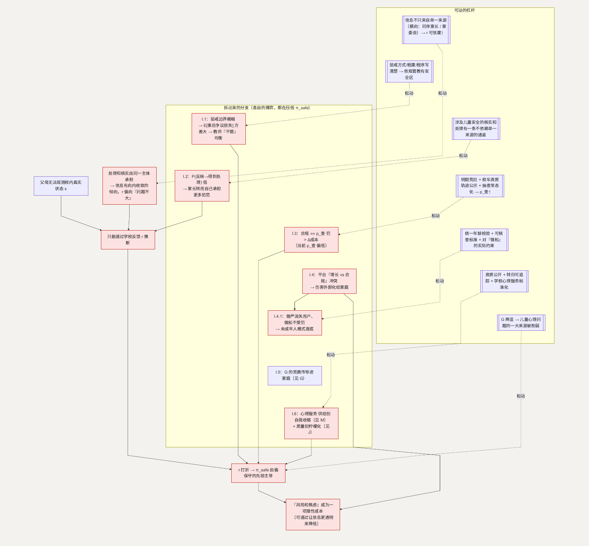

# I. 儿童安全：父母看不见学校里发生什么

**简单说：现代父母怕的不只是养不起，更怕“万一孩子出事，没人能及时接住”。**

传统上算养孩子的成本是奶粉、教育、医疗、住房。现代父母还在算一笔账：**风险和焦虑。** 第十一、十二类（条目 133–162）——校园欺凌、孩子的人身安全、教师管教的边界、反映的渠道、学业压力、青少年情绪问题、心理服务不足——核心是一个问题：**万一孩子遇到麻烦，能不能被及时接住。** 2024 年一项调查里 49% 的受访者希望有专门的校园欺凌治理规定，另一项以家长为主的调查里 62.9% 认为教师管教顾虑较多时，欺凌可能不能被及时制止。([zqb.cyol.com](https://zqb.cyol.com/html/2024-03/05/nw.D110000zgqnb_20240305_3-05.htm))

**这一节用到的记号：**

| 记号 | 含义 | 为什么这样定义 |
| --- | --- | --- |
| $s$ | 校内的真实状态（孩子是否安全、是否被欺凌） | 父母看不见，只能推断——委托-代理的信息缺口 |
| $r$ | 学校给家长的反馈 | 家长的信息几乎只有这一个来源 |
| $\pi_{safe}$ | 父母的安全信念 $= P(\text{孩子安全} \mid \text{观察到的信息})$ | $r$ 打折时，它由父母偏保守的先验主导 |
| $E[\text{事后争议的损失}]$ | 教师依规管教后仍可能引起争议的预期损失 | 它的**方差**大时，教师把管教强度压到接近零（I.1） |
| $P(\text{反映} \to \text{得到处理})$ | 家长对“通过正式途径反映会被认真对待”的主观概率 | 它低时家长转而自己承担更多防范（I.2） |
| $p_{\text{查}} \cdot \text{罚}$ vs $\Delta\text{成本}$ | 抽查发现概率×处罚 与 合规多花的成本 | 交通、食品这类可核查领域的监管—合规博弈（I.3） |

## 主博弈：委托-代理下的信息不对称

父母（委托人）每天把孩子交给学校（代理人）几小时到十几小时，无法直接观测校内的真实状态 $s$（是否安全、是否被欺凌），只能通过学校的反馈 $r$ 来推断。

在“充分沟通”与“低调处理”之间，有一层结构性的张力：一起事件如果被放大，短期声誉有成本；如果处理是充分的，信任是长期收益。当短期声誉压力在权衡里占得多，$r$ 就更可能偏向“问题不大”。父母预期到这种可能，会对 $r$ 打一个折扣：

> 父母的安全信念 $\pi_{safe} = P(\text{孩子安全} \mid \text{观察到的信息})$

当 $r$ 的可信度打了折，$\pi_{safe}$ 更多由父母自己的先验主导——而先验容易受个别负面新闻影响、偏保守。

## I.1 为什么“教师惩戒”会卡住

**这个子问题为什么存在。** 教育惩戒涉及教师、学生（及家长）、学校三方。当惩戒的“度”没有清晰、可操作的边界，任何一次惩戒都可能被事后争议。

**它自己的博弈。** 教师的收益 $=$ 维持秩序的价值 $- E[\text{事后争议的损失}]$。

| | 制度环境：惩戒边界清晰 | 制度环境：边界模糊 |
| --- | --- | --- |
| **教师依规管教** | 秩序好，教师风险可控 → 好均衡 | 秩序好，但教师承担事后争议的风险 |
| **教师不管** | 秩序差 | 秩序差，但教师个人风险最小 → **当前均衡** |

边界模糊时，$E[\text{事后争议的损失}]$ 的方差大，风险规避的教师把惩戒强度降到接近零（“多一事不如少一事”）。秩序失控又让家长不满、让欺凌难被制止——各方都更差。

**怎么优化这个子博弈。** 把惩戒的方式、程度、程序写清楚，给“依规管教”一个明确的安全区。$E[\text{事后争议的损失}]$ 的方差下降 → “管”重新进入教师的策略集。

**如何传导回大问题。** 课堂秩序恢复、欺凌能被及时制止 → 父母的 $\pi_{safe}$ 回升。

### 怎么移动主博弈的均衡

- 家长的信息不只来自单一来源（家校沟通之外，还有同伴家长、班级家委会等横向渠道）→ $r$ 的可信度上升 → $\pi_{safe}$ 回升。
- 心理健康：筛查—转介—能接住的资源链条补齐；**儿童精神科和心理咨询的供给能力是其中的瓶颈**（见 I.6）。
- [G](G-education.md) 降温 → 学业压力、缺觉、没有自由玩的时间减少 → 儿童心理问题的一大来源被削弱。

当父母相信“孩子遇到问题，能被认真对待”，这笔“风险和焦虑”的隐性成本才会小下来。

## I.2 涉及儿童安全的严重情形，家长最看重“反映了有没有用”（条目 140、144）

**这个子问题为什么存在。** 涉及儿童人身安全的严重情形相对少见，但一旦发生，家长最在意的是“反映上去之后，会不会被认真对待”。这是主博弈里 $r$ 可信度问题的一个更尖锐的版本。

**它自己的博弈。** 这仍是一个信念形成问题。家长愿不愿意通过正式途径反映，取决于他对“反映 → 得到处理”这条链条的主观概率。当处理和核实由同一个主体承担，信息容易向内收敛，这个主观概率就偏低——链条越不透明，家长越倾向于不走正式途径、转而自己承担更多的防范，$\pi_{safe}$ 也更多由偏保守的先验主导。

**优化的可行性与方向。** 如果涉及儿童安全的核实和处理，有一条不完全依赖单一来源的通道，家长对“反映有没有用”的预期会更稳定。这类机制怎么设计，属于校园安全的专门领域。

**如何传导回大问题。** 家长对“系统会认真对待”的预期上升 → $\pi_{safe}$ 回升。

## I.3 上下学交通与食品安全（条目 145–146）

**这个子问题为什么存在。** 这是相对独立、标准明确、可核查的领域。风险主要来自执行环节的松懈，而不是信息不对称。

**它自己的博弈。** 这更接近一个常规的监管—合规博弈。供给方（校车运营、供餐企业）选“合规”还是“压成本”：

> 合规 $\Leftrightarrow p_{\text{查}}$（被抽查发现的概率）$\cdot$ 罚 $> \Delta\text{成本}$（合规相对压成本多花的钱）

当前若 $p_{\text{查}}$ 偏低，压成本就是占优。

**优化的可行性与方向。** 可核查的明厨亮灶、校车资质与轨迹公示、抽查常态化 → 提高 $p_{\text{查}}$。落在监管执行，在允许范围内。

**如何优化 → 新均衡。** $p_{\text{查}} \cdot \text{罚} > \Delta\text{成本}$ → 合规成为占优。

**如何传导回大问题。** 这条相对独立的风险被压下去 → $\pi_{safe}$ 里这一块改善。

## I.4 网络霸凌、网络成瘾与儿童信息保护（条目 136、148–149）

**这个子问题为什么存在。** 风险发生在平台上，跨越了校园边界。而平台的收益函数（使用时长、互动量）与“减少对未成年人的伤害”并不一致。

**它自己的博弈。** 这是平台与未成年用户的委托—代理，叠加平台内部“增长 vs 合规”的冲突。平台的设计倾向于最大化参与度——沉迷机制、算法推荐、弱身份校验都是“增长占优”的选择，伤害被外部化给家庭。

**优化的可行性与方向。** 平台责任、未成年人模式的强制性和可核查性。落在平台监管，在允许范围内。

**如何优化 → 新均衡。** 见 I.4.1——当“做松”这条路被实际约束堵上，逐底竞争停止。

**如何传导回大问题。** 平台侧的伤害不再外部化 → 家庭承担的这块“风险和焦虑”下降。

### I.4.1 为什么“青少年模式”常形同虚设

**为什么。** 身份识别成本高、绕过容易，而平台没有强激励把它做严。

**它的博弈。** 如果做严的平台流失用户、做松的不受罚 → 逐底竞争，所有平台都把它做成摆设。

**怎么优化。** 统一的年龄校验基础设施 + 未成年人保护的可核查标准 + 对“做松”的实际约束（不是仅有条款）→ “做松”不再免费 → 打破逐底竞争。

**传导回大问题。** 青少年模式真正生效 → I.4 里“沉迷 / 不良信息”的暴露下降。

## I.5 亲子关系冲突（条目 156）

**这个子问题为什么存在。** G 的竞赛传进家庭——家长把竞赛压力转成对孩子的要求，亲子关系成为竞赛的一个受损面。**机制在 G，随 G 降温而缓解，此处不重复。**

## I.6 心理服务为什么总是“接不住”（条目 159–162）

**这个子问题为什么存在。** 主博弈的一个杠杆是“筛查—转介—能接住”的链条。现实是这条链条两端都薄：学校心理服务质量参差，能处理严重问题的儿童精神科供给不足。筛出了问题，却转不到能处理的地方。

**它自己的博弈。** 两个机制。供给侧：儿童精神科、心理咨询的执业吸引力问题，和 [M.2](M-city.md) 的儿科是同构的自我收缩——选的人少 → 在岗的负荷高 → 更不吸引人。质量侧：心理咨询的效果家长当场难判断 → 柠檬化（接 [J](J-childcare.md)），好机构难被识别、难维持。

**怎么优化这个子博弈。** 供给侧的方向见 M（提高执业吸引力、分级）；质量侧靠资质公开、干预过程和转归可追踪、学校心理服务有可核查的标准。

> **面向儿童青少年的心理健康服务，是一块需求快速上升、优质供给明显不足的领域。** 侧面看：需求明确的地方通常会有供给方进入，但因为质量难判断（柠檬结构），靠自发竞争容易停在低质量均衡——所以“资质和效果可核查”这一条，是让这个市场往上走的关键。

**如何传导回大问题。** 转介链条能真正接住 → $\pi_{safe}$ 里“出了事有人管”这一块回升。

---

## 拆出来的分支（图）

