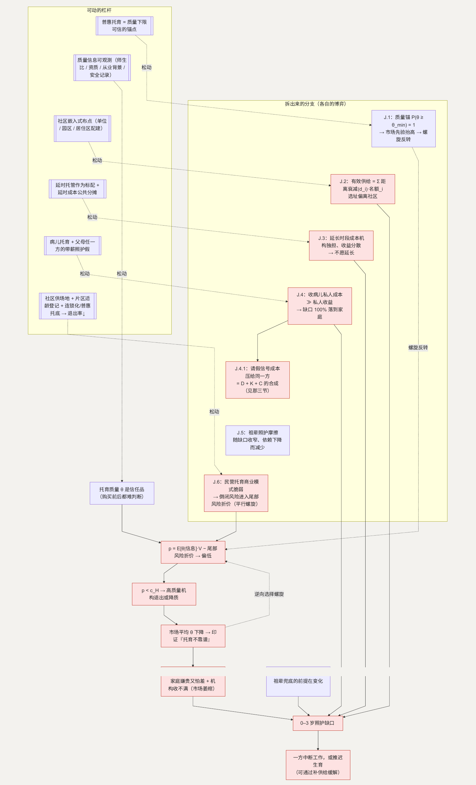

# J. 托育：一个“质量看不见”的市场

**简单说：不是没人想开托育机构，是“质量看不见”这件事，把整个市场往下压。**

第十四、十五类（条目 175–193）：0–3 岁没人带、普惠托育不足、贵、远、担心安全和质量，以及祖辈照护越来越不可持续。调查里出现的典型矛盾是：家庭嫌贵又担心质量，而一些机构同时收不满孩子。([Nopss](https://www.nopss.gov.cn/n1/2024/1227/c219544-40390722.html)) 这不是供需没对上，是**市场在萎缩**。

**这一节用到的记号：**

| 记号 | 含义 | 为什么这样定义 |
| --- | --- | --- |
| $\theta$ | 托育质量（信任品：买前买后都难判断） | 看不见质量，是柠檬市场的前提 |
| $c_H / c_L$ | 高质量 / 低质量机构的运营成本（$c_H > c_L$） | 决定“什么价位能养活什么质量” |
| $p$ | 家长愿付价 $= E[\theta \mid \text{可观测信息}] \cdot V - \text{尾部风险折价}$ | 信息少 → $E[\theta]$ 由保守先验主导 → $p$ 偏低 |
| $P(\text{高质量})$ | 家长心目中“随便挑一家是高质量”的概率 | 它低 → 愿付低 → 只有低质量存活 → 它更低（螺旋） |
| $\theta_{min}$ | 可信的质量下限 | 普惠托育提供 $P(\theta \ge \theta_{min}) = 1$ 的锚点，反转螺旋 |
| 距离衰减($d_i$) | 机构 $i$ 因距离远而对某家庭“打的折” | 有效供给 $= \sum \text{距离衰减}(d_i) \cdot \text{名额}_i$（J.2） |

## 主博弈：托育的柠檬市场

托育质量 $\theta$ 是**信任品**：购买前不可观测，购买后也难完全判断。市场里高质量机构成本 $c_H$、低质量 $c_L$，$c_H > c_L$。家长无法区分，只能按预期质量付费：

> 家长愿付 $p = E[\theta \mid \text{可观测信息}] \cdot V - \text{尾部风险折价}$

可观测信息少时，$E[\theta]$ 由偏保守的先验主导（受个别负面事件影响），加上尾部风险折价，$p$ 偏低。当 $p < c_H$，高质量机构难以为继、退出 → 市场平均 $\theta$ 下降 → $p$ 进一步下降 → 更多机构退出。**逆向选择螺旋。** 结果不是市场出清，而是收缩——“家庭嫌贵又怕差”和“机构收不满”同时成立。

祖辈照护的退出让缺口更紧。过去的均衡是祖辈兜底 0–3 岁，前提是祖辈有闲、身体好、观念一致；这些条件在变化（仍在工作、年纪渐长、两代人观念不同），研究显示祖辈劳动参与上升会挤掉带孙时间。([ScienceDirect](https://www.sciencedirect.com/science/article/pii/S0167268125003221)) 非正式照护退出 → 需求转向市场 → 但市场在螺旋里、接不住 → 一方（多为母亲）中断工作，或推迟生育。

## J.1 信任品市场为什么自我萎缩，“质量锚”如何打破它

**这个子问题为什么存在。** 在信任品市场里，卖方的质量承诺不可信（买方无法验证），“降低质量省成本”成为卖方的占优偏离——只要买方不能立即察觉。理性买方预期到这一点，把愿付价格压到只够低质量机构存活的水平，市场坍缩到低质量均衡。

**它自己的博弈。**

| | 买方：高愿付 | 买方：低愿付 |
| --- | --- | --- |
| **卖方：高质量** | 匹配（但买方因无法验证而不敢高愿付） | 高质量机构亏损退出 |
| **卖方：低质量** | 买方被坑 | 低质量均衡 → 印证“托育不靠谱” |

买方无法区分 → 按 $P(\text{高质量})$ 定价 → $P(\text{高质量})$ 低 → 买方低愿付 → 只有低质量存活 → $P(\text{高质量})$ 更低。

**怎么打破。** 引入一个“质量下限可信”的选项：普惠托育，其质量由公开标准和可核查信息（师生比、人员资质、可查的从业背景、安全记录）背书。这相当于给市场一个 $P(\theta \ge \theta_{min}) = 1$ 的锚点。买方对整个市场的质量先验被抬高 → 愿付价格回升 → 私营高质量机构也能在这个价格上存活 → 逆向选择螺旋反转。

**如何传导回大问题。** 市场从收缩转为扩张 → 0–3 岁照护缺口收窄 → 一方不必因此中断工作（接 [D](D-interruption.md)）、家庭不必完全依赖祖辈。

## J.2 机构距离太远（条目 178）

**这个子问题为什么存在。** 托育机构的选址按租金、客流、合规空间来优化，没有一个主体在优化“相对家庭日常动线”的布局。而 0–3 岁托育对距离极其敏感——一天两趟、抱着孩子、可能一天多次往返。

**它自己的博弈。** 这是 [M](M-city.md) 的动线协调失败在托育上的特例：

> 家庭有效可用托育供给 $= \sum \text{距离衰减}(d_i) \cdot \text{名额}_i$

$d$ 大的机构，对家庭近似“不存在”。机构不承担 $d$ 产生的家庭成本 → 选址系统性偏离社区。于是“名义名额”和“有效可用名额”之间有一个缺口，前者收不满、后者仍短缺。

**优化的可行性与方向。** 社区嵌入式布点——单位、园区、居住区配建（接 M 的配建标准）。落在公共服务和城市规划，在允许范围内。

**如何优化 → 新均衡。** 托育点进入社区动线 → 距离衰减($d_i$) 趋近 1 → 有效可用供给上升。

**如何传导回大问题。** 缺口按“有效可用”而非“名义名额”收窄，主博弈的螺旋反转更实在。

## J.3 上下班和托育时间不匹配（条目 179）

**这个子问题为什么存在。** 托育机构的运营时段按员工工时和成本来定，家长的需求时段按“通勤 + 工时”来定，两者不重合。这是 [C](C-time.md) 的工时错配在托育上的复制。

**它自己的博弈。** 机构延长时段的成本（加班工资、排班）由机构独担，收益（接住晚接的家庭）分散，所以机构不愿延长。缺口落到家庭（一方早退 / 请假）或祖辈。

**优化的可行性与方向。** 延时托管作为普惠托育的标配 + 延时成本的公共分摊。在允许范围内。

**如何优化 → 新均衡。** 托育时段覆盖到“家长通勤到家” → 缺口被机构侧接住。

**如何传导回大问题。** D 主博弈二里“必须有人早退接孩子”的压力下降 → 分工不被这一项单向拖偏。

## J.4 孩子生病，托育解决不了（条目 185）

**这个子问题为什么存在。** 普通托育机构出于交叉感染和责任考虑不收病儿，而孩子在托育期高频生病。这是供给缺口叠加责任规避。

**它自己的博弈。** 机构收病儿的私人成本（其他家长投诉、责任、隔离条件）远大于私人收益 → 不收是占优 → 病儿照护缺口 100% 落到家庭。

**优化的可行性与方向。** 病儿托育（独立设置或家庭式）+ 父母任一方的带薪照护假（接 C），两条并行。在允许范围内。

**如何优化 → 新均衡。** 病儿缺口有外部承接 → 不再全额压给家庭。

### J.4.1 为什么这个缺口几乎总是压给同一方

**为什么。** 临时请假的“信号成本”，更多由已经被认为“会因育儿而中断”的一方承担（接 D 主博弈一），再加上 [K](K-body.md) 的 $\alpha_w \approx 1$ 和 C 的育儿假均衡，“孩子病了谁请假”往往有一个默认答案。

**它的博弈。** 这不是 J 内部的独立博弈，是 D、K、C 的合成结果。**机制在那三节展开**——病儿托育和双向可用的照护假，是把这个默认答案打散的两个外部杠杆。

## J.5 隔代教育观念冲突（条目 190、193）

**这个子问题为什么存在。** 祖辈照护是“零价格但附带发言权”的服务，两代人育儿观念不同 → 家庭内协调摩擦。

**它自己的博弈。** 随社会化托育占比上升，家庭对祖辈照护的依赖下降，这个协调博弈的发生频率自然降低。**机制并入主博弈——缺口收窄，依赖减少，摩擦随之减少。**

## J.6 托育机构为什么“说关就关”（条目 184）

**这个子问题为什么存在。** 家长在 $p$ 里扣的“尾部风险折价”，一大块来自“这家会不会突然倒闭”。民营托育的商业模式本身脆弱：每个家庭只用两三年、需求快速流转，前期投入重，现金流不稳。

**它自己的博弈。** 高退出率和主博弈的螺旋叠加：机构脆弱 → 说关就关 → 家长把“倒闭风险”计入尾部风险折价 → $p$ 下降 → 更多机构撑不住 → 退出率更高。这是主博弈的螺旋多了一条平行的正反馈。

**怎么优化这个子博弈。** 降低单点脆弱性：社区提供场地降低启动成本、片区适龄儿童登记让需求可预测、连锁化和普惠机构托底减少“整片没得选”的风险。这些让机构的生存不那么依赖满员率，退出率下降。

**如何传导回大问题。** 倒闭风险下降 → 尾部风险折价缩小 → $p$ 回升，和质量锚一起推动螺旋反转。

---

## 拆出来的分支（图）

