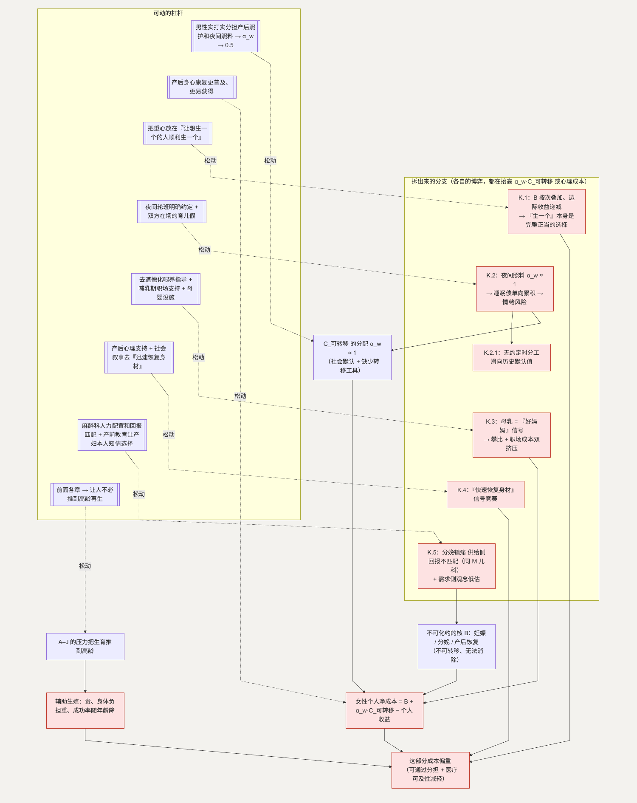

# K. 身体成本：一个不可转移的核，加上可以重新分配的外圈

**简单说：怀孕生产这份身体代价，是全文唯一一个没法转移给别人扛的成本——但围绕它，还是有能做的事。**

第十六类（条目 194–208）和别的章节不一样。前面的困局大多是“规则变了就能松”，但生育的身体付出有一个**不可化约的核** $B$：妊娠反应、并发症、分娩的疼、产后恢复、盆底问题、产后情绪问题、睡眠不足。$B$ 转移不给任何人，也没有办法抹掉。这是全文唯一一个不是“博弈失灵”、而是真实且不可转移的个人成本——但围绕它，仍有可以做的事。

**这一节用到的记号：**

| 记号 | 含义 | 为什么这样定义 |
| --- | --- | --- |
| $B$ | 身体付出里不可转移、无法消除的核（妊娠、分娩、产后恢复） | 全文唯一不是“博弈失灵”的成本——只能承认，不能优化掉 |
| $C_{\text{可转移}}$ | 可在家庭内重新分配的部分（照护、家务、收入损失、夜间照料） | 它才是这一节能移动的对象 |
| $\alpha_w / \alpha_h$ | $C_{\text{可转移}}$ 里落在她 / 他头上的份额（$\alpha_w + \alpha_h = 1$） | 现状 $\alpha_w \approx 1$；目标是推向 0.5 |
| 女性个人净成本 | $= B + \alpha_w \cdot C_{\text{可转移}} -$ 个人收益 | 她在生育决策里实际计入的负担 |
| $B_n$ | 第 $n$ 胎的身体成本 | 按次叠加、随年龄上升——“生一个”和“生多个”是不同决策（K.1） |
| 情绪风险 | $= f(\text{累积睡眠债}, \text{社会支持}, \text{激素})$ | 前两项可干预（K.2） |

## 主博弈：可转移成本的家庭内分配

生育的总成本可以拆成两块：

$$\text{总成本} = B\ (\text{不可转移}) + C_{\text{可转移}}\ (\text{照护、家务、收入损失、夜间照料})$$

$C_{\text{可转移}}$ 在夫妻之间的分配记作 $(\alpha_w, \alpha_h)$，$\alpha_w + \alpha_h = 1$。现状是 $\alpha_w \approx 1$——研究显示成为母亲后这些几乎全落在母亲头上，父亲受到的影响小得多。([ScienceDirect](https://www.sciencedirect.com/science/article/pii/S0167268125003609))

一个理性的女性在生育决策里计入的个人成本是：

$$\text{女性个人净成本} = B + \alpha_w \cdot C_{\text{可转移}} - \text{个人收益}$$

当 $\alpha_w \approx 1$，这个数约等于 $B + C_{\text{可转移}}$——她几乎独自承担了这两块。$\alpha_w$ 之所以接近 1，是因为传统分工（照护配女性，接 [D](D-interruption.md)）加上缺少把 $C_{\text{可转移}}$ 转过去的工具（男女对称的育儿假还不普遍，接 [C](C-time.md) 的子博弈）。**这两条都是可以调整的。**

### 怎么移动均衡

- 承认 $B$ 不可消除，但把 $C_{\text{可转移}}$ 真正转移和分担：$\alpha_w \to$ 更接近 0.5。工具是男性实打实参与产后照护和夜间照料，收入损失不由一个人扛。
- 生育相关的医疗（分娩镇痛、产后身心康复）更普及、更容易获得 → 降低“疼痛和恢复没人当回事”的孤立感。
- 高龄的问题：前面所有这些压力把生育一推再推 → 生育窗口后移 → 不孕不育、辅助生殖需求上升，而它贵、身体负担重、成功率随年龄下降。这是 A–J 的下游后果，真正的解在前面各章——让人不必推到高龄。

## K.1 “生一个”和“生多个”为什么是完全不同的决策

**这个子问题为什么存在。** $B$ 是**按次叠加**的——每一胎都要重新经历一遍妊娠、分娩、产后恢复，而且随年龄增长 $B$ 还会上升。很多支持性讨论把“二孩三孩”当作“一孩”的线性延伸，这与成本结构不符。

**它的模型。** 女性对第 $n$ 胎的决策：

> 生第 $n$ 胎 $\Leftrightarrow E[\text{第 } n \text{ 胎的个人收益}] > B_n + \alpha_w \cdot C_{\text{可转移}, n}$

$B_n$ 在每一胎几乎不变甚至上升，而边际收益 $E[\text{第 } n \text{ 胎收益}]$ 递减（已经体验过为人父母、家庭规模的效用递减）。所以对多数人，$n = 1$ 可能过线，$n \ge 2$ 不过线。

**怎么优化。** 这个子问题的“解”不是劝人多生，而是承认“生一个”是一个完整、正当的选择（接 [A](A-autonomy.md)）。当话语和支持的重心放在“让想生一个的人能顺利生一个”，而不是“让生一个的人生两个”，与个体的成本结构一致。

**如何传导回大问题。** 不把“多生”当成隐性目标 → 减少 A 的规范压力 → “生一个”的决策也更从容。

## K.2 睡眠不足与产后情绪问题（条目 201–202）

**这个子问题为什么存在。** 夜间照料是 $C_{\text{可转移}}$ 里最不可延迟、最密集的一项——每两三个小时一次，持续数月。产后情绪问题与睡眠剥夺、激素变化、社会支持不足相互作用。

**它自己的博弈。** 夜间照料的分配，是一个“谁承担一次性醒来的边际成本”的博弈。若默认由哺乳一方承担（即使非母乳也常如此），夜间那块的 $\alpha_w \approx 1$：

> 情绪风险 $= f(\text{累积睡眠债}, \text{社会支持}, \text{激素})$，前两项可干预

睡眠债单向累积 → 情绪风险上升 → 照护能力下降 → 更需要对方补位，但惯性已经形成。

**优化的可行性与方向。** 家庭内的夜间轮班约定（瓶喂 / 挤奶储备）+ 双方在场的育儿假（接 C）；

- 产后情绪的筛查和支持（公共 / 医疗服务）。在允许范围内。

**如何优化 → 新均衡。** 夜间那块的 $\alpha_w$ 从 $\approx 1$ 下降 → 累积睡眠债下降 → 情绪风险回落。

**如何传导回大问题。** 主博弈的 $\alpha_w \cdot C_{\text{可转移}}$ 和这项心理成本同时下降。

### K.2.1 为什么“非母乳喂养也常由母亲夜间照料”

**为什么。** 观念默认 + 哺乳期形成的惯性 + 对方“次日上班优先睡眠权”被视为理所当然。

**它的博弈。** 这是一个家庭内的默认规则问题：在没有明确约定时，分工滑向历史默认值。**优化**：把夜间轮班写成明确约定（谁哪几天、瓶喂如何准备），再加上产后头几个月两人都在育儿假上——当“两个人都在场”成为起点，默认值就不再是“母亲全包”。

**传导回大问题。** 夜间 $\alpha_w$ 更接近 0.5，直接松动 K.2。

## K.3 母乳喂养压力（条目 203）

**这个子问题为什么存在。** 喂养方式被道德化（“母乳才是负责任的”），叠加职场哺乳条件不足，形成两头挤压。

**它自己的博弈。** 这是一个规范 + 信号博弈。母乳喂养成为“好妈妈”的可观测信号 → 家长之间攀比（多元无知）→ 达不到的一方（奶水不足、返岗、疾病）承担污名。同时职场缺少哺乳时间和空间，让坚持母乳的成本更高。

**优化的可行性与方向。** 去道德化的喂养指导（专业上强调“充分喂养”而非“必须母乳”）

- 哺乳期职场支持（接 [D.2](D-interruption.md)）+ 母婴设施（接 [M](M-city.md)）。在允许范围内。

**如何优化 → 新均衡。** 信号权重下降 + 职场成本下降 → 这项压力从 $C_{\text{可转移}}$ 和心理成本两侧同时减小。

**如何传导回大问题。** 养育初期的一项高频压力被拆掉，$\alpha_w \cdot C_{\text{可转移}}$ 进一步收窄。

## K.4 身体形态变化的心理压力（条目 204）

**这个子问题为什么存在。** 社会叙事对“产后迅速恢复身材”的期待，把一个正常的生理过程变成一项需要额外投入（时间、金钱、自我评价）的任务。

**它自己的博弈。** 这是地位信号博弈的又一例。“快速恢复”成为可见信号 → 攀比 → 未达标者承担自我评价成本。名人和平台内容放大了这个基准。

**优化的可行性与方向。** 产后心理支持 + 社会叙事去“迅速恢复身材”（平台内容、公共传播）。在观念层面，可操作。

**如何优化 → 新均衡。** 基准回落 → 这项自我评价成本下降。

**如何传导回大问题。** 生育的心理成本一侧减小。

## K.5 分娩镇痛为什么普及得慢（条目 197）

**这个子问题为什么存在。** 主博弈的一个杠杆是“分娩镇痛更容易获得”。它的可及性长期偏低——$B$ 不可消除，但“疼痛且没人当回事”这层可以不那么孤立。

**它自己的博弈。** 供给侧：分娩镇痛需要麻醉医生在产程中较长时间值守，而麻醉科人力本就紧张，这项工作的投入和它得到的回报不匹配 → 医院和医生缺乏提供动力（和 [M.2](M-city.md) 的儿科同构）。需求侧：“生孩子哪有不疼的”这类观念，加上分娩时常由家属代为决策，让产妇本人的需求被低估。

**怎么优化这个子博弈。** 供给侧提高这项工作的人力配置和回报匹配（其中收费定价属制度层面）；需求侧靠产前教育让产妇本人知情、可以预先选择。

**如何传导回大问题。** 可及性上升 → $B$ 里“疼痛且孤立”的体验减轻 → 生育的身体成本虽不能消除，但更可承受。

---

## 拆出来的分支（图）

