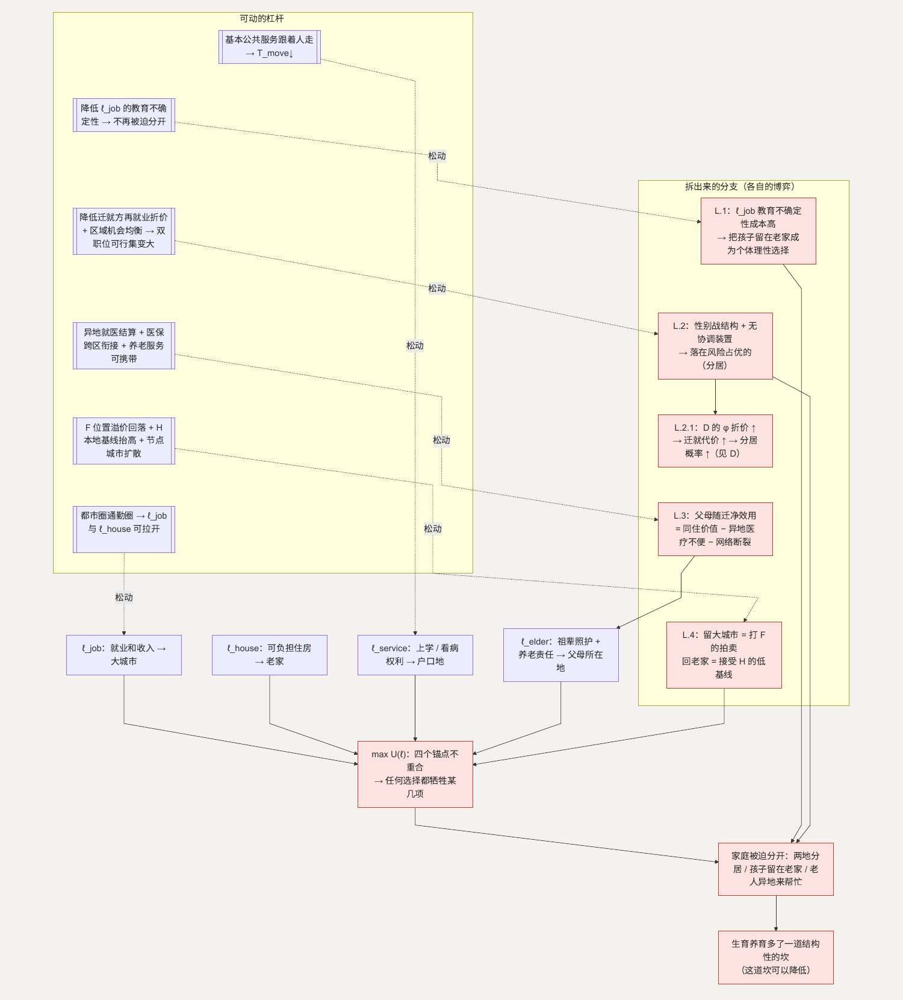

# L. 区位：三代人需要的资源，绑在不同的地方

**简单说：工作在哪、孩子在哪上学、父母在哪养老，常常不是同一个地方——一家人被这几件事拉向不同方向。**

第二十一类（条目 252–260）：工作城市和户口地不一致、孩子在哪上学、父母在哪养老、夫妻可能在不同城市工作、回老家机会少 / 留大城市房价高。国家 2024 年人口与家庭发展调查已经把“迁移流动经历”列为影响婚育行为的重要内容，与就业、收入、住房、生育、养育、教育一起调查。([National Bureau of Statistics of China](https://www.stats.gov.cn/fw/bmdcxmsp/bmzd/202501/t20250126_1958471.html))

**这一节用到的记号：**

| 记号 | 含义 | 为什么这样定义 |
| --- | --- | --- |
| $\ell$ | 家庭选的落脚点 | 决策变量 |
| $\ell_{job} / \ell_{house} / \ell_{service} / \ell_{elder}$ | 就业、可负担住房、孩子上学看病、祖辈养老 各自最优的地点 | 这四个“锚点”在空间上不重合，是本节的根本约束 |
| $U(\ell)$ | $= w(\ell) + h(\ell) + s(\ell) + e(\ell) -$ 分居成本 | 四项分别对应四个锚点的满足程度 |
| $T_{move}$ | 举家搬迁的成本（主要是孩子换地上学的代价） | 它高 → 家庭被迫分开 |
| 教育不确定性成本 | 在 $\ell_{job}$ 让孩子上学，学位/连续性/费用的不确定 | 它高 → “把孩子留在老家”的不等式成立（L.1） |

## 主博弈：多目标、没有占优解的选址

家庭要选一个落脚点 $\ell$，但需要的资源在空间上是割裂的：

- 就业和收入 → 大城市 $\ell_{job}$
- 可负担住房 → 老家 / 小城市 $\ell_{house}$
- 孩子上学、看病的权利 → 户口地 $\ell_{service}$
- 祖辈照护 + 养老责任 → 父母所在地 $\ell_{elder}$

家庭效用 $U(\ell) = w(\ell) + h(\ell) + s(\ell) + e(\ell) -$ 分居成本。这是一个约束优化，约束是“这四个锚点在空间上不重合”。**锚点越分散，$\max U(\ell)$ 越低——任何一种选择都要牺牲某几项。**

### 两个子结构

**夫妻区位协调（协调博弈）。** 夫妻在不同城市有工作机会：

| | 一方去 A | 一方留 B |
| --- | --- | --- |
| **另一方去 A** | 需选一个 → 迁就的一方职业受损 | 分居 → 很难同时养育孩子 |
| **另一方留 B** | 分居 | 需选一个 → 迁就的一方职业受损 |

两个非分居均衡都优于分居，但“谁迁就”有分配上的冲突。由于 [D](D-interruption.md)，迁就一方的职业损失可能不小，“谁迁就”并不好谈。

**公共服务与户口地绑定，抬高了举家搬迁的成本。** 孩子的上学、看病权利在 $\ell_{service}$。家庭若迁到 $\ell_{job} \ne \ell_{service}$，要么把孩子留在 $\ell_{service}$，要么承受 $\ell_{job}$ 的服务不确定。举家搬迁成本 $T_{move}$ 高 → 家庭被迫分开（两地分居 / 孩子留在老家 / 老人异地来帮忙）。

### 怎么移动均衡

- “人在哪儿，基本公共服务就在哪儿” → $\ell_{service}$ 跟着人走 → $T_{move}$ 下降 → 家庭不必为孩子上学而拆开。
- 老人异地看病更方便 → $\ell_{elder}$ 的约束松动，祖辈可以随迁。
- 都市圈通勤圈 → $\ell_{job}$ 和 $\ell_{house}$ 的距离可以拉开而不牺牲太多，“住得稍远、在中心城市上班”可行。
- 优质就业和公共服务向节点城市适度扩散 → 降低 $\ell_{job}$ 的空间集中度（接 [F](F-housing.md)、[H](H-inequality.md)）。

## L.1 为什么“把孩子留在老家”会成为一个理性选择

**这个子问题为什么存在。** 当 $\ell_{job} \ne \ell_{service}$ 且 $T_{move}$ 高，家庭面对一个权衡：

> 带孩子随迁 $\Leftrightarrow$ 一家人在一起的价值 $- \ell_{job}$ 的教育不确定性成本 $> T_{move}$

当 $\ell_{job}$ 的教育不确定性成本高（学位、连续性、成本都不确定），不等式不成立 → 把孩子留在 $\ell_{service}$ 由老人照看。

**它的博弈性质。** 这是一个“个体理性但整体次优”的均衡——父母在 $\ell_{job}$ 工作、孩子在 $\ell_{service}$ 上学、老人照看。代价是一家人分开生活（对孩子的影响，接 [I](I-child-safety.md)）加老人的负担（接 [J](J-childcare.md)）。

**怎么优化。** 降低 $\ell_{job}$ 的教育不确定性——让随迁子女在常住地上学的确定性提高。不等式重新成立 → 孩子随迁 → 这个“分开”的选择不再是被迫的。

**如何传导回大问题。** 家庭可以完整地在一个地方生活 → 生育不再需要“接受一段分开生活”作为前提。

## L.2 夫妻长期分居（条目 255–256）

**这个子问题为什么存在。** 这是主博弈第一个子结构——夫妻区位协调博弈——停在了最差的那个格子。分居本是三个结果里最差的，但当“谁迁就”谈不拢，它成为无法达成协调时的默认结果。

**它自己的博弈。** 把上面的 2×2 展开：(都在 A)、(都在 B) 两个非分居结果都优于 (分居)，但双方偏好不同的那一个——这是“性别战”（battle of the sexes）结构。当双方都不愿做让步方，又缺少一个协调装置，博弈落在风险占优的 (分居)：各自保住自己的工作。

**优化的可行性与方向。** 一是降低迁就方的再就业折价（接 D 的可信凭证补偿）；二是区域就业机会适度均衡，让“两人在同一城市各有合适工作”的可行集变大（接 H）。在允许范围内。

**如何优化 → 新均衡。** 迁就的代价下降 + 双职位可行集变大 → 协调博弈更容易落在某个非分居结果。

**如何传导回大问题。** 主博弈里“分居”这条路被压缩 → 家庭在同一地点生活的概率上升。

### L.2.1 为什么迁就方的损失这么大

**为什么。** 因为 D 的 $\phi$ 机制——一段随配偶迁移造成的职业中断被读作“低承诺”信号 → 迁就方在新城市的再就业折价。

**它的博弈。** 这不是 L 内部的独立博弈，是 L 与 D 的耦合：D 的信号折价越大，L 的“谁迁就”越难谈，越容易掉进分居。**机制在 D 展开**——这里只标出这条耦合链路：D 的 $\phi$ 折价 ↑ → L 的协调越难 → 分居概率 ↑。

## L.3 父母养老在异地（条目 254）

**这个子问题为什么存在。** 这是 $\ell_{elder}$ 约束。父母的养老和就医资源在原籍，子女的工作在迁入地。子女要么两地奔波，要么把父母接来——但父母的医保、社交、熟悉环境都在原籍。

**它自己的博弈。** 这是一个“照护责任 vs 迁移成本”的个体决策，叠加异地就医结算的摩擦：

> 父母随迁的净效用 $=$ 与子女同住的价值 $-$ 异地医疗的不便 $-$ 社会网络断裂

异地医疗不便越大，父母越倾向留原籍 → 子女的双向照护（接 [B.4](B-certainty.md)）压力越大。

**优化的可行性与方向。** 异地就医结算、医保跨区衔接、养老服务的可携带性。落在公共服务的衔接，在允许范围内。

**如何优化 → 新均衡。** 异地医疗不便下降 → $\ell_{elder}$ 约束松动 → 主博弈的锚点少一个。

**如何传导回大问题。** $\max U(\ell)$ 抬高——同一个落脚点能同时满足的需求更多。

## L.4 回老家机会少 vs 留大城市房价高（条目 257–258）

**这个子问题为什么存在。** 这是 $\ell_{job}$ 和 $\ell_{house}$ 在个人层面的正面冲突——两个锚点方向相反，且都比较刚性。

**它自己的博弈。** 它其实是 F（位置拍卖）和 H（资源集中）在区位选择上的投影：留大城市 = 参加 F 的全支付拍卖；回老家 = 接受 H 的本地基线更低。个人是在两个已经分析过的陷阱之间选一个。

**优化的可行性与方向。** 不是 L 内部的独立杠杆——靠 F 的位置溢价回落 + H 的本地基线抬高

- 节点城市扩散（让 $\ell_{job}$ 和 $\ell_{house}$ 的落差本身变小）。

**如何优化 → 新均衡。** 两难的两端都不再那么极端 → 家庭有中间解（节点城市）可选。

**如何传导回大问题。** 区位选择从“二选一的陷阱”变成“有梯度的选择”。

---

## 拆出来的分支（图）

