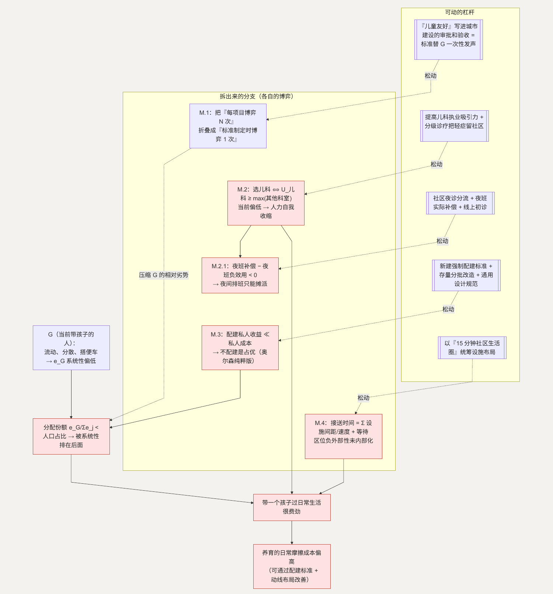

# M. 城市环境：谁替带孩子的人说话

**简单说：一个对孩子友好的城市，标准很朴素——带娃过日子不该那么费劲，可现在多数城市还没做到。**

第二十类（条目 242–251）：社区没有儿童活动空间、公园远、找不到母婴室、婴儿车过不去、带孩子挤公交难、儿童医院拥挤、夜间儿科难找、托育幼儿园社区医院分散、家长每天像跑接力。一个“生育友好”的社会，标准很朴素：**带一个孩子过日常生活，不该特别费劲。**

**这一节用到的记号：**

| 记号 | 含义 | 为什么这样定义 |
| --- | --- | --- |
| $G$ | “当前正在带孩子的人”这个群体 | 儿童友好设施的受益者——但它流动、分散 |
| $e_i$ | 群体 $i$ 为影响资源分配投入的“发声努力” | 资源份额 $\approx e_i / \sum e_j$（发声博弈） |
| $N$ | 需要单独争取的建设项目数 | $G$ 每个项目都要博弈一次、次次吃亏（M.1） |
| $U_{\text{儿科}}$ | 医生选择儿科相对其他科室的效用 | 系统性偏低 → 人力自我收缩（M.2） |
| 每日接送成本 | $= \sum$ 相邻设施间距/移动速度 $+$ 各设施等待时间 | 分散选址让第一项偏大（M.4） |
| 配建私人收益/私人成本 | 运营方建母婴室等设施的收益 / 占用可租售面积的成本 | 前者 ≪ 后者 → 不配建是占优（M.3） |

## 主博弈：分散受益 vs 集中利益

儿童友好设施是一种局部公共品，受益者是“当前正在带孩子的人”——记作群体 $G$。城市空间和预算的分配可以看成一个发声博弈：各群体投入“发声努力” $e_i$ 来影响分配，

> 群体 $i$ 得到的资源份额 $\approx e_i / \sum e_j$

$G$ 有几个特征让它的 $e$ 系统性偏低：人数不少，但每个人处在这个阶段的时间短（孩子长大就退出）、彼此不认识、搭便车激励强。于是 $G$ 组织不起有效的集体发声，儿童友好设施的分配份额低于它按人口占比应得的份额——**被系统性排在后面。**

这是奥尔森问题：小而分散的利益，通常干不过大而集中的利益。

## 子结构：动线协调失败

托育、幼儿园、社区医院、儿童活动空间各自选址，每个选址单独看都优化了自己的目标，但没有一个主体在优化“这些设施相对一个家庭日常动线的整体布局”。家庭的每日接送成本 = Σ 各设施之间的距离和时间。分散选址 → 接送成本高（接 [C](C-time.md) 的时间贫困）。

## M.1 为什么“配建标准”能替代“发声”

**这个子问题为什么值得单独看。** 在奥尔森框架里，分散群体的困难是无法把个体收益聚合成集体行动。每个建设项目都要 $G$ 单独去争取一次，而 $G$ 每次都因组织成本高而输。

**它的博弈变化。** 把儿童友好的配建要求写进建设项目的审批和验收环节，等于把“每个项目博弈一次”（$N$ 次，$G$ 次次吃亏）折叠成“标准制定时博弈一次”（1 次，可以由专业群体加一次性的公众参与完成）。博弈频率从 $N$ 降到 1，$G$ 的相对劣势被大幅压缩——**标准替分散的受益者一次性发了声。**

**如何传导回大问题。** 儿童友好设施的供给份额回到接近人口占比 → 带一个孩子的日常摩擦成本下降。

## M.2 儿童医院拥挤、夜间儿科难找（条目 249–250）

**这个子问题为什么存在。** 儿科的供给能力（医生数量、夜间排班）相对需求长期偏紧。一个原因是儿科相对其他科室的执业吸引力偏低——工作强度大、纠纷风险高、收入结构偏弱——人员流入不足，供给刚性。

**它自己的博弈。** 这是一个劳动力配置博弈，结构与 [J](J-childcare.md) 的柠檬螺旋类似，只是发生在人力供给侧：

> 选儿科 $\Leftrightarrow U_{\text{儿科}} \ge \max(\text{其他科室的 } U)$，当前 $U_{\text{儿科}}$ 系统性偏低

选儿科的人少 → 现有儿科医生负荷更高 → 更不吸引人 → 自我强化的收缩。

**优化的可行性与方向。** 提高儿科执业吸引力（职业发展、风险分担、收入结构方向），加上分级诊疗把轻症留在社区。落在医疗服务供给，在允许范围内（谈方向，不谈具体定价）。

**如何优化 → 新均衡。** $U_{\text{儿科}}$ 回升 → 人力供给的收缩被止住 → 负荷回到可持续区间。

### M.2.1 为什么夜间儿科尤其难

**为什么。** 夜间是需求高峰（孩子发烧多在夜间），却遇上夜班的额外负效用，而夜班补偿不足以覆盖。

**它的博弈。** 医生对夜班的接受度取决于 夜班补偿 $-$ 夜班负效用，当前这个差值为负 → 夜间排班只能靠摊派，服务质量和连续性都难保证。**优化：** 社区夜诊分流轻症 + 夜班的实际补偿到位 + 线上问诊做初步分诊。

**传导回大问题。** 夜间这条最尖锐的缺口被拓宽 → 家庭“孩子半夜发烧没处去”的焦虑成本下降（接 [B.3](B-certainty.md) 的尾部、[I](I-child-safety.md) 的 $\pi_{safe}$）。

## M.3 母婴室、无障碍、婴儿车通行（条目 246–248）

**这个子问题为什么存在。** 这些是“事后加装成本远高于事前配建成本”的设施。存量建筑和交通系统建成时没有把带孩子出行纳入设计，改造受空间和产权限制。

**它自己的博弈。** 这是主博弈（奥尔森）的一个纯粹版本：每一个具体的母婴室都要 $G$ 单独去争取，而 $G$ 争取不动。同时，开发或运营方在建设时，配建母婴室的私人收益（少数用户）远小于私人成本（占用可租售面积）→ 不配建是占优。

**优化的可行性与方向。** 新建项目的强制配建标准（接 M.1）+ 存量的分批改造

- 通用设计规范。落在城市建设标准，在允许范围内。

**如何优化 → 新均衡。** 新增供给按标准自动到位、存量逐步补 → $G$ 不必逐个争取。

**如何传导回大问题。** 日常出行的摩擦成本下降，且不再依赖分散群体的发声能力。

## M.4 分散布局带来的接送负担（条目 251）

**这个子问题为什么存在。** 这就是主博弈的“子结构：动线协调失败”——托育、幼儿园、社区医院、活动空间各自选址，没人优化相对家庭动线的整体布局。

**它自己的博弈。**

> 家庭每日接送时间 $= \sum$ 相邻设施间距 / 移动速度 $+$ 各设施等待时间

分散选址让第一项系统性偏大。根子是“设施区位的负外部性没有内部化”——每个设施的选址决策，不承担它给家庭动线增加的时间成本。

**优化的可行性与方向。** 以社区生活圈（如“15 分钟”）为单位，统筹托育、幼儿园、社区医疗、儿童活动空间的布局。落在城市规划，在允许范围内。

**如何优化 → 新均衡。** 设施进入同一个生活圈 → 接送时间那一项下降。

**如何传导回大问题。** 接 C 的时间贫困缓解一块——家庭每天省下的时间可以回到陪伴和休息。

---

## 拆出来的分支（图）

