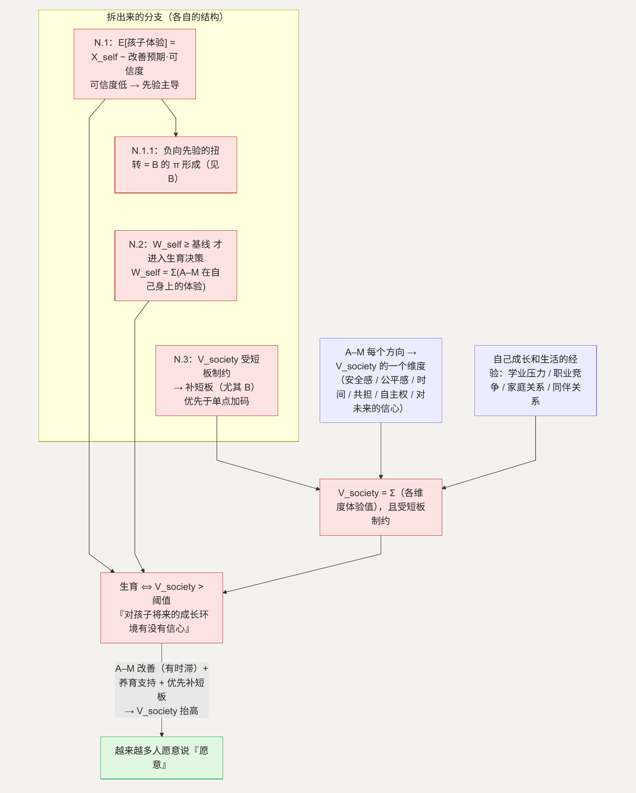

# N. 所有困难加起来，是一个总体判断

**简单说：前面所有困难加起来，最后都会变成一句自问——“我的孩子将来，会不会过得比我从容？”**

第十八、二十三类（条目 222–230、271–280）不太好用人口学指标测量。它们是一串成长中的经历（学业压力、职业竞争、家庭关系、同伴关系、资源紧张）加一串自我评估（我的生活过得好吗、我对未来有期待吗、这个社会对普通人是否便利、努力和回报是否相称）。这一节是前面 A–M 的加总。

**这一节用到的记号：**

| 记号 | 含义 | 为什么这样定义 |
| --- | --- | --- |
| $V_{society}$ | 个体对“孩子将来的成长环境”的总体信心 | 生育 $\Leftrightarrow V_{society} >$ 阈值；它是 A–M 各维度的合成 |
| 各维度体验值 | 安全感、公平感、时间、共担、自主权、对未来的信心… | 每个维度对应 A–M 的一节，欠一样就把 $V_{society}$ 拉低一点 |
| $X_{self}$ | 个体自己成长和生活的经验值 | 用作 $V_{society}$ 的先验（N.1） |
| 改善的可信度 | 个体相信“这些方向确实在往好里走”的程度 | 低时先验 $X_{self}$ 主导——这正是 [B](B-certainty.md) 的 $\pi$（N.1） |
| $W_{self}$ | 个体对自己当下生活的评价 | $W_{self} \ge$ 基线 才会进入生育决策（N.2） |
| min(各维度) | 最弱的那个维度 | $V_{society}$ 受短板制约，不是简单加总（N.3） |

## 这一节的“模型”：一个总体评价

个体的生育决策可以写成：

> 生育 $\Leftrightarrow V_{society}$（对“孩子将来的成长环境”有多少信心）$>$ 阈值

而 $V_{society}$ 是基于个体**自己成长和生活的经验**估计的。A–M 每个方向都对应 $V_{society}$ 的一个维度，每一样的欠缺都把它往下拉：

> $V_{society} = \sum$（各维度的体验值）：安全感、公平感、时间、共担、自主权、对未来的信心…

当 $V_{society}$ 偏低，“对孩子将来的成长环境有没有信心”这个判断就偏于保守。它不是经济账，是对成长环境的一个总体信心。

N 没有独立的杠杆——它的解就是 A–M 的解：每改善一个方向，$V_{society}$ 抬高一点。只是有一个时滞：今天的改善，要等这一代人观察到、相信了，才会反映到决策里（接 B 的 $\pi$）。

## N.1 “希望孩子的成长比自己更从容”（条目 229–230）

**这个子问题为什么存在。** 在压力较大的环境里长大的人，会有一个额外的顾虑：希望孩子的成长不要重复自己经历过的那些难处。

**它自己的博弈。** 这是一个跨代的信念传递问题。个体用自己的成长体验 $X_{self}$ 作为 $V_{society}$ 的先验：

> $E[\text{孩子体验}] = X_{self} - \text{改善预期} \cdot \text{可信度}$

当“改善不可信”（接 B 的 $\pi$ 低），先验主导 → $E[\text{孩子体验}] \approx X_{self}$ → 顾虑不消。说白了：如果不相信情况会变好，对孩子未来的预期，就还是按自己小时候的经历打底。即使外部环境客观上改善了，只要这一代人还没相信，这份心理顾虑仍在。

**优化的可行性与方向。** 一方面是 A–M 的客观改善让“孩子的成长环境”确实和上一代不一样；另一方面是家庭教育支持服务，帮助形成更从容的养育方式（观念 / 公共服务）。

**如何优化 → 新均衡。** 客观改善 + 时间（让改善被观察到）→ “改善的可信度”上升 → 先验对 $E[\text{孩子体验}]$ 的主导减弱。

**如何传导回大问题。** $V_{society}$ 里这一项顾虑的权重下降。

### N.1.1 为什么“改善的可信度”这么低

**为什么。** 这一代人在成长期观察到的环境往往是高压的，形成了一个负向先验。要扭转，需要持续、可观测、跨期一致的改善信号。

**它的博弈。** 这正是 [B.1](B-certainty.md)（$\pi$ 的形成）：可信度由观察到的一致性决定，频繁调整会压低它。**不是 N 内部能解的，指回 B——$\pi$ 上升，这里的“改善可信度”随之上升。**

## N.2 生活本身的幸福感——“我自己的日子还没过明白”（条目 271–280）

**这个子问题为什么存在。** 生育决策有一个前置条件：个体对自己当下生活的评价 $W_{self}$ 要先达到某种基线。当 $W_{self}$ 偏低——努力和回报不相称、没有属于自己的时间、对未来没有期待——个体根本不会进入“是否再照顾一个生命”的决策。

**它自己的博弈。** 这更像一个序贯决策的门槛，而不是一个对抗博弈：

> $W_{self} \ge$ 基线 才会进入生育决策；而 $W_{self}$ 本身 $= \sum$（A–M 各维度在个体自己身上的体验值）

时间（[C](C-time.md)）、公平（[H](H-inequality.md)）、确定感（B）、自主（[A](A-autonomy.md)）——这些维度个体自己先过一遍。所以“提升青年自身的生活质量”和“改善生育条件”是同一件事，不是并列的两件事。

**优化的可行性与方向。** 与 A–M 完全重合。这个子问题的价值是纠正一个误区——不能脱离“年轻人自己过得好不好”单独谈生育。

**如何优化 → 新均衡。** $W_{self}$ 抬高 → 更多人跨过门槛，进入生育决策本身。

**如何传导回大问题。** 进入决策的人多了，$V_{society} >$ 阈值 的判断才有机会被做出。

## N.3 为什么不能只挑一两个方向做

**这个子问题为什么值得单独看。** $V_{society}$ 不完全是简单加总——各维度之间有互补，某些维度更接近“短板”。

**它自己的博弈。** 这更接近一个“弱环节决定强度”的结构：

> $V_{society} \approx \min(\text{各维度体验值})$ 加权 $\sum$（各维度体验值）

B（确定感）是典型短板——$\pi$ 低时，A–M 的改善都会被打折（见“[把这些方向连起来看](16-connections.md)”）。只改善一两个维度而短板不动，总和的抬升有限。

**优化的可行性与方向。** 优先补短板（尤其 B 的确定感），再全面推进；单点突破的边际效果受其他维度制约。

**如何优化 → 新均衡。** 改善的次序和组合，比单项力度更重要。

**如何传导回大问题。** 这解释了为什么“只发补贴”或“只延长产假”效果有限——它们只动了一两个维度，短板还在。

---

## 拆出来的分支（图）

