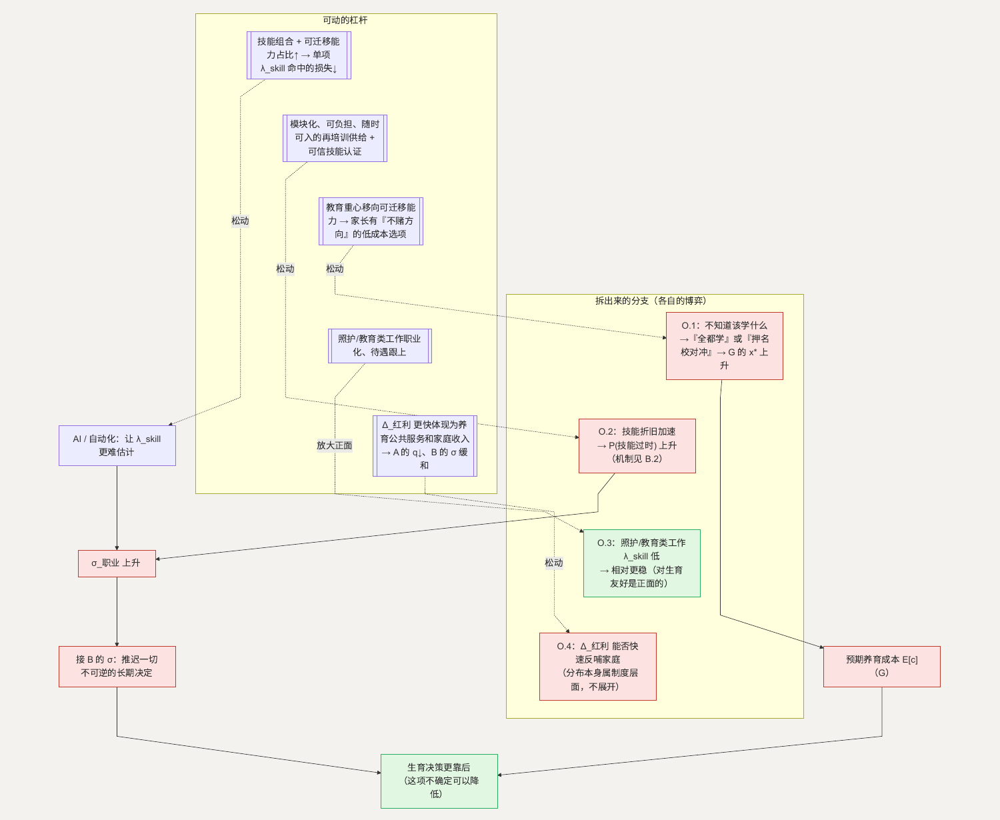

# O. 技术变迁：AI 如何影响前面几个博弈

**简单说：AI 既可能让前面这些困局更严重，也可能是缓解它们的关键——差别在于技术红利多快能反哺到普通家庭。**

前面 14 节大多在拆当下已经成形的结构。这一节单独看一个正在快速变化的外部力量：AI 和自动化。它不进入“是不是自己的选择”“婚姻合约”这类具体问题，而是同时改变前面好几个博弈的关键参数——尤其 [B](B-certainty.md) 的不确定性、[G](G-education.md) 与 [H](H-inequality.md) 的信号和竞赛、[A](A-autonomy.md) 的养老指望。发展 AI 是明确的方向；这一节谈的是它对生育决策的传导机制，以及在个人、企业、教育、观念层面可以怎样让传导更平稳。

**这一节用到的记号：**

| 记号 | 含义 | 为什么这样定义 |
| --- | --- | --- |
| $\lambda_{skill}$ | 一项具体技能在未来 10–20 年被自动化替代或大幅贬值的概率 | 个体对“学它值不值”的判断取决于这个概率 |
| $\sigma_{\text{职业}}$ | 个体对“自己这条职业路径未来是否稳定”的不确定程度 | AI 主要通过抬高它作用于生育决策（接 B 的 $\sigma$） |
| $V_{\text{名校}}$ | 上名校的收益差 $=$ 生产率差异 $+$ 信号租金（沿用 G） | AI 会同时压和抬它的两个部分，净方向不确定 |
| $\Delta_{\text{红利}}$ | AI 带来的生产率提升 | 它能不能、多快回到承担生育成本的家庭，是关键 |
| 技能组合 / 可迁移能力 | 个体持有的多项技能 / 不绑定具体工种的能力（沟通、判断、学习） | 组合和可迁移能力的抗贬值能力 > 单一技能——主要杠杆 |

## 主博弈：技术不确定性下的技能投资

个体在职业早期要投入学习一项技能（时间、学费、机会成本），投入较难反悔。设这项技能未来被自动化替代的概率为 $\lambda_{skill}$，个体的决策类似 B 的不可逆投资：

> 深投一项专用技能 $\Leftrightarrow$ 预期回报 $\cdot (1 - \lambda_{skill}) >$ 学习成本 $+$ 押错的期权损失

关键变化不是 $\lambda_{skill}$ 的平均值高低，而是**它变得更难估计**——十年前“学什么稳”有较清楚的答案，现在没有。这把 $\sigma_{\text{职业}}$ 抬高，而 $\sigma_{\text{职业}}$ 直接进入 B 的 $\sigma$：对未来职业路径越没把握，越倾向推迟一切不可逆的长期决定，生育是其中之一。

### 怎么移动均衡

- **降低对单一技能的依赖：** 技能组合越宽、可迁移能力占比越高，任何单项 $\lambda_{skill}$ 命中的损失越小。落点在个人的学习策略和教育的课程设计。
- **让“换技能”的成本更低：** 可负担、模块化、随时可入的再培训供给，把“押错了重来”从灾难变成可承受。落点在再培训的市场供给和企业的在职培训文化。
- **缩短信息滞后：** 行业对“哪些能力在变得重要”的信号越及时、越公开，个体和家庭越不需要靠“全都学一点”来对冲。

## O.1 教育“该学什么”的方向在漂移（接 G）

**这个子问题为什么存在。** G 的军备竞赛里，家庭的投入 $x_i$ 原本有一个大致明确的方向（考试科目、名校路径）。AI 让“未来需要什么能力”变得模糊，方向感下降。

**它自己的博弈。** 这是不确定性下的过度投资。当家长不知道该押哪个方向，理性反应有两种：一是“全都学一点”（横向铺开，总投入 $x^*$ 不降反升）；二是“押最保险的头部”（更挤名校，因为“名校”被当成不管方向怎么变都不亏的对冲）。两种反应都让 G 的 $x^*$ 上升，孩子的时间和心理损失加重。

**怎么优化这个子博弈。** 教育把重心从“特定知识点”移向可迁移能力（阅读、写作、数理思维、学习方法、协作）——这些的 $\lambda_{skill}$ 低，“押注”它们不需要赌方向。这相当于给家长一个“不管技术怎么变都不亏”的低成本选项，替代掉“名校对冲”和“全都学”。

**如何传导回大问题。** 方向感恢复 + 低成本对冲存在 → G 的 $x^*$ 不再因为“不知道学什么”而额外抬高 → 预期养育成本 $E[c]$ 回落。

## O.2 技能折旧加速与中年再就业（接 B.2）

**这个子问题为什么存在。** B.2 讲的是“中年就业稳定性”，AI 是让技能折旧变快的一个具体驱动：一项技能的有效年限在缩短。

**它自己的博弈。** 和 B.2 同构（履历空档、技能过时被读作生产率下降的信号），AI 只是让 $P(\text{技能过时})$ 上升。**机制在 B 展开**，这里补一个 AI 特有的方向：如果再培训的凭证体系能跟上技术变化的节奏（新能力有可信、可查的认证），“我的技能过时了”就不等于“我没有价值”。

**怎么优化这个子博弈。** 可信的、随技术更新的技能认证 + 企业把“再培训后上岗”当成常规路径而非例外。B 的 $\Delta\sigma_{\text{中断}}$ 里“技能过时”那一块下降。

> 这一块和 B.2 指向的是同一个方向：**“成年人随时能重新学、并拿到被认可的凭证”是一块需求在扩大、供给还不足的市场。** 侧面看，技术变化越快，这个需求越持续，培训方、行业组织、用人方在其中的竞争会推动课程更新更快、凭证更可信。

**如何传导回大问题。** 中年职业路径的可修复性上升 → $\sigma_{\text{职业}}$ 下降 → 接 B 的 $\sigma$。

## O.3 和育儿、教育、照护相关的工作，反而相对更稳

**这个子问题为什么值得单独看。** 这是一个反方向的点，容易被“AI 取代一切”的叙事盖住。需要密集人际互动、情感劳动、身体照护、复杂现场判断的工作（幼教、护理、康复、家庭服务、社区工作），$\lambda_{skill}$ 相对低。

**它的博弈性质。** 如果这类工作的 $\lambda_{skill}$ 低，而社会需求随人口结构上升，它们的相对回报有上行空间。这对“生育友好”是双重正面的：一方面这些正是支撑生育和养育的岗位（接 [J](J-childcare.md)、[M](M-city.md)、[K](K-body.md)），供给会更稳；另一方面从事这类工作的人，自己的 $\sigma_{\text{职业}}$ 也较低。

**怎么优化这个子博弈。** 让这类工作的职业化、专业化、待遇跟上——把“照护和教育类工作”从“没门槛、低回报”变成一条有前景的路径（接 G.5 职业教育的方向）。

**如何传导回大问题。** 生育养育所依赖的岗位供给更稳（J、M、K 的机构不缺人）

- 一条低 $\sigma_{\text{职业}}$ 的职业路径被打开。

（这类工作被 AI 加了杠杆——辅助工具让一个照护者覆盖更多人——在大病照护和双向照护里具体怎么落地，见 B.3.2、B.4.1。）

## O.4 生产率红利能不能反哺到承担生育成本的家庭

**这个子问题为什么存在。** 引言“两本账”的缺口是：社会受益、个体承担成本、反哺慢且不确定。AI 提高生产率 $\Delta_{\text{红利}}$，理论上让社会供养下一代的能力更强——但这个红利能不能、多快回到正在养孩子的家庭，决定了它是缓解还是加剧那个缺口。

**它的博弈性质。** 这不是一个能在个人层面解的博弈——它取决于生产率提升的收益在整个经济里怎么分布。本文只把它标出来：**如果 $\Delta_{\text{红利}}$ 能更快、更实在地体现为养育相关的公共服务和家庭可支配收入，A 的“养儿防老”依赖（$q$）可以进一步下降，B 的 $\sigma$ 也会缓和。** 至于收益分布本身如何调节，属于更宏观的制度安排。

**如何传导回大问题。** 红利反哺越快 → 引言“两本账”的缺口越小 → 生育决策的结构性障碍整体减轻。

---

## 拆出来的分支（图）

